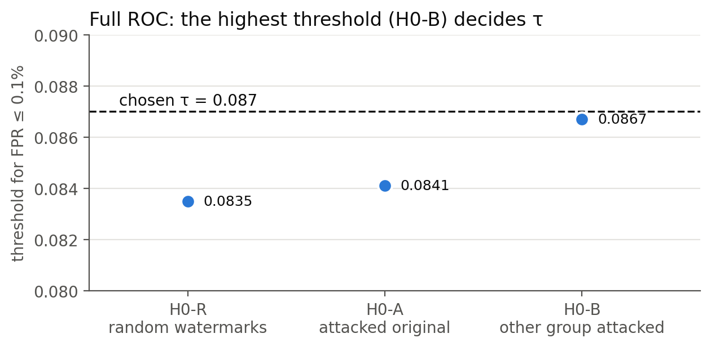
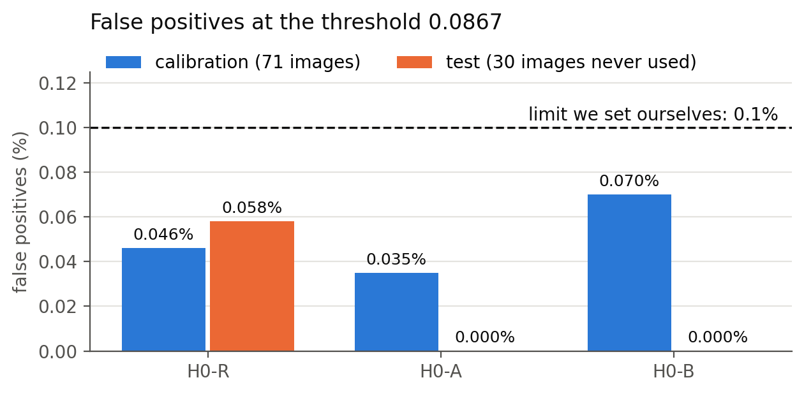
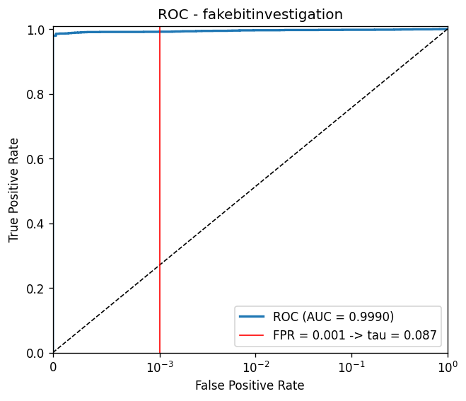
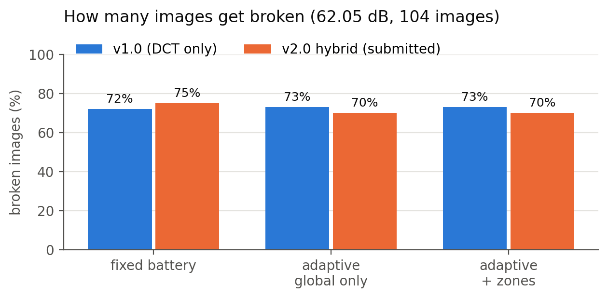
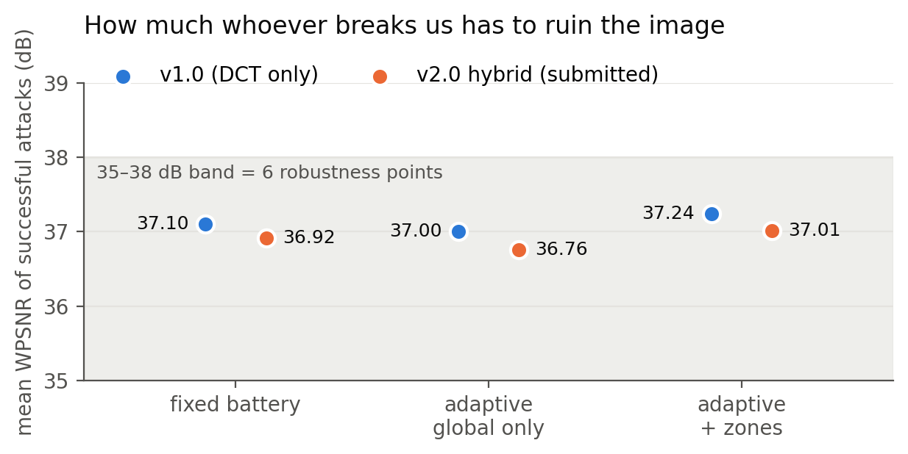
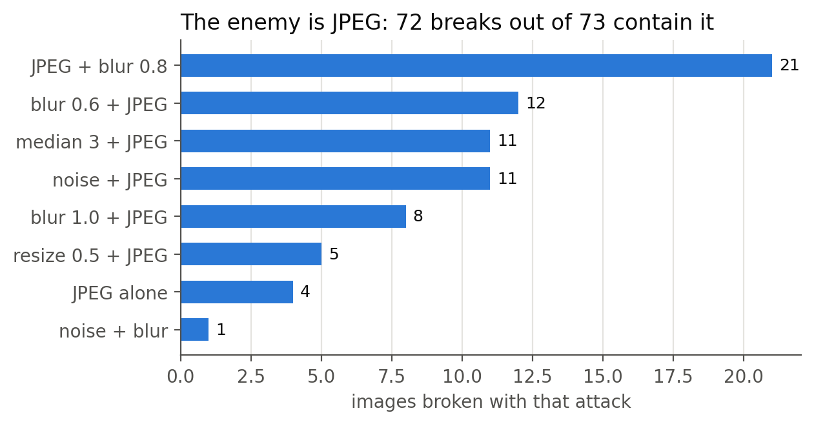
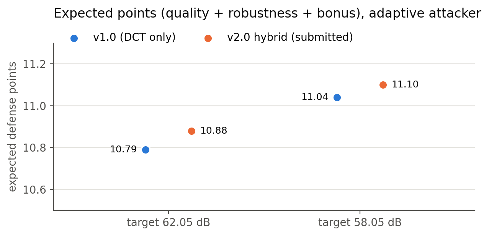
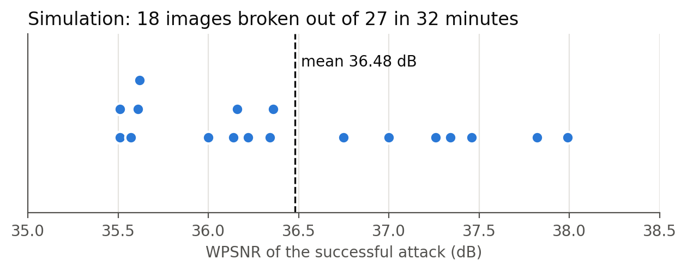
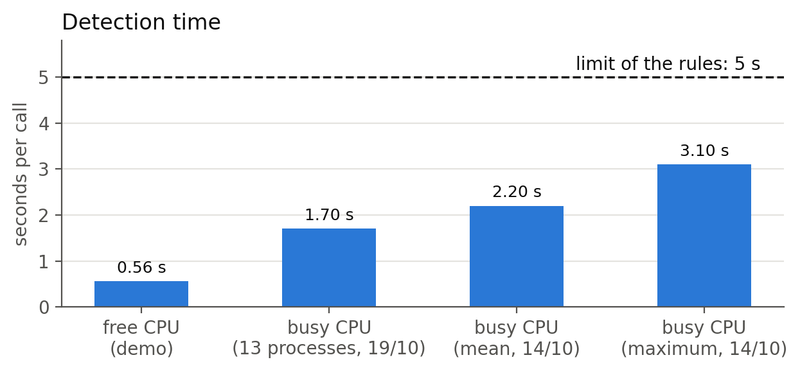

# Capture the Mark 2026: the defense of group `fakebitinvestigation`

**Version 2.0 "hybrid" (DCT + wavelet): full explanation of strategy, algorithm and code**

(15/10, updated on 19/10 with the full ROC, τ = 0.087, the answers of the TAs, the attacks and the demo, and on 21/10 with the answers of the TAs of 20/10, the test on destroyed images and the test against a real group of the 2022 challenge; translated into English on 26/10. The document explains from scratch the version we submit, v2.0: why it is built this way, how it works, the code function by function, how robust it is and which alternatives we tried and discarded.)

How the repo is organized:

- `fakebitinvestigation/submission/`: **the files to submit**, the only copy of the code:
  - `embedding_fakebitinvestigation.py`: the function `embedding(input1, input2)`;
  - `detection_fakebitinvestigation.py`: the function `detection(input1, input2, input3)`;
  - `roc_fakebitinvestigation.py`: the code that computes the threshold τ with the ROC (procedure of p.4 of the rules); `roc_fakebitinvestigation.png` and `roc_fakebitinvestigation_output.txt` are the curve and the numbers of the full run;
  - `attacks_fakebitinvestigation.py`: **all** our attack code, in a single file that works on its own: `attacks(input1, attack_name, param_array)` applies an allowed attack, also in a chain or on a zone; `attack_image(...)` searches the lightest attack that breaks an image, using the detection of the attacked group as the check (§A11);
  - `demo_fakebitinvestigation.py`: the demo that shows how to use every file;
  - `README.md`: instructions to run everything (for the TAs);
- `fakebitinvestigation/challenge/`: what we need **on the challenge day**, not submitted: `CHALLENGE_INSTRUCTIONS.md` (step by step), the encrypted detection to upload (`detection_fakebitinvestigation.pyc`, compiled with `py_compile` as shown in lab 1) and two **helpers** that contain no embedding or attack logic, but only use the files of `submission/`: `defense_fakebitinvestigation.py` (embedding of the 3 images at several targets with `embedding()`, checks with `detection()`, attack against ourselves with `attack_image()`, computation of the points, files to upload) and `search_attacks_fakebitinvestigation.py` (calls `attack_image()` in parallel on all the downloaded images and writes the Excel log);
- `fakebitinvestigation/documentation/`: this document (`project_explanation.md` and the PDF generated with `make_pdf.sh`), the charts and the source of the page on the test against the 2022 group.

Shared resources in the folder `fakebitinvestigation/`: the updated rules (`documentation/document.pdf`, together with all the other PDFs), the assigned watermark (`submission/fakebitinvestigation.npy`: it is in the submission because the embedding and the demo need it, so the demo works with the submitted folder alone), the 101 sample images (`sample-images/`) and 14 images never used to decide anything (`set_c/`).

The experiment scripts the numbers of this document come from (fixed battery, adaptive attacker, realistic false positives, simulation of the points) are needed neither for the submission nor for the challenge and are no longer in the repo; they can be recovered with `git checkout cc4c11d -- fakebitinvestigation/esperimenti`.

---

# Version 2.0 explained from scratch

## A0. Summary in 11 points

1. The watermark is a sequence of **1024 bits** assigned by the TAs. We turn it into **±1** (0 → −1, 1 → +1).
2. Every bit is written on a **pair of neighbouring coefficients**: we increase the magnitude of the first and decrease the magnitude of the second (or the opposite if the bit is −1). This way the attacks that "raise or lower everything" (blur, sharpening, resize, contrast) do not cancel the bit.
3. The **same** watermark is written **twice, in two different "languages"** of the image: in the **global DCT** (1024 pairs in the frequency band 32 ≤ r ≤ 128) and in the **db4 wavelet** (1024 pairs in the detail subbands of levels 3 and 4, roughly the same frequencies but localized in space).
4. The pairs are the ones with the **largest coefficients** of the original image: the (non-blind) detection finds them again by itself starting from the original.
5. The strength of the watermark is **calibrated automatically** to get exactly the WPSNR we want (62.05 dB by default, just above the threshold of the 5 quality points), with the lab WPSNR code.
6. The detection extracts the watermark from the watermarked image (W_ext, 2048 values) and from the attacked one (W_att), and computes the **cosine** between the two. To be more robust it also tries to "de-stretch" the attacked image (against the lab resize) and to weight the zones of the image according to how damaged they are (against localized attacks), and keeps the **maximum**.
7. Present if cosine ≥ **τ = 0.087**, chosen with the ROC (procedure of the rules plus the "realistic" false positives of Lab 4) at a false positive rate of 0.1%, and verified on a separate test set. No check on the WPSNR in the decision: the updated rules forbid it.
8. **Robustness** (104 images, "adaptive" opponent that searches the lightest attack image by image using our detection, which in the challenge is not even allowed): at 62.05 dB it breaks **70%** of the images, with attacks on average at **37.0 dB** → band of **6 points** of robustness.
9. At **58.05 dB** it breaks only **17%** of the images (attacks at 35.9 dB). With the rules confirmed by the TA (never broken = 6 points + 2 of bonus; quality on the **mean** of the 3 images) the **expected points** are **11.10** at 58.05 dB against **10.88** at 62.05 dB.
10. The scheme is the result of a selection: the alternatives we tried (DCT only, more bands, high frequency, masks, schemes from the slides and the labs), measured **at equal false positives**, tie or get worse (§A9).
11. The main enemy is still **JPEG**, alone or in a chain with blur and median: 72 of the 73 images broken at 62 dB fall this way.

> 🗣 **In plain words**: we write the same secret message twice, with two different "inks", in places of the image that matter to the eye. To erase it an attacker has to ruin the image enough to end up in the lowest quality band the rules accept (35–38 dB), which for us is still worth the maximum robustness score.

---

## A1. The game: what the rules say and how points are made

The reference rules are the **updated** version (`document.pdf`, received on 14/10), which replaces `1BattleRules2026.pdf`. Plus the answers of the TA (Andrea Montibeller) to our questions of 14/10.

### A1.1 The rules that concern us

| rule | what it means for us |
|---|---|
| `embedding(input1, input2) → output1`: path of the original, path of the watermark, watermarked image | signature followed to the letter; images read with OpenCV |
| the embedding does not print, does not open windows | no `print`, no file written |
| `detection(input1, input2, input3) → (output1, output2)`: original, watermarked, attacked → present/absent and WPSNR(watermarked, attacked) | signature followed; the three images are read inside the function |
| detection in **a single file**, no external function except the WPSNR, no relative path | everything (WPSNR included) is copied inside the file |
| **non-blind**: the watermark extracted from the watermarked image is compared with the one extracted from the attacked image; it is forbidden to read the watermark file or to write it in the code | we extract W_ext from the watermarked image using the original as reference |
| the detection must **always** run the algorithm; it is forbidden to force output1 based on the WPSNR, even below 25 dB (new rule) | the decision is only "cosine ≥ τ" (§A6.5) |
| if the attacked image is the **original**, the watermark must be absent | on the original our extraction gives a null or almost null vector; checked on all the images (§A7.4) |
| detection within **5 seconds** | measured: about 0.56 s per call with a free CPU (demo, 13 calls); 2.2 s on average and 3.1 s at most with the CPU busy with 13 other heavy processes |
| **one single threshold τ** for all the images, computed with the ROC (FPR ∈ [0, 0.1]) | τ = 0.087 at FPR 0.1% (§A7) |
| the watermark can be embedded several times and the similarity can be computed on the concatenation (answer of the TA) | it is exactly v2.0: 1024 DCT values + 1024 wavelet values |
| after 27/10 only "fine-tuning": parameters and embedding locations | all the parameters are constants at the top of the files |

### A1.2 How points are made (defense)

| mean WPSNR of the embedding (mean of the 3 images) | quality points | | mean WPSNR of the successful attacks against us | robustness points |
|---|---|---|---|---|
| 35–50 | 1 | | 35–38 | **6** |
| 50–54 | 2 | | 38–41 | 5 |
| 54–58 | 3 | | 41–44 | 4 |
| 58–62 | 4 | | 44–47 | 3 |
| 62–66 | 5 | | 47–50 | 2 |
| ≥ 66 | 6 | | 50–53 | 1 |
| | | | ≥ 53 | 0 |

Two clarifications the TA gave us:

- **quality is computed on the mean WPSNR of the 3 images**, not image by image;
- **if nobody manages to break us** we get full robustness (**6 points**) **plus the 2-point bonus**.

An attack is "successful" only if it removes the watermark **and** leaves the image with WPSNR ≥ 35 dB with respect to the watermarked one.

> 🗣 **In plain words**: the defense points come from two things that pull in opposite directions. The lighter the watermark, the nicer the image (quality points); the stronger it is, the more the attacker has to ruin the image to remove it (robustness points). And if it is so strong that nobody manages, the bonus comes.

### A1.3 What follows for the strategy

1. **Stay just above the edge of a band.** Quality points go up in 4 dB steps: 62.05 dB is worth as much as 65.9 dB, but with much more energy (= robustness). This is why we calibrate the strength to land exactly on 62.05 or 58.05.
2. **Robustness at 35–38 dB is already worth the maximum.** We do not need an "indestructible" watermark: it is enough that whoever wants to remove it has to go below 38 dB.
3. **The 2-point bonus is worth more than a quality point.** This is why 58.05 dB can be better than 62.05 (§A8.3).
4. **The mean over the 3 images opens a new strategy for the challenge day**: we can give every image a different target, as long as the mean stays above the threshold of the band (§A8.4).

---

## A2. The strategy in one page

**The starting question** was: is a "simple" spread spectrum enough, or do we need more sophisticated techniques (QIM, ISS, combinations of transforms, more bands)? The answer we gave ourselves, with the numbers of the following sections:

- **The "smarter" spread spectrum techniques are not needed in our case.** QIM, STDM and ISS (Improved Spread Spectrum) exist to remove the "noise" that the image itself creates when the detection does **not** have the original (blind detection). Our detection is **non-blind**: we subtract the original and that noise disappears completely. Moreover QIM is fragile exactly against the attacks that change the "volume" of the coefficients (blur, sharpening, contrast), while our pair scheme is immune by construction.
- **What really matters are three things**: *where* to put the energy (which frequencies and which coefficients), *how much* (the WPSNR target) and *how* to read it (the detection). We ran experiments on all three.
- **A single "cake" of energy.** The WPSNR fixes how much energy we can put in total. Splitting it among more bands or more transforms does not make it grow: it only helps if the attacks hit the parts differently. We measured it: adding a copy at high frequency, splitting into two DCT bands or using the wavelet at high frequency **gets worse**; DCT + wavelet on the same medium frequencies instead **improves a little** (§A9). It is the scheme we use.
- **The detection weighs as much as the embedding.** The biggest jump came from the detection (resynchronization of the resize and spatial weighting): from 94% to 78% of broken images at equal false positives.
- **Every improvement must be compared at equal false positives.** A detection that sees the watermark everywhere "resists" all attacks but gets penalties. For this reason every comparison in this document is made with thresholds chosen at the same false positive rate (0.1%).

> 🗣 **In plain words**: we did not look for the most complicated algorithm, but for the one that, at equal "cleanliness" of the image, forces the attacker to dirty it more. And every time something seemed to improve, we checked that it was not just a more "gullible" detection.

---

## A3. The key point: how the WPSNR "weighs" the frequencies

The lab WPSNR (the same used in the challenge, confirmed) does not measure the error pixel by pixel: first it **filters** it with a CSF filter (*Contrast Sensitivity Function*, 41×41) that imitates the sensitivity of the eye to the different frequencies, then it computes a PSNR. We measured how much each frequency "counts", using the same radius r of the DCT (frequency = r/1024 cycles per pixel):

| r (DCT index) | 8 | 16 | 32 | 64 | 96 | 128 | 160 | 200 | 256 | 320 |
|---|---|---|---|---|---|---|---|---|---|---|
| cycles/pixel | 0.008 | 0.016 | 0.031 | 0.062 | 0.094 | 0.125 | 0.156 | 0.195 | 0.250 | 0.312 |
| gain of the CSF filter | 0.501 | 0.505 | 0.517 | 0.549 | 0.561 | 0.525 | 0.439 | 0.294 | 0.111 | 0.020 |
| relative cost of the energy (r = 64 → 1) | 0.83 | 0.85 | 0.89 | 1.00 | 1.04 | 0.91 | 0.64 | 0.29 | 0.04 | ≈ 0 |

Two consequences, a good one and a bad one:

- **Up to r ≈ 128 the cost is almost constant**: we can choose the band for robustness, not for the WPSNR.
- **Above r ≈ 200 the energy is almost free**: at r = 256 an amplitude 5 times larger costs the same WPSNR. It looks like a gift, but **the attacker gets the same gift**: blur, median and JPEG erase exactly those frequencies, and it costs him almost nothing too. We verified it (§A9): putting a copy of the watermark up there **always gets worse**.

> 🗣 **In plain words**: the WPSNR is a judge that looks carefully at the medium details of the image and almost does not see the finest grain. If we hide the watermark in the finest grain the judge does not see it, but the attacker can sweep it away and the judge does not see that either. We must hide where the judge looks, and where "cleaning" is expensive.

---

## A4. The embedding algorithm, step by step

### A4.1 The four ingredients

**1. Bipolar watermark.** `w = 2·bit − 1`, so 0 → −1 and 1 → +1. With ±1 two independent watermarks have cosine similarity with mean 0 (and standard deviation 1/√N). With 0/1 it would be about 0.5: any two watermarks would look "half equal" and the threshold would be much more delicate.

**2. Differential pairs.** Every bit goes on two neighbouring coefficients C₁ and C₂ (neighbours in frequency in the DCT, neighbours in space inside the same subband in the wavelet):

- magnitude of C₁ → |C₁| + a·w
- magnitude of C₂ → |C₂| − a·w

In the extraction we look at the **difference** of the relative variations of the two. A "smooth" attack (blur, sharpening, resize, contrast) multiplies two neighbouring coefficients by almost the same factor g: in the difference the factor cancels out and g·a·w is left, and the cosine does not depend on g. The lab scheme (multiplicative Cox) instead was broken at 60 dB in 9 images out of 9 by attacks of this kind.

**3. Selection of the coefficients.** In each domain we take the 1024 pairs with the **largest minimum of the two magnitudes** inside the chosen band. Large coefficients mean three things: stable divisions in the extraction, components that are "important" for the image (that an attacker cannot erase without ruining it) and positions that depend **only on the original**, which the detection has.

**4. Calibrated uniform amplitude.** All the pairs get the same absolute push (it is the optimal choice for additive noise). The amplitude is found with an automatic search (bisection) so that the final WPSNR is ≥ TARGET_WPSNR, with the exact lab code.

### A4.2 The two parts: global DCT and wavelet

**Part 1, global DCT.** DCT of the whole 512×512 image. The pairs are (u,v) and (u,v+1) with v even, in the radial band 32 ≤ r ≤ 128 with r = √(u² + (v+½)²). In spatial terms they are structures with a period between 8 and 32 pixels. Every global DCT coefficient "talks" about the whole image: a bit is spread over all the 262,144 pixels.

**Part 2, db4 wavelet.** Orthogonal wavelet transform (Daubechies 4, 4 levels, "periodization" mode, which preserves the energy like the DCT). We use the detail subbands (horizontal, vertical, diagonal) of **levels 3 and 4**: level 3 covers about 0.06–0.125 cycles/pixel, level 4 about 0.03–0.06, that is **the same frequencies as the DCT part**. The difference is that the wavelet coefficients are **localized**: each one describes a small zone of the image. The pairs are two horizontally adjacent coefficients (columns j and j+1, with j even) in the same subband.

**Why the two together.** The two parts are in the same frequency band (the one that the WPSNR "pays" uniformly and that the attacks cannot clean for free), but they "see" the image differently: the global DCT averages over the whole image, the wavelet zone by zone. The idea is that a localized or "block" attack (like JPEG) does not damage the two parts in the same way. The measured advantage is there but it is small (§A9): we say it right away so as not to sell it as a revolution. The same watermark written in both domains is read by the detection as a single vector of 2048 values.

> 🗣 **In plain words**: it is like writing the same sentence on a wall with a paint that spreads over the whole wall (DCT) and with many small stickers scattered around (wavelet). To erase it you have to repaint everything or peel off almost all the stickers.

### A4.3 The complete formula

Notation: O = original, P_DCT and P_DWT = "pattern" of the watermark in the pixels with amplitude 1 (that is the image obtained by putting +sgn(C₁)·w on the first coefficient of every pair, −sgn(C₂)·w on the second, zero elsewhere, and going back to the pixels with the inverse transform).

Watermarked image:

`I_w = clip(rint(O + s·(K_DCT·P_DCT + K_DWT·P_DWT)), 0, 255)`

- `K_DCT = K_DWT = 1`: the two parts have the same relative amplitude;
- `s` is the scale, found with the bisection: the largest one that keeps WPSNR(O, I_w) ≥ 62.05 dB.

Measurements on the 104 images (101 samples + 3 from the 2022 challenge): `s` between **3.01 and 3.16** (median 3.08), WPSNR obtained always between **62.0500 and 62.0538 dB**.

> 🗣 **In plain words**: we compute "the drawing" of the watermark in the image, then we add it to the original with a volume that we turn up until the judge (the WPSNR) says "enough, not above 62.05".

### A4.4 Extraction (used only by the detection)

For every pair, given the original coefficient C and the one of the image to analyze X:

`W_i = [ s₁·(X₁ − C₁)/|C₁| − s₂·(X₂ − C₂)/|C₂| ] / ( 1/|C₁| + 1/|C₂| )`

with s₁, s₂ the signs of the original coefficients (and |C| replaced by max(|C|, 1) so as never to divide by zero). Properties (identical for the DCT part and for the wavelet part):

- on the **watermarked** image it gives `W_i = a·w_i`: the exact watermark, up to a scale;
- on the **original** it gives exactly `W_i = 0`;
- if an attack multiplies both coefficients by g, it gives `g·a·w_i`: the cosine does not change.

The proofs are short. We write `s_j = sgn(C_j)`, so `s_j·(X_j − C_j)/|C_j| = (X_j − C_j)/C_j = r_j`, and the numerator is `r₁ − r₂`.

- *Watermarked* (ignoring the rounding): `X₁ = C₁ + s₁·a·w`, `X₂ = C₂ − s₂·a·w`, so `r₁ = a·w/|C₁|`, `r₂ = −a·w/|C₂|` and `W = a·w·(1/|C₁| + 1/|C₂|)/(1/|C₁| + 1/|C₂|) = a·w`. In practice, with the rounding, the correlation with the true watermark is 0.98–0.99.
- *Original*: `X = C`, so `r = 0` and `W = 0`; we define the similarity with a null vector as 0, so "absent", as the rules require.
- *Same gain on the pair* (blur, sharpening, resize, contrast): `X_j = g·C'_j`, so `r₁ − r₂ = g·a·w·(1/|C₁| + 1/|C₂|)` and `W = g·a·w`: the term `(g − 1)` disappears and the cosine does not see `g`. With the lab scheme `(g − 1)/α` would remain instead, huge.

The complete vector is `W = [W_DCT (1024 values), W_DWT (1024 values)]`.

---

## A5. The embedding code, function by function

File: `embedding_fakebitinvestigation.py`. We read it from top to bottom.

### A5.1 The parameters

```python
TARGET_WPSNR = 62.05   # dB: just above 62, the lower limit of the 5-point quality band
TARGET_BY_IMAGE = {}   # optional per-image target, e.g. {"buildings": 58.05}; empty = TARGET_WPSNR for every image
R_MIN = 32.0           # radial band of the DCT pairs
R_MAX = 128.0
N_BITS = 1024          # length of the assigned watermark
WAVELET = "db4"        # wavelet of the second part
DWT_LEVELS = 4         # levels of the decomposition
DWT_USE = (3, 4)       # levels whose detail subbands host the watermark
K_DCT = 1.0            # relative amplitude of the DCT part
K_DWT = 1.0            # relative amplitude of the wavelet part
AMP_MIN, AMP_MAX = 0.2, 40.0   # search interval of the scale
N_ITER = 14                    # bisection steps
```

They are **the only things that can be touched after 27/10** ("fine-tuning: parameters and embedding locations"). The ones that describe *where* the watermark is (R_MIN, R_MAX, WAVELET, DWT_LEVELS, DWT_USE, N_BITS) must be kept **identical** in the detection; TARGET_WPSNR, TARGET_BY_IMAGE, K_DCT and K_DWT only concern the embedding.

`TARGET_BY_IMAGE` (added on 19/10) is for the challenge day. The quality points are computed on the **mean** of the WPSNRs of the 3 images (answer of the TAs), so we can put more energy into the image that is hardest to defend. For example `{"buildings": 58.05}` gives 58.05 dB to `buildings.bmp` and leaves the others at `TARGET_WPSNR`. The key is the file name without extension. The empty dictionary (the default) leaves the behaviour identical to before. It is filled by the defense script (§A8.4), so that the code reproduces exactly the images we upload.

> 🗣 **In plain words**: it is the "control panel". TARGET_WPSNR is the volume knob; the others say in which "rooms" of the image to hide the watermark.

### A5.2 The lab WPSNR

The functions `_csffun`, `_csfmat`, `_get_csf_filter` and `wpsnr` are **copied identical** from the lab code. They are needed because the calibration must use exactly the number the TAs will compute. `wpsnr(a, b)`:

1. brings the images to [0, 1];
2. computes the error A − B;
3. filters it with the 41×41 CSF filter (`convolve2d`, "wrap" borders);
4. returns `20·log10(1/√(mean of the filtered error²))`.

### A5.3 The DCT part: `_dct2`, `_idct2`, `_select_pairs`

```python
def _dct2(x):
    return dctn(x, norm='ortho')
```

"Orthonormal" two-dimensional DCT: it preserves the energy (the sum of the squares of the coefficients is equal to that of the pixels). It is the same transform as in the labs, written in one line. `_idct2` is the inverse.

```python
def _select_pairs(coeffs):
    H, W = coeffs.shape
    u = np.arange(H)[:, None]
    v = np.arange(0, W - 1, 2)[None, :]          # v even: pairs (u,v),(u,v+1)
    uu = np.broadcast_to(u, (H, v.shape[1])).ravel()
    vv = np.broadcast_to(v, (H, v.shape[1])).ravel()
    r = np.sqrt(uu**2 + (vv + 0.5)**2)          # "radial" frequency of the pair
    band = (r >= R_MIN) & (r <= R_MAX)
    uu, vv = uu[band], vv[band]
    strength = np.minimum(np.abs(coeffs[uu, vv]), np.abs(coeffs[uu, vv + 1]))
    best = np.argsort(-strength, kind='stable')[:N_BITS]
    best = np.sort(best)
    return uu[best], vv[best]
```

Line by line:

- it builds **all** the possible pairs (u, v)–(u, v+1) with v even;
- it computes their frequency r (the "+½" puts r halfway between the two coefficients) and keeps only the ones in the band 32–128;
- for every pair, the "strength" is the **smaller** of the two magnitudes: we want **both** coefficients to be large;
- it takes the 1024 strongest (`argsort` decreasing, "stable" to always have the same order for equal values);
- it **sorts them again by position**: this way the matching bit → pair does not depend on tiny rounding differences.

> 🗣 **In plain words**: among all the "pairs of notes" of the image in the right frequency range, we choose the 1024 played loudest, and we put them in order of position, like the seats of a theatre.

### A5.4 The wavelet part: `_dwt2`, `_idwt2`, `_select_pairs_dwt`

```python
def _dwt2(x):
    arr, slices = pywt.coeffs_to_array(pywt.wavedec2(x, WAVELET, mode='periodization', level=DWT_LEVELS))
    return arr, slices
```

`wavedec2` decomposes the image into 4 levels: a coarse approximation (32×32) and, for every level, three detail subbands (horizontal, vertical, diagonal), of 32×32 at level 4, 64×64 at level 3, 128×128 at level 2 and 256×256 at level 1. `coeffs_to_array` puts them all in **a single 512×512 matrix**, plus `slices`, which says where every subband is. Working on a single matrix makes the selection of the pairs identical, in concept, to the DCT one. `_idwt2` does the inverse path.

```python
def _select_pairs_dwt(arr, slices):
    m = np.zeros(arr.shape, bool)
    for lev in DWT_USE:
        k = DWT_LEVELS - lev + 1           # in wavedec2 index 1 is the coarsest level
        for key in ('ad', 'da', 'dd'):
            m[slices[k][key]] = True
    ii, jj = np.nonzero(m[:, :-1] & m[:, 1:])
    keep = jj % 2 == 0
    ii, jj = ii[keep], jj[keep]
    strength = np.minimum(np.abs(arr[ii, jj]), np.abs(arr[ii, jj + 1]))
    best = np.sort(np.argsort(-strength, kind='stable')[:N_BITS])
    return ii[best], jj[best]
```

- `m` is a "mask" that marks the coefficients of the detail subbands (`'ad'`, `'da'`, `'dd'` = horizontal, vertical, diagonal) of levels 3 and 4;
- a pair is (i, j)–(i, j+1) with **both** coefficients inside the mask and j even (pairs that do not overlap);
- then the same rule as the DCT: the 1024 pairs with the largest minimum of the two magnitudes, sorted again by position.

### A5.5 The "drawing" of the watermark: `_pair_pattern`

```python
def _pair_pattern(c, ii, jj, w):
    s1 = np.where(c[ii, jj] < 0, -1.0, 1.0)
    s2 = np.where(c[ii, jj + 1] < 0, -1.0, 1.0)
    P = np.zeros_like(c)
    P[ii, jj] = s1 * w
    P[ii, jj + 1] = -s2 * w
    return P
```

It creates a matrix of coefficients that is all zero except the chosen pairs: on the first coefficient it puts `+sign(C₁)·w`, on the second `−sign(C₂)·w`. Multiplying by the sign of the original coefficient makes the **magnitude** of the first grow by w and that of the second drop by w, whatever the sign. This matrix, brought back to the pixels with the inverse transform, is the "drawing" of the watermark with amplitude 1. It works for both domains: the selection functions return rows and columns, and here it does not matter whether they come from the DCT or from the wavelet.

### A5.6 The function `embedding`

```python
def embedding(input1, input2):
    original = cv2.imread(input1, cv2.IMREAD_GRAYSCALE)
    bits = np.load(input2).astype(np.float64).ravel()[:N_BITS]
    w = 2.0 * bits - 1.0                          # 0/1 -> -1/+1
    o = original.astype(np.float64)
    target = TARGET_BY_IMAGE.get(os.path.splitext(os.path.basename(input1))[0], TARGET_WPSNR)

    c = _dct2(o)
    uu, vv = _select_pairs(c)
    arr, slices = _dwt2(o)
    ii, jj = _select_pairs_dwt(arr, slices)
    pattern = K_DCT * _idct2(_pair_pattern(c, uu, vv, w)) + K_DWT * _idwt2(_pair_pattern(arr, ii, jj, w), slices)

    def marked(s):
        return np.clip(np.rint(o + s * pattern), 0, 255).astype(np.uint8)

    lo, hi = AMP_MIN, AMP_MAX
    best = marked(lo)
    for _ in range(N_ITER):
        mid = np.sqrt(lo * hi)
        candidate = marked(mid)
        if wpsnr(original, candidate) >= target:
            lo, best = mid, candidate
        else:
            hi = mid

    output1 = best
    return output1
```

Step by step:

1. it **reads** the original in grayscale with OpenCV and the watermark from the `.npy` file (1024 bits), then turns it into ±1; it chooses the WPSNR target: the one in `TARGET_BY_IMAGE` for that image, if there is one, otherwise `TARGET_WPSNR`;
2. it computes the two transforms of the original and **chooses the pairs** in each;
3. it builds the **complete drawing** of the watermark in the pixels: DCT drawing + wavelet drawing (the transforms are linear, so they can be added in the pixels);
4. `marked(s)` produces the watermarked image with scale `s`: it adds, rounds to integers, clips to [0, 255];
5. **logarithmic bisection**: it starts from the interval [0.2, 40]; at every step it tries the geometric mean; if the WPSNR is still ≥ 62.05 the scale is fine and it tries higher, otherwise lower. After 14 steps the precision is about 0.03% on the scale;
6. it returns the **last valid image**, that is the one with the largest scale that respects the target. The WPSNR is computed on the image **already rounded**, so it is exactly the number the TAs will compute.

> 🗣 **In plain words**: we prepare the drawing of the watermark and then we look for the right volume as you look for a word in a dictionary: you open it in the middle, check whether you are too far ahead or too far behind, and halve every time. In 14 tries we find the maximum volume that does not exceed the quality limit.

**Time**: between 22 and 31 seconds per image, measured with the CPU busy with other processes (at every step the wavelet part has to be recomputed too). The slow part is the lab WPSNR (41×41 convolution), computed 14 times.

---

## A6. The detection code, function by function

File: `detection_fakebitinvestigation.py`. It is a **single file**: it contains again the lab WPSNR and the same selection functions as the embedding, copied identical (not imported, as the rules require).

### A6.0 The logic, before the code

The detection has to answer one question only: *is the watermark that is in the watermarked image still in the attacked image?* It does not know the watermark (the rules forbid reading it from the file or writing it in the code), but it has three images, and from these it rebuilds it. The steps are six:

1. **The "mould", from the original.** From the original we recompute exactly the positions the embedding chose: the 1024 DCT pairs and the 1024 wavelet pairs. This is possible because the choice depends **only** on the original (the pairs with the largest coefficients) and because the constants of the two files are identical.
2. **The reference watermark, from the watermarked image.** We compare the watermarked image with the original, pair by pair, with the formula of §A4.4: we get `W_ext = a·w`, that is our watermark up to a scale, without ever having read it.
3. **The "surviving" watermark, from the attacked image.** We make the same measurement on the attacked image and get `W_att`. If the attack did not touch the watermark, `W_att ≈ W_ext`. If it weakened it, `W_att ≈ g·W_ext + noise`. If the image has nothing to do with it (the original, an image of another group), `W_att` is noise that has nothing to do with `W_ext`.
4. **How similar they are.** We compute the cosine between `W_ext` and `W_att`. It is 1 if the watermark is intact, stays high if it is only weakened (the cosine does not see the scale `g`) and is around zero if the watermark is not there. In the ROC measurements, on the cases without our watermark, the mean is about 0.02 and the standard deviation 0.017–0.019 (§A7.2).
5. **More readings of the attacked image.** We do not read the attacked image only once but six times: as it is, "de-stretched" in four ways (against the lab resize) and with a weighting that ignores the devastated zones (against localized attacks). We keep the **maximum** cosine.
6. **The decision.** The watermark is present if the maximum is ≥ τ = 0.087. The WPSNR between watermarked and attacked image is computed and returned (`output2`), but it does not enter the decision.

Why having the original (**non-blind** detection) matters so much: by subtracting the original we get rid of the image itself, which for a spread spectrum is the biggest "noise". What is left is only the watermark plus the damage of the attack. It is also the reason why on the original the extraction gives a null vector, and therefore "absent" for sure.

> 🗣 **In plain words**: the original tells us *where* to look, the watermarked image *what* we should find there, the attacked image *what* we actually find. If the last two "point in the same direction" more than happens by chance, the watermark is there.

### A6.1 The constants

```python
R_MIN = 32.0
R_MAX = 128.0
N_BITS = 1024
WAVELET = "db4"
DWT_LEVELS = 4
DWT_USE = (3, 4)
TAU = 0.087
SQ_WIN = 16                     # window (pixels) of the spatial weighting
SQ_EPS = 0.5                    # regularization of the spatial weighting
STRETCH = (510, 511, 513, 514)  # intermediate sizes of the lab resize to compensate
C_FLOOR = 1.0                   # minimum |coefficient| in the denominator of the extraction
```

The first six must be **identical** to the embedding (otherwise the detection would look for the watermark in the wrong places). TAU is the threshold of the ROC (§A7). The others tune the extraction variants (§A6.4).

### A6.2 The extraction: `_pair_extract`, `_context`, `_extract`

```python
def _pair_extract(c0, ii, jj, c1):
    a1, a2 = c0[ii, jj], c0[ii, jj + 1]
    s1 = np.where(a1 < 0, -1.0, 1.0)
    s2 = np.where(a2 < 0, -1.0, 1.0)
    m1 = np.maximum(np.abs(a1), C_FLOOR)
    m2 = np.maximum(np.abs(a2), C_FLOOR)
    r1 = s1 * (c1[ii, jj] - a1) / m1
    r2 = s2 * (c1[ii, jj + 1] - a2) / m2
    return (r1 - r2) / (1.0 / m1 + 1.0 / m2)
```

It is the formula of §A4.4:

- `c0` are the coefficients of the **original**, `c1` those of the image to analyze;
- `r1` and `r2` are the relative variations in magnitude of the two coefficients of the pair (`s·(X − C)/|C|`);
- the difference `r1 − r2` cancels the common gains (blur, sharpening, ...);
- the final division makes the result exactly `a·w` on the watermarked image;
- `C_FLOOR = 1`: if an original coefficient were almost zero (constant images or synthetic gradients) we do not divide by zero. On real photos nothing changes, because the chosen coefficients are large (in the DCT part the smallest is about 13 on all the 104 images).

```python
def _context(original):
    o = original.astype(np.float64)
    c0 = _dct2(o)
    uu, vv = _select_pairs(c0)
    a0, slices = _dwt2(o)
    ii, jj = _select_pairs_dwt(a0, slices)
    return c0, uu, vv, a0, ii, jj

def _extract(ctx, img):
    c0, uu, vv, a0, ii, jj = ctx
    x = np.asarray(img, dtype=np.float64)
    return np.concatenate([_pair_extract(c0, uu, vv, _dct2(x)), _pair_extract(a0, ii, jj, _dwt2(x)[0])])
```

- `_context` computes **only once** everything that depends only on the original: transforms and positions of the pairs, for both parts;
- `_extract` transforms any image and returns the vector of **2048 values**: first the 1024 of the DCT, then the 1024 of the wavelet.

> 🗣 **In plain words**: the original acts as a "mould". We lay the image on the mould and measure, pair by pair, which of the two coefficients grew with respect to the other. That list of 2048 measurements is the watermark "read".

### A6.3 The similarity: `_similarity`

```python
def _similarity(x, y):
    nx, ny = np.linalg.norm(x), np.linalg.norm(y)
    if nx == 0 or ny == 0:
        return 0.0
    return float(np.dot(x, y) / (nx * ny))
```

The **cosine** between the two vectors: it is 1 if they are identical up to a scale, about 0 if they have nothing to do with each other, −1 if they are opposite. If one of the two is null (for example the attacked image is the original and the extraction gives zero), by definition the similarity is 0: watermark absent.

> 🗣 **In plain words**: the cosine measures how much two lists of numbers "go in the same direction", without caring how large they are. If the attacker weakened the watermark but did not destroy it, the direction stays the right one.

### A6.4 The extraction variants: `_destretch`, `_attacked_vectors`, `_score`

From the attacked image we do not extract a single vector, but **six**:

```python
def _attacked_vectors(ctx, original, attacked):
    o = original.astype(np.float64)
    a = attacked.astype(np.float64)
    vecs = [_extract(ctx, a)]                       # 1. normal
    for m in STRETCH:                               # 2-5. "de-stretched"
        vecs.append(_extract(ctx, _destretch(attacked, m)))
    d = a - o                                       # 6. spatially weighted
    rho = 1.0 / (uniform_filter(d * d, SQ_WIN) + SQ_EPS)
    vecs.append(_extract(ctx, o + rho * d))
    return vecs

def _score(reference, vecs):
    return max(_similarity(reference, y) for y in vecs)
```

**Variants 2–5, "de-stretching".** The lab resize function shrinks and then enlarges the image; for some scales the intermediate image comes out with 510, 511, 513 or 514 pixels instead of 512, and the final result is **stretched** by a few thousandths. Such a small stretch is not visible, but it shifts the frequencies and "desynchronizes" the pairs. `_destretch` applies the inverse stretch for each of the 4 possible sizes:

```python
def _destretch(img, m):
    x = (np.arange(img.shape[0]) + 0.5) * m / img.shape[0] - 0.5
    mx, my = np.meshgrid(x, x)
    return cv2.remap(img.astype(np.float32), mx.astype(np.float32), my.astype(np.float32),
                     cv2.INTER_CUBIC, borderMode=cv2.BORDER_REPLICATE).astype(np.float64)
```

- if the intermediate image had `m` pixels, the content of pixel `i` ended up at position `(i + 0.5)·m/512 − 0.5` of the attacked image (the "+0.5/−0.5" is used to reason on the centres of the pixels);
- `x` is exactly this position, for every row and every column; `cv2.remap` goes to take every pixel there, with a cubic interpolation;
- at the borders, where the position falls outside the image, the last pixel is repeated (`BORDER_REPLICATE`).

Measured: lab resize at scale 0.55 → similarity from 0.225 to 0.831.

**Variant 6, spatial weighting.** A localized attack (for example very strong JPEG only on the smooth zones) destroys the watermark in a part of the image and leaves the rest intact. In the normal extraction the destroyed part "pollutes" everything. So we weight every pixel of the difference `attacked − original` with

`ρ = 1 / (mean over 16×16 pixels of (attacked − original)² + 0.5)`

Where the attack did not touch anything the difference is small (there is only the watermark) → high weight; where the attack devastated → low weight. The weight uses **only attacked image and original**, never the watermarked one: this way, if the attacked image does not contain our watermark, the weight cannot "invent" it. With the watermarked image instead of the original the false positives were 30–87%.

**The maximum.** The final similarity is the **maximum** of the six cosines: the attacker must beat all the variants together. The price is that, on images without our watermark, the maximum of six random values is a bit higher than a single one: this is why τ must be computed with the **same** function `_score` (§A7).

> 🗣 **In plain words**: instead of reading the attacked image only once, we read it six times: as it is, "straightened" in four different ways (if someone stretched it) and with a lens that ignores the ruined zones. If in at least one reading the message is clearly visible, it is present.

### A6.5 The function `detection`

```python
def detection(input1, input2, input3):
    original = cv2.imread(input1, cv2.IMREAD_GRAYSCALE)
    watermarked = cv2.imread(input2, cv2.IMREAD_GRAYSCALE)
    attacked = cv2.imread(input3, cv2.IMREAD_GRAYSCALE)

    ctx = _context(original)
    W_ext = _extract(ctx, watermarked)
    sim = _score(W_ext, _attacked_vectors(ctx, original, attacked))

    output2 = wpsnr(watermarked, attacked)
    output1 = 1 if sim >= TAU else 0
    return output1, output2
```

1. it reads the **three images inside the function** from the three paths (explicit rule);
2. it prepares the "mould" from the original;
3. it extracts `W_ext` from the **watermarked image**: it is the watermark as we embedded it, **derived** and not read from a file (rule: "don't read the original watermark: extract it");
4. it computes the similarity with the six variants of the attacked image;
5. `output2` = WPSNR between watermarked and attacked image, with the lab code;
6. `output1` = 1 if the similarity is ≥ τ, otherwise 0.

**Why there is no check on the WPSNR.** The updated rules forbid it explicitly ("an if statement that skips detection or forces output1 based on the WPSNR is not allowed, including for severely degraded images"): the decision depends only on the similarity. The measured consequence on destroyed images is in §A7.5.

> 🗣 **In plain words**: the detection always does its job all the way and answers only on the basis of what it sees. It computes the WPSNR and returns it, but does not use it to decide.

---

## A7. The threshold τ: ROC and checks

### A7.1 The problem

τ is the bar: above "present", below "absent". The lower it is, the more robust we are (a weakened watermark is still recognized), but the more we risk "seeing" our watermark where it is not, and this gives **penalties** (non-watermarked images, images of other groups). The rules ask for **one single τ** for all the images, chosen with a ROC curve at a false positive rate (FPR) between 0 and 0.1.

### A7.2 The procedure (p.4 of the rules), as we do it in `roc_fakebitinvestigation.py`

1. embedding of our watermark on the 101 sample images;
2. for every image, 40 **random attacks** among the allowed ones (JPEG, AWGN, blur, sharpening, median, resize, combinations and localized attacks);
3. for every attack: `sim(W_ext, W_att)` with **the same function `_score` as the detection** → label 1 (watermark present, **H1**);
4. for every attack, three kinds of "watermark absent" cases (label 0), always with the same `_score`:
   - **H0-R** (the one of the rules): 10 **random** ±1 watermarks, put in the same form as W_ext (the same ±1 in the DCT part and in the wavelet part, with the amplitude of each part taken from W_ext), compared with W_att;
   - **H0-A** (Lab 4): **the same attack applied to the non-watermarked original**;
   - **H0-B** (Lab 4): **the same attack applied to the same image with the watermark of "another group"** (same scheme, random watermark);
5. the images are split into **calibration** (71) and **test** (30, never used to choose τ);
6. on the calibration: ROC curve with `sklearn` and τ = the lowest threshold with FPR ≤ 0.1% on **each** of the three kinds of H0;
7. on the test: τ frozen, only FPR and TPR are measured.

**Result of the full run (19/10, 101 images × 40 attacks, 37 minutes; output in `roc_fakebitinvestigation_output.txt`):**

| calibration (71 images) | samples | mean | std | 99.9% quantile | maximum | threshold for FPR ≤ 0.1% |
|---|---|---|---|---|---|---|
| H0-R (random watermarks) | 28,400 | +0.0225 | 0.0165 | 0.0833 | 0.1050 | 0.0835 |
| H0-A (attacked original) | 2,840 | +0.0257 | 0.0175 | 0.0839 | 0.0874 | 0.0841 |
| H0-B (other group, attacked) | 2,840 | +0.0256 | 0.0188 | 0.0866 | 0.0951 | **0.0867** |

- AUC (all the H0 together) **0.99895**.
- τ = the highest of the three = **0.0867**. At this threshold, in calibration: FPR 0.046% (H0-R), 0.035% (H0-A), 0.070% (H0-B); TPR 99.1% (99.9% on the attacks with WPSNR ≥ 35 only).
- **Test** (30 images never seen, τ frozen at 0.0867): FPR 0.058% (H0-R), 0% (H0-A), 0% (H0-B); TPR 97.6% (99.6% on the attacks with WPSNR ≥ 35 only). The test confirms the threshold.
- For comparison, at the previous τ (0.086) H0-B had FPR **0.141%**, above 0.1%: this is why τ went up.

The curve is in `roc_fakebitinvestigation.png`.

> 🗣 **In plain words**: we run thousands of trials in which we know the right answer ("it is there" or "it is not there"). Among the "it is not there" trials we also put the trickiest cases of the challenge: the attacked original and the image of another group. The bar goes where, for each of these cases, less than one trial in a thousand goes over it. Then we check it on images never used to choose it.

### A7.3 The extra check: "realistic" false positives

The ROC of the rules uses random watermarks, but in the challenge the dangerous cases are others. This is why we measure them separately (104 images):

| case | n | mean | 99.9% quantile | maximum |
|---|---|---|---|---|
| same image with the watermark of **another group** (same scheme) + random attack | 4,105 | +0.026 | 0.091 | 0.097 |
| non-watermarked **original** + random attack | 4,111 | +0.025 | 0.080 | 0.085 |
| **exact original** | 104 | +0.022 | 0.074 | 0.075 |

The 99.9% quantile of the two realistic cases together gives **τ = 0.0851**: it is the threshold with which we made all the robustness comparisons of v2.0 (§A8), and it almost coincides with the one of the random watermarks (0.0831–0.0832 in the battery trials).

### A7.4 The final value and the check on the original

Before writing τ in the detection we checked three things (realistic false positives from §A7.3, robustness from the fixed battery on the 104 images):

| candidate τ | realistic FPR | exact original "present" | fixed battery: broken, mean WPSNR |
|---|---|---|---|
| 0.0830 (official ROC) | 0.146% ✘ (above 0.1%) | 0/104 | 70%, 36.94 dB |
| 0.0851 | 0.110% ✘ | 0/104 | 75%, 36.92 dB |
| **0.086 (chosen on 14/10; final 0.087, below)** | **0.073%** ✔ | **0/104** (maximum 0.075, margin 0.011) | **76%, 36.95 dB** |
| 0.09 | 0.061% | 0/104 | 80%, 37.03 dB |

On 14/10 we had chosen **τ = 0.086**: it was the lowest for which **both** the ROC of the rules **and** the realistic false positives stayed below 0.1%, and the non-attacked original was always "absent".

**Final value (19/10): τ = 0.087.** The full run of the ROC with H0-A and H0-B (§A7.2) gives 0.0867: at 0.086 the "other group" case would go above 0.1% (0.141%). We round up to **0.087**, as we had done from 0.0830 to 0.086. The cost in robustness is minimal: between 0.086 and 0.0867 the TPR of the ROC does not change (99.1%). The exact original stays "absent" with margin (maximum 0.075 on the 104 images, now with margin 0.012). In the table above 0.087 is between the row 0.086 and the row 0.09.

> 🗣 **In plain words**: the official ROC said 0.083, but with the "hard" cases (images of other groups, attacked original) at 0.083 we would be wrong a bit more than once in a thousand. By raising the bar a little, up to 0.087, we go back below one in a thousand in all the cases, and the original always stays below with a margin.

### A7.5 Destroyed images (WPSNR ≤ 25 dB)

The rules penalize whoever finds the watermark in "destroyed" images, but now they forbid using the WPSNR to decide. We measured what the v2.0 detection does on its own on 13 images, with attacks that bring the WPSNR below 25 dB:

| destructive attack | "present" |
|---|---|
| black, white, negative image | 0/39 |
| AWGN noise σ = 120 | 1/13 |
| blur σ = 8 | 0/4 |
| median 21, resize 0.1 | 0/6 |
| **extreme sharpening** (σ 10 α 3; σ 4 α 8) | **23/25** |
| AWGN noise σ = 80 (only case below 25 dB) | 0/1 |
| total | 24/88 |

Extreme sharpening **amplifies** the medium frequencies, where our watermark is: the watermark is really there, in fact it is stronger. We decided to leave the detection like this: the purpose of the new rule is exactly that the detection does not reject a watermark that is present because of a WPSNR question.

**Recheck of 19/10 (τ = 0.087, image 0042).**
- Black, white, constant image, pure noise, gradient, negative and unrelated image: all "absent".
- Sharpening σ=4 α=3 (22.0 dB) and σ=2 α=15 (19.8 dB): **"present"**.
- σ=10 α=3, σ=4 α=8 and σ=10 α=8: "absent".

The PDF lists among the penalties the detection that *"finds a watermark in destroyed images (WPSNR ≤ 25 dB)"*. No group would upload such an image, because below 35 dB the attack does not count, but the TAs might try it in the code check. So we asked the TAs whether this case falls under the penalty and, if so, whether a check based on the result of the extraction and not on the WPSNR is allowed, for example an extracted watermark that is "too amplified". The answer came on 20/10 (see below): the detection, for now, stays as it is.

**The answer of the TA (20/10).** The TA said neither yes nor no to the check on the "too amplified watermark". Instead he suggested building a **held-out set of destroyed images**, with similar attacks, looking at which false positive rate our τ ends up at and **recalibrating it**, "probably raising it". In practice: treat the destroyed images as cases in which the detection should say "absent", and choose τ on them too.

**What we measured (21/10, preliminary tests, not a full ROC).**

- *Test 1* (11 images, sharpening with σ ∈ {0.5; 1; 2; 4; 10} and α ∈ {2; 3; 5; 8; 15}, plus very strong noise, blur, median, JPEG and resize): on the images destroyed by sharpening the similarity is on average 0.17–0.23 depending on the parameters, with maxima up to 0.52. Destructive noise, blur, median and resize instead stay at most at 0.07.
- *Test 2* (20 images; 90 sharpenings and 60 random attacks of the ROC per image, 3,000 cases): 489 cases below 25 dB, all of them sharpening, and in **475** the detection says "present". To have at most one false positive in a thousand on these cases we would need τ ≈ **0.455**, and then the valid attacks (WPSNR ≥ 35) on which we still say "present" would drop to **72%**. Even accepting 10% of false positives, the maximum the rules allow, we would need τ ≈ 0.36 (81%).
- *Test 3* (quick ROC on 10 images, with 70 destroyed cases taken from a mix of 8 families: noise, blur, sharpening, median, resize, JPEG + blur, sharpening + noise, JPEG + sharpening): with τ = 0.087 **49%** of the destroyed images are "present". They are few cases, so the number is indicative, but it goes in the same direction.

The reason is always the same: the similarity is a cosine, and the cosine does not change if the watermark is multiplied by a number. Extreme sharpening **amplifies** our watermark together with everything else, so on a destroyed image the similarity stays higher than the one many legal attacks have (JPEG, median).

**Decision (21/10): τ stays 0.087** and the ROC stays the one of the rules (H0-R, H0-A, H0-B). Raising τ up to 0.36–0.45 would make us break much more often, and we would probably lose more robustness points than the 2 of the penalty. The risk remains, and it is known: if the TAs try the detection on an image destroyed with extreme sharpening, the detection says "present". The comparison in points (penalty against lost robustness, with the adaptive attacker) is the only thing that could make us change our mind, and for now we have not done it.

> 🗣 **In plain words**: exaggerated sharpening ruins the image but "turns up the volume" of our watermark too, which can therefore still be heard very well. To stop hearing it we would have to become much harder of hearing, that is raise the threshold a lot, but then we would not hear the watermark even after normal attacks. We prefer an honest detection, that says what is there, and we keep the risk of the penalty.

### A7.6 The ROC code, function by function

File: `roc_fakebitinvestigation.py`. It is not part of the detection (the rules want the threshold computed only once, outside), but it **imports** the detection and uses its internal functions: this way the similarity of the ROC is by construction the same that the detection computes in the challenge.

**The constants.**

```python
FPR_TARGET = 0.001      # FPR chosen for tau (the rules allow [0, 0.1])
N_RANDOM = 10           # random watermarks for every attack (samples with label 0)
SEED = 2026
TEST_EVERY = 10         # index % 10 >= 7 -> TEST (30%), the others -> CALIBRATION
```

- `FPR_TARGET = 0.001`: we want at most one false positive in a thousand, much stricter than the 10% the rules would allow, because a false positive in the challenge costs a penalty;
- `SEED`: all the random numbers (attacks, random watermarks) start from here, so the run is **reproducible**: running it again gives the same numbers;
- `TEST_EVERY`: images 7, 8, 9, 17, 18, 19, … (30%) go into the test set; with the 101 sample images they are 71 for calibration and 30 for test.

**The random attacks: `random_attack`.** The attack functions (`awgn`, `blur`, `sharpening`, `median`, `resizing`, `jpeg_compression`) are the lab ones, with the output rounded to integers 0–255 like a real BMP. `random_attack` picks one at random, with random parameters:

| case (probability 1/10 each) | parameters |
|---|---|
| JPEG | quality 3–94 |
| AWGN noise | standard deviation 1–30 |
| blur | σ 0.3–3 |
| sharpening | σ ∈ {0.5; 1; 2; 4; 10}, α 0.2–3 |
| median (lab) | 3, 5, 7 or 9 |
| resize (lab) | scale 0.2–0.95 |
| noise + blur | noise 5–30, then blur 0.5–2 |
| blur + JPEG | blur 0.3–1.5, then quality 3–49 |
| JPEG **localized** on the smooth zones | quality 2–19, on the smoothest 30–70% of the image |
| median (scipy) | 3, 5 or 7 |

The important point is that `random_attack` does not return an attacked image but **a function**: the same function, with the same parameters, can be applied to different images. This is what we need for H0-A and H0-B, where we want "the same attack" applied to the original and to the image of another group.

**The work on one image: `_one_image`.** For every image:

```python
watermarked = emb.embedding(path, watermark)
...
other = emb.embedding(path, other_wm)   # random watermark: "another group"
ctx = det._context(original)
W_ext = det._extract(ctx, watermarked)
half = W_ext.size // 2
amp = np.array([np.sqrt(np.mean(W_ext[:half] ** 2)), np.sqrt(np.mean(W_ext[half:] ** 2))])
for _ in range(n_att):
    f, _ = random_attack(rng)
    attacked = f(watermarked)
    vecs = det._attacked_vectors(ctx, original, attacked)
    scores.append(det._score(W_ext, vecs)); kinds.append('H1')
    for _ in range(N_RANDOM):
        r = rng.choice([-1.0, 1.0], half)
        W_random = np.concatenate([amp[0] * r, amp[1] * r])
        scores.append(det._score(W_random, vecs)); kinds.append('H0-R')
    for kind, img in (('H0-A', original), ('H0-B', other)):
        a = f(img)
        scores.append(det._score(W_ext, det._attacked_vectors(ctx, original, a)))
        kinds.append(kind)
```

1. it does the embedding of our watermark and, separately, of a random watermark (the "other group", same scheme);
2. it prepares the mould from the original and derives `W_ext` from the watermarked image, exactly like the detection;
3. for every random attack:
   - **H1**: it attacks the watermarked image and computes the similarity with `_score`, that is the maximum over the six readings, as in the challenge;
   - **H0-R**: 10 random ±1 watermarks. Each one is put "in the form" of `W_ext`: the same ±1 in the DCT half and in the wavelet half (as the embedding does with the true watermark), each half with its mean amplitude taken from `W_ext`. This way the random watermark is indistinguishable from ours except for the bits;
   - **H0-A**: the same attack applied to the **original**;
   - **H0-B**: the same attack applied to the image of the **other group**;
4. it also saves the WPSNR of every attack, to be able to count separately the "valid" attacks (≥ 35 dB).

With 40 attacks per image we have, for every image, 40 H1 cases, 400 H0-R, 40 H0-A and 40 H0-B.

**The threshold: `_tau`.**

```python
def _tau(h0, fpr_target):
    h0s = np.sort(h0)
    m = int(np.floor(fpr_target * len(h0s)))
    return float(np.nextafter(h0s[len(h0s) - m - 1], np.inf))
```

- it sorts the "absent" scores;
- `m` is the maximum number of false positives allowed: for example, on 2,840 H0-B cases with FPR 0.1% it is 2;
- τ is the value just above (`nextafter`) the (m+1)-th highest score: this way at most `m` cases are above the threshold. It is the lowest threshold, so the most robust, that respects the limit.

**The program: `main`.**

1. it reads the options (`--images`, `--watermark`, `--attacks`, `--quick`, `--out`);
2. it runs `_one_image` on all the images **in parallel** (one process per core, minus one), with a progress bar on stderr;
3. it splits the results into calibration and test according to the index of the image;
4. on the calibration it computes a threshold for **each** kind of H0 and takes the **highest**: it must hold for all three cases together;
5. with `roc_curve` of scikit-learn it builds the ROC curve (all the H0 together against H1) and computes its area (AUC);
6. it prints for every kind mean, standard deviation, 99.9% quantile, maximum and threshold; then FPR and TPR at the chosen τ, also on the attacks with WPSNR ≥ 35 only;
7. on the **test** it freezes τ and only measures: if the false positives stay below 0.1% on images never seen, the threshold is not "tailored" to the calibration ones;
8. for comparison it prints FPR and TPR at some fixed thresholds (0.08; 0.086; 0.09; 0.10);
9. it saves the curve in a `.png` (matplotlib in `Agg` mode: no window).

The full run (101 images × 40 attacks) took 37 minutes; `--quick` (10 images × 5 attacks) is only for seeing that everything runs, and the τ it gives is not the real one.

> 🗣 **In plain words**: the program acts as a "trial referee". It puts the watermark, attacks at random, and asks the detection (its real functions) how similar it is; then it asks the same questions on images where the watermark is **not** there. With all these answers it chooses the bar and checks it on images kept aside.

---

## A8. How robust we are, and how many points we expect

### A8.1 Two kinds of opponent

We measured the robustness against two opponents, on the same **104 images** (101 samples + 3 from the 2022 challenge), always with the threshold chosen at FPR 0.1%:

1. **Fixed battery** (680 attacks per image): all the allowed attacks, single and in a chain, global and localized, with parameters on a fixed grid. It resembles an opponent "within the rules", who chooses the attacks looking only at the watermarked image.
2. **Adaptive attacker**: for every image it searches the **lightest** attack that removes the watermark. For 13 attack families (JPEG, blur, noise, median, resize and the most dangerous chains) it goes through the strength from the lightest to the strongest and then refines it with a bisection. Then it also tries to **attack only the zones that are needed**, giving back to the image the 64×64 and 32×32 blocks that are not necessary. It uses our detection as an "oracle" (on average about 700 calls per image). **The TAs confirmed (19/10) that using the outcome of the other groups' detection to guide the attacks is allowed**: so this is **not** a theoretical worst case, it is what a well-equipped opponent will really do in the challenge (ourselves included, §A12).

> 🗣 **In plain words**: the fixed battery is a bunch of keys that is always the same. The adaptive attacker is a burglar who tries, listens to the lock and files the key. If we hold against the burglar, all the more we hold against whoever only has the bunch of keys.

A note on the thresholds: we measured these numbers with the "realistic" threshold 0.0851 (FPR 0.1% on the realistic false positives, §A7.3). The final τ written in the detection is a bit higher out of caution (0.086 on 14/10, now 0.087; §A7.4): with the fixed battery, at the final τ we are broken in 1 more image out of 104 (76% instead of 75%).

### A8.2 The results (target 62.05 dB)

| opponent (τ 0.0851) | broken | mean WPSNR of the successful attacks |
|---|---|---|
| fixed battery | 75% | 36.92 |
| adaptive, global attacks only | 70% | 36.76 |
| adaptive + zone attacks | **70%** | **37.01** |

Reading:

- **We are always in the 35–38 dB band**, that is 6 robustness points: to remove our watermark the attacker has to ruin the image almost down to the limit the rules accept.
- **The adaptive attacker does not do much better than the fixed battery.** We feared the battery was optimistic; it is not: searching the exact parameter image by image gains a few tenths of a dB.
- **Zone attacks add about +0.25 dB.** On 14/10 we believed they were forbidden; with the answer of the TAs they are allowed, so the row "adaptive + zone attacks" is the realistic scenario.
- These numbers are measured with τ = 0.0851; with the final τ 0.087 the picture is the same (at τ 0.086 the fixed battery broke one more image out of 104, §A8.1).
- **The enemy is JPEG.** Attack that breaks each image (v2.0, adaptive, 73 broken images): JPEG + blur 0.8 → 21; blur 0.6 + JPEG → 12; median 3 + JPEG → 11; light noise + JPEG → 11; blur 1.0 + JPEG → 8; resize 0.5 + JPEG → 5; JPEG alone → 4; noise + blur → 1.

### A8.3 The expected points, and why 58 dB can be better than 62

Simulation: we draw at random 3 images out of the 104 (20,000 times), for each one we take the best successful attack found by the adaptive attacker, and we apply the rules: quality on the mean WPSNR, robustness on the mean WPSNR of the successful attacks, **6 + 2** if none of the 3 is broken.

| target | broken (adaptive) | mean WPSNR of the successful attacks | quality points | **total expected points** |
|---|---|---|---|---|
| **62.05 dB** | 70% | 37.01 | 5 | **10.88** |
| **58.05 dB** | 17% | 35.92 | 4 | **11.10** |

Why by going down 4 dB we gain, even if we lose a quality point:

- at 62 dB we are broken often (70% of the images): the probability that **none** of the 3 is broken is very low, so the bonus almost never comes;
- at 58 dB the watermark has about 1.6 times the amplitude and we are broken only in 17% of the cases: the 2-point bonus comes often, and on average it is worth more than the lost quality point.

**Warning**: the bonus requires that **no group** breaks us. With 10–15 groups trying, the real probability of not being broken is lower than the one simulated with a single opponent (even if very strong). The advantage of 58 dB (+0.22 points) must therefore be taken as indicative.

> 🗣 **In plain words**: we give up a sure point (quality) to play for two points (the bonus) with good chances. It pays off if the chances are really good, and at 58 dB they are.

### A8.4 The strategy for the challenge day

The target is **not** chosen once and for all: it is a fine-tuning parameter (allowed also on the challenge day, as long as it is corrected in embedding and detection before the upload) and the quality points are computed on the **mean** of the 3 images. The plan:

1. once the 3 images are downloaded, we do the embedding at several targets (for example 58.05 and 62.05) on each one;
2. we run against each version the fixed battery (fast) and, if there is time, the global-only adaptive attacker;
3. for every image we look at how hard it is to break: the "easy to defend" images (textured) hold even at high targets, the "hard" ones (many flat zones) must be put lower;
4. we choose the combination of targets that maximizes the expected points, remembering that the **mean** counts: for example, if we want 5 quality points it is enough that the mean of the 3 WPSNRs is ≥ 62, so a hard image can stay lower if another one stays higher. We have not simulated this combination yet: we will do it with the real images;
5. τ does not change with the target (it depends on the false positives, which do not depend on the strength of the watermark), but we check it again on the original of the 3 real images before the upload.

**The tool (19/10): `defense_fakebitinvestigation.py`.** It automates points 1–5. For every image and every target (58.05 and 62.05):
- it does the embedding;
- it checks that watermarked → 1, original → 0 and that the detection stays under 5 s;
- it **attacks us** with the automatic attack search (`attack_image()`, §A11), which is the adaptive attacker of §A8.1, at most 15 minutes per trial, 6 trials in parallel.

Then it tries all the 8 combinations of targets and estimates the defense points with the table of the rules: quality on the mean, robustness on the mean WPSNR of the successful attacks, 6 + 2 if no image is broken. It prints the `TARGET_BY_IMAGE` line to copy into the embedding. With `--final` it regenerates the 3 images **with the code as it is**, checks them again and saves them with the name required by the rules, together with the encrypted detection to upload (`detection_fakebitinvestigation.pyc`, compiled with `py_compile` as shown in lab 1). This way the submitted code and the uploaded files match.

A limit to keep in mind: it simulates **one** opponent, however strong. In the challenge 9 groups attack us, so the "never broken" bonus is less likely than the simulation suggests. The step-by-step procedure, with the times, is in `CHALLENGE_INSTRUCTIONS.md`.

---

## A9. The embedding solutions we explored and discarded

The scheme we submit is the result of a selection. We measured every alternative with the same detection and **at equal false positives** (each one with its own threshold at FPR 0.1%); almost all of them tie or get worse.

| alternative | what we measured | outcome |
|---|---|---|
| global DCT 32–128 only, without the wavelet part (our first complete version) | adaptive attacker at 62.05 dB: 73% broken, attacks at 37.24 dB (against 70% and 37.01 dB); expected points 10.79 against 10.88 (difference +0.09, 90% interval from +0.04 to +0.16); at 58.05 dB a tie | slightly outperformed: the wavelet part helps, but it is not a revolution |
| copy of the watermark at high frequency (r 200–320), amplitude ×3 / ×6 | fixed battery, half A: 88% / 92% broken, 38.0 / 38.9 dB (DCT only: 83%, 37.3) | **worse** (5 robustness points instead of 6) |
| two DCT bands (8–56 and 56–140), each with the whole watermark | 81% broken, 37.9 dB | **worse** (one step away from 38 dB) |
| DCT + wavelet level 2 (high frequencies), amplitude ×3 | 96% broken, 38.6 dB | **worse** |
| other DCT bands (16–96, 24–128, 32–96, 48–160) | differences within the statistical noise | no advantage |
| block DCT 64×64 and 32×32 | same robustness, more sensitive to resizes | discarded |
| 2 pairs per bit (2048 pairs in the same band) | no improvement | discarded |
| lab scheme (multiplicative Cox) | broken 9/9 at 60 dB, attacks at 42 dB | discarded |
| multiplicative on pairs | broken 7/9 at 60 dB, 42 dB | discarded |
| spatial mask towards the textures (γ = 0.5 and 1) | it looked better at fixed τ, but with 5 times more false positives: at equal FPR 76% broken against 72% | **worse** |
| strength modulated by the CSF, NVF mask | no improvement | discarded |
| Barni et al. 2001 (DWT level 1 + HVS mask, also in Lab 4) | broken 17/17, attacks at 48.7 dB: too high in frequency | discarded |
| 8×8 DCT on the coefficients (1,3),(3,5) | broken 16/17, 42.7 dB | discarded |

Why the high frequency always gets worse: it costs us little (§A3) but it costs the attacker little too, and meanwhile the energy moved up there weakens the part in the medium frequencies (with the ×3 copy the amplitude of the DCT part drops from 3.66 to 2.77 on a test image). Why two DCT bands do not help: they react almost in the same way to JPEG, which is the attack that breaks us, and the low band (8–56) is more exposed to the JPEG "blocking".

> 🗣 **In plain words**: we tried almost everything that can be found in the slides and in the labs, plus some ideas of our own. Almost everything ties or gets worse: the scheme we use is not the first idea we had, but the one left standing after the comparisons.

---

## A10. Compliance with the rules: checklist

| check | outcome |
|---|---|
| signature `embedding(input1, input2)` and `detection(input1, input2, input3)` | ✔ |
| images read with OpenCV inside the functions, from the received paths | ✔ |
| no print, no window, no file written (embedding and detection) | ✔ verified by capturing stdout and stderr |
| detection in a single file named `detection_fakebitinvestigation.py`, without imports of our files or relative paths, WPSNR included in the file | ✔ (it only uses libraries: numpy, scipy, opencv, pywt) |
| environment: Python 3.10 with the requirements of lab 1 and lab 2 | ✔ all the libraries we use (numpy, scipy, opencv-python, PyWavelets, pillow, scikit-image, scikit-learn, matplotlib) are in those requirements |
| watermark never read or written in the detection: W_ext is extracted from the watermarked image | ✔ |
| original as attacked image → absent | ✔ maximum similarity 0.075 on the 104 images, τ = 0.087 |
| watermarked image as attacked image → present | ✔ similarity 1 |
| no decision based on the WPSNR (updated rules) | ✔ `output1 = 1 if sim >= TAU else 0` |
| detection < 5 s | ✔ about 0.56 s with a free CPU (demo); 2.2 s on average and 3.1 s at most with the CPU busy with 13 other heavy processes |
| one single τ, computed with the ROC outside the detection | ✔ `roc_fakebitinvestigation.py` |
| repeating the watermark and comparing the concatenation | ✔ allowed by the TA |
| fine-tuning parameters collected in constants at the top of the files | ✔ |
| detection uploaded encrypted, as the professors asked (`py_compile`, lab 1) | ✔ `detection_fakebitinvestigation.pyc`, same outputs as the plain file (checked on 50 cases, 26/10) |
| attacks: only AWGN, blur, sharpening, JPEG, resize, median (also in a chain or localized) | ✔ `attacks()` rejects any other name |
| attacks: the original never used to design, select, tune, localize or perform an attack | ✔ zones computed only from the watermarked image; the original only goes to the attacked group's detection, as its `input1` (confirmed by the TAs on 20/10) |
| attack code submitted complete, in a single self-contained file, with README | ✔ `attacks_fakebitinvestigation.py`, tested alone in an empty folder (21/10 and 26/10) |
| only one attack uploaded per image, the successful one with the highest WPSNR; names `fakebitinvestigation_<group>_<image>.bmp` | ✔ `attack_image()` |
| demo that shows how to run every submitted file | ✔ `demo_fakebitinvestigation.py` (embedding, detection, attacks; `--attacks` for the automatic search, `--roc` for the ROC) |

---

## A11. The attacks: logic and code, function by function

File: `attacks_fakebitinvestigation.py`. It contains **all** our attack code and works on its own: it does not import other files of ours, and the only "external" function is the lab WPSNR, copied inside as in the detection.

### A11.1 The logic

In the attack phase we receive, for every group, their 3 watermarked images, the originals and their detection. For every image we want the attack that removes the watermark **leaving the image as nice as possible** (highest WPSNR): it is worth more for us (quality points of the attacks) and less for them.

We do not know the scheme of the others, but we have their detection, which tells us "present" or "absent". The TAs confirmed (19/10 and 20/10) that we can use it to guide the attacks; what the rules forbid is using the **original** to build the attack (for example computing `watermarked − original`). This is why in our code the original is never read: its path is only passed to their detection, as its `input1`. We compute the zones for the localized attacks from the watermarked image alone.

The strategy, from the general to the particular:

1. **families of allowed attacks** (single and in a chain), each one with a strength "knob";
2. for every family, the **minimum strength** that breaks, found with few tries (binary search plus a refinement);
3. the same families **only inside a zone** of the image (outside the watermarked image stays intact, so the WPSNR goes up);
4. on the best one found, the **block greedy**: all the parts that are not needed to break are given back to the watermarked image, one block at a time;
5. the successful one with the highest WPSNR is saved.

> 🗣 **In plain words**: it is the work of a patient burglar. He tries the picks from the most delicate to the most robust, stops at the first one that opens, and then files away everything superfluous, checking every time that the lock still opens. The "lock" is the detection of the others, which only tells us "open" or "closed".

### A11.2 The base attacks and the function `attacks`

The base functions are the lab ones with two differences, needed to work on integers 0–255 like a real BMP: the input becomes `float` before blur and sharpening (with integers the lab sharpening overflows) and the output of every attack is rounded and clipped to 0–255.

| name | parameters | what it does |
|---|---|---|
| `'awgn'` | `[std, seed]` | gaussian noise; the seed (optional, default 123) makes the attack reproducible |
| `'blur'` | `[sigma]` | gaussian filter; with a pair `(sy, sx)` it is an anisotropic blur (stronger in one direction) |
| `'sharp'` | `[sigma, alpha]` | unsharp masking: `img + alpha·(img − blur(img, sigma))` |
| `'jpeg'` | `[QF]` | JPEG compression with quality 1–100 (Pillow) |
| `'resize'` | `[scale, method]` | shrinks by `scale` and goes back to 512×512; method `'lab'` (default, the lab one with skimage) or `'cubic'`, `'linear'`, `'area'` (OpenCV) |
| `'median'` | `[k]` | k×k median (or `(ky, kx)`), reflected borders |

```python
def attacks(input1, attack_name, param_array, mask=None):
    wm = cv2.imread(input1, 0) if isinstance(input1, str) else np.asarray(input1, dtype=np.uint8)
    if isinstance(attack_name, str):
        names, params = [attack_name], [param_array]
    else:
        names, params = list(attack_name), list(param_array)
    ...
    out = wm
    for name, p in zip(names, params):
        if name not in ATTACKS:
            raise ValueError(f"attack not allowed: {name!r} ...")
        out = ATTACKS[name](out, list(p))
    if mask is not None:
        loc = wm.copy()
        loc[mask] = out[mask]
        out = loc
    return out
```

- it is the example structure of the rules (`attacks(input1, attack_name, param_array)`), with one extra optional argument, the mask;
- `input1` can be a path or an image already read (the automatic search works in memory);
- if `attack_name` is a **list**, the attacks are applied in a chain, in the given order (for example `["blur", "jpeg"], [[0.6], [12]]`);
- any name outside the six allowed ones raises an error: it is impossible, even by mistake, to use an attack that is not allowed;
- with the `mask` the attack stays only where the mask is true; outside the watermarked image is put back.

### A11.3 The zones: `smooth_mask`, `textured_mask`, `edge_mask`, `smooth_blocks8_mask`

All the zones are computed **from the watermarked image alone**:

- `_block_std` computes, for every pixel, the standard deviation of the gray levels in a window around it (16×16): low in the smooth zones, high in the textures;
- `smooth_mask(wm, q)`: the smoothest fraction `q` of the image. Against us the best localized attacks were exactly on the smooth zones, where JPEG does more damage to the watermark while costing little in WPSNR;
- `textured_mask(wm, q)`: the most textured fraction `q`;
- `edge_mask(wm, q)`: the fraction `q` with the strongest edges (Sobel gradient, then blurred);
- `smooth_blocks8_mask(wm, q)`: like the smooth zones, but made of whole 8×8 blocks aligned to the JPEG grid, so a localized JPEG leaves no "half" blocks.

The zones used by the search are 7, in order of effectiveness: smooth 50% (`smooth50`), smooth 70%, smooth in blocks 50%, smooth 30%, texture 50%, texture 30%, edges 30%.

### A11.4 The families: `FAMILIES`

Every family is described by four things:

```python
"blur0.6+jpeg": (["blur", "jpeg"], lambda p: [[0.6], [p]], QF[:-1], "int"),
```

1. the **chain** of attacks (`blur` and then `jpeg`);
2. how the strength `p` becomes the parameters (here `p` is the JPEG quality, the blur is fixed at 0.6);
3. the **grid** of strengths, **from the lightest to the strongest** (for JPEG: quality 95, 90, 80, … down to 2);
4. how to refine between two values of the grid: `'int'` (integer qualities), `'float'`, `'float-down'` (for the resize, where stronger means smaller scale) or `'none'` (only the values of the grid, for example the medians, which only make sense when odd).

The families are 25: first the chains with JPEG (JPEG + blur, blur + JPEG, median + JPEG, noise + JPEG, resize + JPEG, double JPEG…), which against us were almost always the winning attacks (§A8.2); then blur, median, resize in the various methods, noise, the combinations with sharpening and the anisotropic versions (blur and median only horizontal or only vertical). With the 7 zones the combinations to try are 25 + 25 × 7 = 200, in this order: first all the families on the whole image, then zone by zone.

### A11.5 The fast WPSNR: `wpsnr_fast`

The lab WPSNR filters the error with a 41×41 convolution (`convolve2d` with `wrap` border), which is slow. But a convolution with a "wrap-around" border is exactly a multiplication in the Fourier domain: `wpsnr_fast` computes only once the FFT of the filter (centred and enlarged to 512×512) and then, for every image, multiplies the FFTs instead of convolving. The result is the same as the lab code (verified), but much faster.

It is only used to **discard** quickly the candidates that would end up below 35 dB, without bothering the others' detection. The value that ends up in the log is always recomputed with `wpsnr()`, the identical copy of the lab one.

### A11.6 The oracle: the class `Oracle`

It wraps the detection of the attacked group:

- it **loads it** from the `.py` file (or the encrypted `.pyc`) with `importlib`, silencing any print at load time, and checks that it defines `detection()`;
- `broken(att)` answers "did the attack work?": it saves the attacked image in a temporary BMP (so the detection reads it exactly as it will read the uploaded one) and calls `detection(original, watermarked, attacked)`. Broken if `output1 == 0`;
- it puts a **timeout** on every call (10 s by default, with a system signal): a stuck detection does not block us;
- **an error or a timeout count as "not broken"**: to be safe we never upload an attack we are not sure of. After 3 errors in a row the image is skipped and reported;
- it keeps a **cache**: if the same image has already been tried, it answers without calling the detection again.

### A11.7 The search inside a family: `search`

```python
valid = []
for p in grid:                                   # 1. only the strengths above 35 dB
    if wpsnr_fast(wm, make(p)) < MIN_WPSNR:
        break
    valid.append(p)
if not valid or not oracle.broken(make(valid[-1])):
    return None
lo_i, hi_i = -1, len(valid) - 1                  # 2. binary search
while hi_i - lo_i > 1:
    mid = (lo_i + hi_i) // 2
    if oracle.broken(make(valid[mid])):
        hi_i = mid
    else:
        lo_i = mid
best = valid[hi_i]
# 3. refinement between valid[lo_i] (does not break) and best (breaks)
```

1. **Filter on the WPSNR.** It goes through the grid from the lightest to the strongest and stops at the first value that goes below 35 dB: an attack below that does not count, no point trying it. Then it tries the strongest one left: if not even that one breaks, the family is abandoned with **a single** call to the detection.
2. **Binary search.** Assuming that a stronger attack breaks more easily, it halves every time the interval between "the last one that does not break" and "the first one that breaks".
3. **Refinement.** Between the two values of the grid it looks for something even lighter: for JPEG it tries the integer qualities from the highest down and stops at the first one that breaks; for the continuous strengths it does 3 bisection steps.

On average it takes about 8 calls to the detection per family. It returns the WPSNR (with the lab code), the chain and the parameters.

### A11.8 The block greedy: `greedy_blocks`

It starts from the best attack found and "trims" it:

1. it divides the image into 64×64 blocks and keeps only those in which the attack changed something;
2. it sorts them from the **most modified** to the least modified, because they are the ones that cost more in WPSNR;
3. for every block it tries to put the watermarked image back: if the detection still says "absent", the block stays given back, otherwise it goes back;
4. it does everything again with 32×32 blocks.

The result is an attack that only touches the indispensable zones, so with a higher WPSNR. The function also returns the mask `keep` of the blocks in which the attack stayed: we save it as a PNG, so the attack is reproducible (base attack, then watermarked image outside the white blocks). The TAs confirmed (19/10) that using their detection to choose the zones is allowed.

### A11.9 The director: `attack_image`

`attack_image(wm_path, orig_path, det_path, out_dir, budget=600, use_greedy=True, timeout=10)` attacks **one** image from start to finish:

1. from the name `<group>_<image>.bmp` it derives the group and the name of the image, and checks that it is a readable 512×512;
2. it creates the oracle and does an **initial check**: on the non-attacked watermarked image their detection must say "present", otherwise something is wrong (wrong files, faulty detection) and we do not attack;
3. it splits the time: 75% of the `budget` to the search, the rest to the greedy (all to the search with `--no-greedy`);
4. it computes the 7 zones from the watermarked image and tries the 200 family × zone combinations with `search`, as long as there is time, collecting all the successful attacks;
5. on the best one it runs `greedy_blocks` and, if it still breaks, adds it to the candidates;
6. it sorts the candidates by decreasing WPSNR and saves the **first one that, checked again, is still ≥ 35 dB and really breaks**, with the name of the rules `fakebitinvestigation_<group>_<image>.bmp` (plus the PNG of the zones, if it comes from the greedy);
7. it returns a summary (WPSNR, description of the attack, number of calls, errors, time) and **never raises exceptions**: a problem with one image must not stop the challenge.

**The description for the log** is written by `describe()`, in the style of the example of the rules: `Blur sigma=0.6, JPEG QF=12 (only zone smooth50, computed from the watermarked image)`.

**From the command line** the file has two commands: `apply` (one attack or a chain on an image, saved, with the WPSNR printed) and `search` (the automatic search on a single image, with `--budget`, `--timeout` and `--no-greedy`).

### A11.10 The challenge day and the tests

**Protections for the challenge day.** The detections of the other groups are code we do not know, so the search (and the challenge helper that runs it on all the images, `../challenge/search_attacks_fakebitinvestigation.py`):
- puts a **timeout** on every call (10 s);
- **catches the errors**: after 3 errors in a row it skips the image and reports it;
- **suppresses the prints**;
- computes the time per image from the total time available (`--total-min`);
- writes the log as it goes and can restart after an interruption (`--resume`);
- also accepts the encrypted detections of the other groups (`detection_<group>.pyc`).

`--check` verifies in a minute that every detection loads and answers. We tried them with detections built on purpose to be faulty (one fails, one is slow, one prints): the script never stops.

**The log for the TAs.** The descriptions are in the style of the example of the rules (`JPEG QF=6, Blur sigma=0.8`). When an attack was restricted to zones chosen with the detection (point 5), the script also saves the mask of the zones as a PNG, mentioned in the log, so the attack is reproducible. The TAs confirmed (19/10) that point 5 is allowed; the PNG is there to make the attack verifiable.

**Simulation of the attack phase (19/10).** 9 fake groups × 3 images = 27, all with our scheme (different watermarks) and our detection, because we do not have the code of the others; 13 processes, default settings:

| | value |
|---|---|
| total time | **32 minutes** (ceiling: 100) |
| broken images | **18 out of 27**, at least one for **each** of the 9 groups (activity 100%) |
| WPSNR of the successful attacks | mean **36.5 dB**, from 35.6 to 38.0 |
| images not broken | finished in ~7 minutes each (tries exhausted) |
| errors | 0 |

These numbers measure the **times** of the script and, indirectly, how much a well-equipped attacker breaks **us** (about 2 images out of 3, always in the 35–38 dB band). They do not say how much we will break the others: it depends on their schemes.

> 🗣 **In plain words**: in defense we learned which attacks hurt a scheme like ours the most. In attack we use them against the others, and we ask their own detection how gently we can go.

**Test against a real group of the 2022 challenge (21/10).** To measure how much we break a scheme **different** from ours we used the code of `smokeonthewatermark`, a group that took part in the challenge last year (it was in `esperimenti/gruppo2022_smokeonthewatermark/`, recoverable from git as said at the beginning). Their scheme: Haar wavelet with 2 levels (subbands LH2, HL2, HH2), spread spectrum with a local energy mask, LDPC error-correcting code, fixed strength; their detection compares the decoded 0/1 bits with a cosine and threshold 0.5377. Bench: 12 images (the 3 of the 2022 challenge plus 0000, 0010, …, 0080), watermarked with their code and their watermark (WPSNR from 56.23 to 58.16 dB, mean 57.60) and with ours (62.05 dB).

*Our script against them* (challenge settings, 12 processes, 29.4 minutes per image):

| image | WPSNR | attack |
|---|---|---|
| 0070 | 47.79 | median 7×7, only in the zones |
| 0010 | 41.30 | blur σ 1 + JPEG 16, zones |
| 0050 | 41.17 | resize 0.263, zones |
| 0040 | 39.98 | resize 0.325, zones |
| 0080 | 39.85 | blur 0.8 + JPEG 19 + blur 0.6, zones |
| 0030 | 39.11 | blur 1 + JPEG 19, zones |
| 0060 | 38.95 | resize 0.5 (lab) + JPEG 13, zones |
| tree | 38.84 | resize 0.375, zones |
| 0020 | 38.49 | JPEG 8 + blur 0.8, zones |
| rollercoaster | 37.82 | median 5 + sharpening σ 4 α 0.3, zones |
| 0000, buildings | — | not broken |

**Broken 10 out of 12, at 40.33 dB on average** (median 39.48), in 19.9 minutes, without errors. All the best attacks are localized: the zone greedy makes the difference. We checked again every saved image: their detection says 0 and the WPSNR recomputed with the lab code matches the one in the log to the hundredth.

*Their attacks against us.* Their `attack.py` is a manual tool (one attack at a time, parameters chosen by hand). We emulated it generously: their identical functions on a grid of 154 attacks and chains (the parameters suggested in their comments, widened, plus blur → JPEG as in their example), keeping for every image the successful one with the highest WPSNR according to our detection. **Broken 5 out of 12, at 36.72 dB on average** (from 35.95 to 38.74), all with JPEG at quality 5–7, our already known weak point (§A8.2).

The two tests are not symmetric: the first is our complete engine with zones and oracle, the second only global attacks. Against our own engine we were broken in 18 images out of 27, at 36.5 dB (simulation above). And they have about 4.5 dB more energy in the embedding (3 quality points against our 5). A summary page is in `documentation/test_group2022.pdf`.

> 🗣 **In plain words**: our script also works on a watermark built in a completely different way from ours, and it breaks it almost always while staying above 38 dB. We, attacked with their tools, fall less often and only at low WPSNR, that is in the band that gives us the maximum robustness points.

---

## A12. How to use it

The complete instructions to run everything (also for the TAs) are in `README.md`. The quickest way to see everything in action is the demo:

```bash
python demo_fakebitinvestigation.py              # embedding + detection + 11 example attacks (~15 s)
python demo_fakebitinvestigation.py --attacks    # + automatic attack search (~5 min)
```

To run the single files by hand, from the folder `fakebitinvestigation/submission/` with the Python environment of the project active (`source ../../OFF_MDS_ENV/bin/activate`):

```bash
# embedding of an image and saving with the name required by the rules
python -c "import cv2; from embedding_fakebitinvestigation import embedding, wpsnr; \
o = cv2.imread('demo_images/0000.bmp', 0); \
wm = embedding('demo_images/0000.bmp', 'fakebitinvestigation.npy'); \
cv2.imwrite('fakebitinvestigation_0000.bmp', wm); print('WPSNR', wpsnr(o, wm))"

# detection: original, watermarked, attacked -> (present?, WPSNR)
python -c "from detection_fakebitinvestigation import detection; \
print(detection('demo_images/0000.bmp', 'fakebitinvestigation_0000.bmp', 'fakebitinvestigation_0000.bmp'))"

# ROC and threshold (101 images)
python roc_fakebitinvestigation.py
```

To change the target (fine-tuning): modify `TARGET_WPSNR` in the embedding, or `TARGET_BY_IMAGE` for a single image. There is no need to touch the detection (τ does not depend on the target).

---

## A13. Glossary

- **WPSNR**: quality measure between two images, in dB; the higher it is the more similar the images are. The lab one weights the error with a filter that imitates the eye (CSF).
- **Global DCT**: transform that describes the image as a sum of "waves" at various frequencies; every coefficient concerns the whole image.
- **Wavelet (db4)**: transform that describes the image by frequencies **and** by zones; every coefficient concerns a small zone.
- **Coefficient**: one of the numbers of the transform.
- **Differential pair**: two neighbouring coefficients on which we write a bit with opposite pushes.
- **Non-blind**: the detection also has the original.
- **Cosine (similarity)**: how much two vectors point in the same direction; 1 = equal, 0 = uncorrelated.
- **τ (tau)**: the threshold above which we say "present".
- **FPR**: false positive rate, that is the fraction of cases without our watermark in which we would say "present".
- **ROC**: curve that shows, as τ changes, how many true positives we get for every level of false positives.
- **H0 / H1**: the two hypotheses "watermark absent" / "watermark present".
- **Bisection**: search that halves the interval every time; it is used to find the right amplitude.
- **Adaptive attacker**: our simulated opponent that searches the lightest attack image by image.
- **Expected points**: the mean of the points we would get over many simulated challenges.

---

## A14. The main numbers in charts

The same numbers as the previous sections, drawn. No new number: the script `charts/make_charts.py` reports next to every value the section it comes from.

### A14.1 The threshold τ (§A7)



For each of the three kinds of "watermark absent" the ROC gives the threshold below which we would have more than one false positive in a thousand. The trickiest case is the attacked image of **another group** (H0-B): it is the one that fixes τ.



On the 30 images never used to choose τ, the false positives stay below 0.1% (actually at zero in two cases out of three): the threshold is not "tailored" to the calibration images.



### A14.2 The robustness (§A8)





Whoever breaks us almost always has to go below 38 dB, in the band that for us is still worth the maximum robustness points. v2.0 is broken a bit less often by the adaptive attacker and forces slightly heavier attacks (lower WPSNR).





The differences between the versions are a few hundredths of a point; going down to 58.05 dB is worth about +0.2 points (against **one** simulated opponent).

### A14.3 The attack phase and the times (§A11, §A10)



Every point is an image broken in the simulation (9 fake groups × 3 images, all with our scheme): all in the 35–38 dB band.



---

## Sources

- Rules: `document.pdf` (Multimedia Data Security, Competition Rules, updated version of 14/10).
- I. J. Cox, J. Kilian, F. T. Leighton, T. Shamoon, *Secure Spread Spectrum Watermarking for Multimedia*, IEEE Transactions on Image Processing 6(12), 1997 (`ss_cox_1.pdf`).
- Lab notebooks: `LAB3-SS_Watermarking`, `LAB3-LSB_Watermarking`, `LAB3-ROC`, `EXERCISEs_SOL` (lab 3), `EXERCISE_SOL` (lab 2), `01-Image-processing`, `02-Transform-domain-solutions`, `MDS-Lab1a/b`, `Python_installation` (lab 1, encryption of the detection with `py_compile`).
- Sample images, 2022 challenge images and results of the 2022 attacks: public repository [vicentinileonardo/DWT-SVD-digital-watermarking](https://github.com/vicentinileonardo/DWT-SVD-digital-watermarking) (group *howimetyourmark*, academic year 2022/23).
