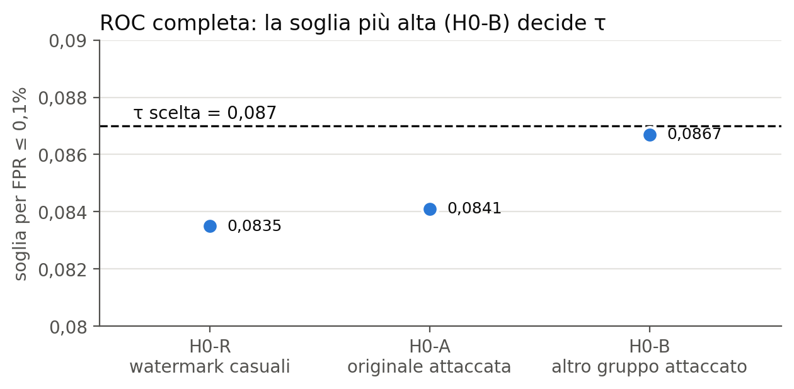
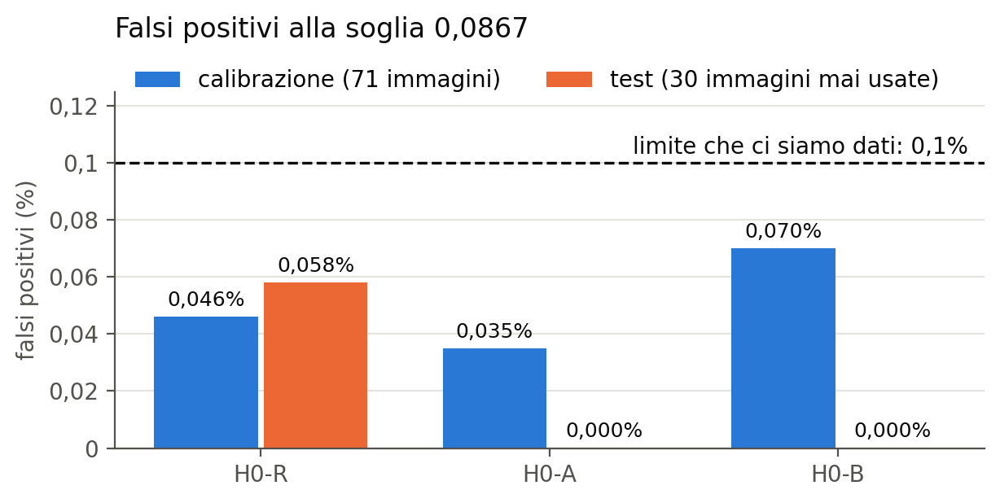
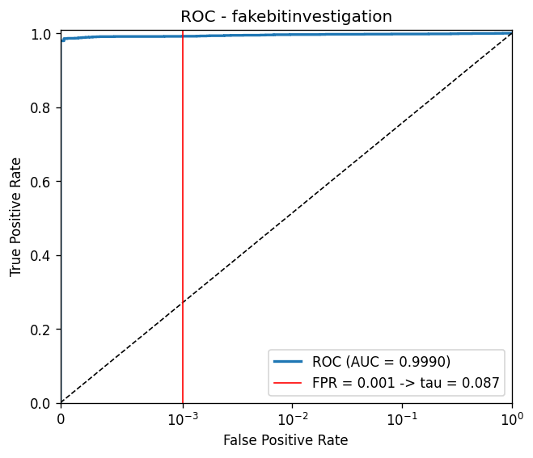
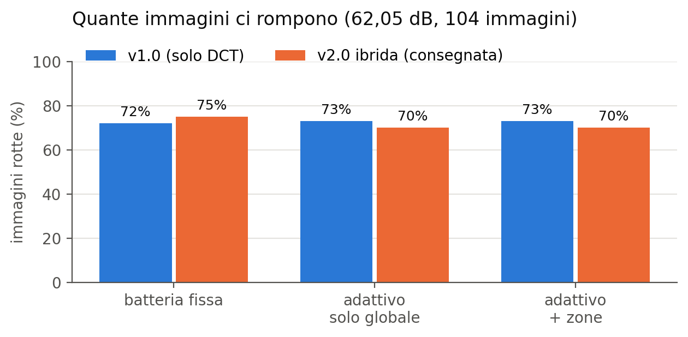
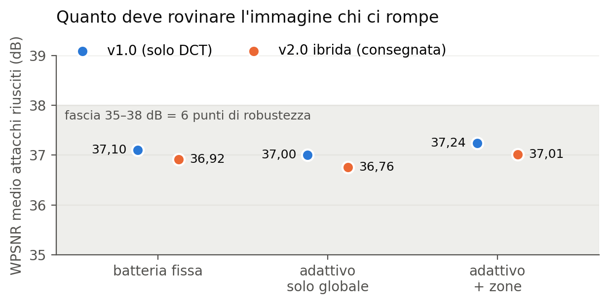
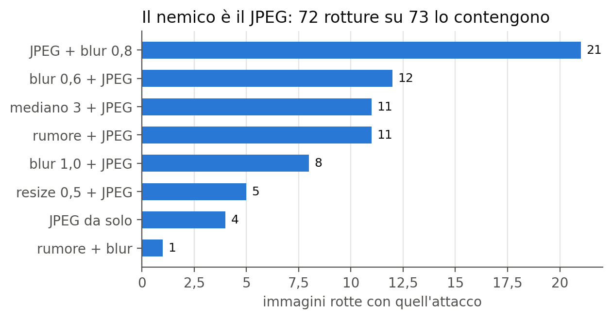
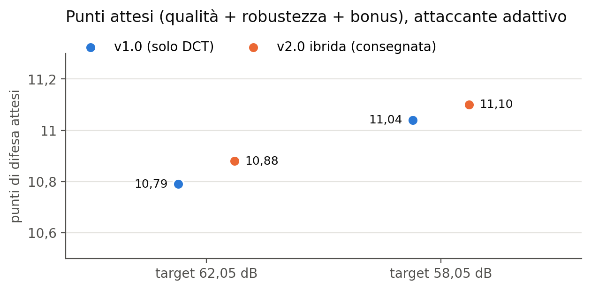
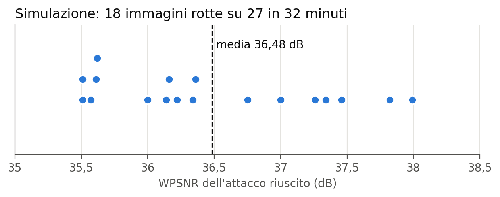
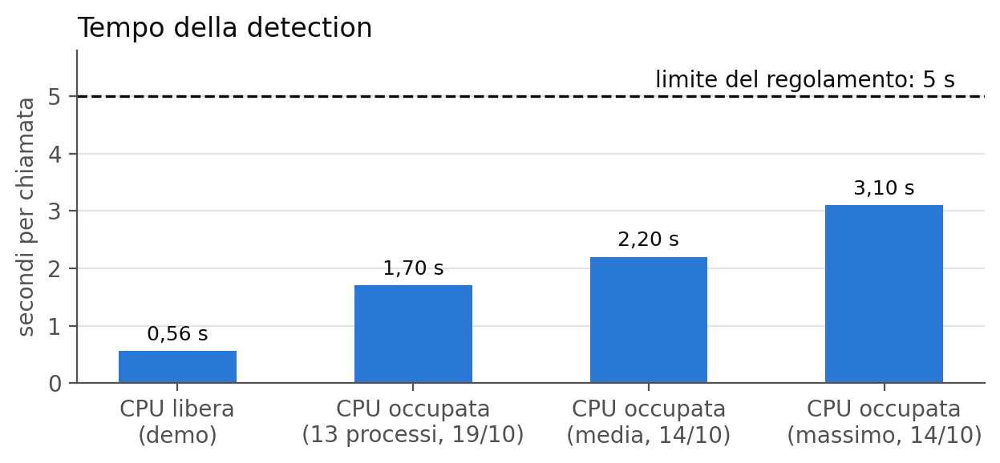

# Capture the Mark 2026: la difesa del gruppo `fakebitinvestigation`

**Versione 2.0 "ibrida" (DCT + wavelet): spiegazione completa di strategia, algoritmo e codice**

(15/10, aggiornato il 19/10 con la ROC completa, τ = 0,087, le risposte dei TA, gli attacchi e la demo, e il 21/10 con le risposte dei TA del 20/10, la prova sulle immagini distrutte e il test contro un gruppo vero della gara 2022. Il documento spiega da zero la versione che consegniamo, la v2.0: perché è fatta così, come funziona, il codice funzione per funzione, quanto è robusta e quali alternative abbiamo provato e scartato.)

Come è organizzata la repo:

- `fakebitinvestigation/consegna/`: **i file da consegnare**, l'unica copia del codice:
  - `embedding_fakebitinvestigation.py`: la funzione `embedding(input1, input2)`;
  - `detection_fakebitinvestigation.py`: la funzione `detection(input1, input2, input3)`;
  - `roc_fakebitinvestigation.py`: il codice che calcola la soglia τ con la ROC (procedura di p.4 del regolamento); `roc_fakebitinvestigation.png` e `roc_fakebitinvestigation_output.txt` sono la curva e i numeri della run completa;
  - `attacks_fakebitinvestigation.py`: **tutto** il nostro codice di attacco, in un solo file che funziona da solo: `attacks(input1, attack_name, param_array)` applica un attacco ammesso, anche in catena o in una zona; `attack_image(...)` cerca l'attacco più leggero che rompe un'immagine, usando la detection del gruppo attaccato come verifica (§A11);
  - `demo_fakebitinvestigation.py`: la demo che mostra come si usa ogni file;
  - `README.md`: istruzioni per eseguire tutto (per i TA);
- `fakebitinvestigation/gara/`: quello che serve **il giorno della gara** e non si consegna: `ISTRUZIONI_GARA.md` (passo passo) e due **helper** che non contengono logica di embedding né di attacco, ma usano solo i file di `consegna/`: `difesa_fakebitinvestigation.py` (embedding delle 3 immagini a più target con `embedding()`, controlli con `detection()`, attacco contro noi stessi con `attack_image()`, calcolo dei punti) e `cerca_attacchi_fakebitinvestigation.py` (chiama `attack_image()` in parallelo su tutte le immagini scaricate e scrive il log Excel);
- `fakebitinvestigation/documentazione/`: questo documento (`spiegazione_progetto.md` e il PDF generato con `genera_pdf.sh`), i grafici e il sorgente della pagina sul test contro il gruppo 2022.

Risorse condivise nella cartella `fakebitinvestigation/`: il regolamento aggiornato (`documentazione/document.pdf`, insieme a tutti gli altri PDF), il watermark assegnato (`consegna/fakebitinvestigation.npy`: sta nella consegna perché serve all'embedding e alla demo, che così funziona con la sola cartella consegnata), le 101 immagini di esempio (`sample-images/`) e 14 immagini mai usate per decidere (`set_c/`).

Gli script degli esperimenti da cui vengono i numeri di questo documento (batteria fissa, attaccante adattivo, falsi positivi realistici, simulazione dei punti) non servono né alla consegna né alla gara e non sono più nella repo; si recuperano con `git checkout cc4c11d -- fakebitinvestigation/esperimenti`.

---

# La versione 2.0 spiegata da zero

## A0. Riassunto in 11 punti

1. Il watermark è una sequenza di **1024 bit** assegnata dai TA. La trasformiamo in **±1** (0 → −1, 1 → +1).
2. Ogni bit viene scritto su una **coppia di coefficienti vicini**: al primo aumentiamo il modulo, al secondo lo diminuiamo (o il contrario se il bit è −1). Così gli attacchi che "alzano o abbassano tutto" (blur, sharpening, resize, contrasto) non cancellano il bit.
3. Lo **stesso** watermark viene scritto **due volte, in due "linguaggi" diversi** dell'immagine: nella **DCT globale** (1024 coppie nella banda di frequenze 32 ≤ r ≤ 128) e nella **wavelet db4** (1024 coppie nelle sottobande di dettaglio dei livelli 3 e 4, circa le stesse frequenze ma localizzate nello spazio).
4. Le coppie sono quelle con i **coefficienti più grandi** dell'immagine originale: la detection (non-blind) le ritrova da sola partendo dall'originale.
5. L'intensità del watermark viene **calibrata in automatico** per ottenere esattamente il WPSNR che vogliamo (62,05 dB di default, appena sopra la soglia dei 5 punti qualità), con il codice WPSNR dei lab.
6. La detection estrae il watermark dalla watermarkata (W_ext, 2048 valori) e dall'attaccata (W_att), e calcola il **coseno** tra i due. Per essere più robusta prova anche a "de-stirare" l'attaccata (contro il resize dei lab) e a pesare le zone dell'immagine in base a quanto sono state danneggiate (contro gli attacchi localizzati), e tiene il **massimo**.
7. Presente se coseno ≥ **τ = 0,087**, scelta con la ROC (procedura del regolamento più i falsi positivi "realistici" del Lab 4) a un tasso di falsi positivi dello 0,1%, e verificata su un set di test separato. Nessun controllo sul WPSNR nella decisione: il regolamento aggiornato lo vieta.
8. **Robustezza** (104 immagini, avversario "adattivo" che cerca l'attacco più leggero immagine per immagine usando la nostra detection, cosa che in gara non è nemmeno permessa): a 62,05 dB ci rompe il **70%** delle immagini, con attacchi in media a **37,0 dB** → fascia da **6 punti** di robustezza.
9. A **58,05 dB** ci rompe solo il **17%** delle immagini (attacchi a 35,9 dB). Con le regole confermate dal TA (mai rotti = 6 punti + 2 di bonus; qualità sulla **media** delle 3 immagini) i **punti attesi** sono **11,10** a 58,05 dB contro **10,88** a 62,05 dB.
10. Lo schema è il risultato di una selezione: le alternative che abbiamo provato (solo DCT, più bande, alta frequenza, maschere, schemi delle slide e dei lab) misurate **a parità di falsi positivi** pareggiano o peggiorano (§A9).
11. Il nemico principale resta il **JPEG**, da solo o in catena con blur e mediano: 72 delle 73 immagini rotte a 62 dB cadono così.

> 🗣 **In parole povere**: scriviamo lo stesso messaggio segreto due volte, con due "inchiostri" diversi, in punti dell'immagine che contano per l'occhio. Per cancellarlo un attaccante deve rovinare abbastanza l'immagine da finire nella fascia di qualità più bassa che il regolamento accetta (35–38 dB), che per noi vale comunque il punteggio massimo di robustezza.

---

## A1. Il gioco: cosa dice il regolamento e come si fanno i punti

Il regolamento di riferimento è la versione **aggiornata** (`document.pdf`, ricevuta il 14/10), che sostituisce `1BattleRules2026.pdf`. Più le risposte del TA (Andrea Montibeller) alle nostre domande del 14/10.

### A1.1 Le regole che ci riguardano

| regola | cosa significa per noi |
|---|---|
| `embedding(input1, input2) → output1`: percorso dell'originale, percorso del watermark, immagine watermarkata | firma rispettata alla lettera; immagini lette con OpenCV |
| l'embedding non stampa, non apre finestre | nessuna `print`, nessun file scritto |
| `detection(input1, input2, input3) → (output1, output2)`: originale, watermarkata, attaccata → presente/assente e WPSNR(watermarkata, attaccata) | firma rispettata; le tre immagini vengono lette dentro la funzione |
| detection in **un solo file**, nessuna funzione esterna tranne il WPSNR, nessun percorso relativo | tutto (WPSNR compreso) è copiato dentro il file |
| **non-blind**: si confronta il watermark estratto dalla watermarkata con quello estratto dall'attaccata; vietato leggere il file del watermark o scriverlo nel codice | estraiamo W_ext dalla watermarkata usando l'originale come riferimento |
| la detection deve **sempre** eseguire l'algoritmo; vietato forzare output1 in base al WPSNR, anche sotto i 25 dB (regola nuova) | la decisione è solo "coseno ≥ τ" (§A6.5) |
| se l'attaccata è l'**originale**, il watermark deve risultare assente | sull'originale la nostra estrazione dà un vettore nullo o quasi; controllato su tutte le immagini (§A7.4) |
| detection entro **5 secondi** | misurato: circa 0,56 s per chiamata a CPU libera (demo, 13 chiamate); 2,2 s in media e 3,1 s al massimo con la CPU occupata da altri 13 processi pesanti |
| **una sola soglia τ** per tutte le immagini, calcolata con la ROC (FPR ∈ [0; 0,1]) | τ = 0,087 a FPR 0,1% (§A7) |
| il watermark si può inserire più volte e la similarità si può calcolare sulla concatenazione (risposta del TA) | è esattamente la v2.0: 1024 valori DCT + 1024 valori wavelet |
| dopo il 27/10 solo "fine-tuning": parametri e posizioni di embedding | tutti i parametri sono costanti in testa ai file |

### A1.2 Come si fanno i punti (difesa)

| WPSNR medio dell'embedding (media delle 3 immagini) | punti qualità | | WPSNR medio degli attacchi riusciti su di noi | punti robustezza |
|---|---|---|---|---|
| 35–50 | 1 | | 35–38 | **6** |
| 50–54 | 2 | | 38–41 | 5 |
| 54–58 | 3 | | 41–44 | 4 |
| 58–62 | 4 | | 44–47 | 3 |
| 62–66 | 5 | | 47–50 | 2 |
| ≥ 66 | 6 | | 50–53 | 1 |
| | | | ≥ 53 | 0 |

Due chiarimenti che ci ha dato il TA:

- **la qualità si calcola sulla media del WPSNR delle 3 immagini**, non immagine per immagine;
- **se nessuno riesce a romperci** prendiamo la robustezza piena (**6 punti**) **più il bonus di 2 punti**.

Un attacco è "riuscito" solo se toglie il watermark **e** lascia l'immagine con WPSNR ≥ 35 dB rispetto alla watermarkata.

> 🗣 **In parole povere**: i punti di difesa vengono da due cose che tirano in direzioni opposte. Più il watermark è leggero, più l'immagine è bella (punti qualità); più è forte, più l'attaccante deve rovinare l'immagine per toglierlo (punti robustezza). E se è così forte che nessuno ci riesce, arriva il bonus.

### A1.3 Cosa ne segue per la strategia

1. **Stare appena sopra il bordo di una fascia.** I punti qualità salgono a gradini di 4 dB: 62,05 dB vale come 65,9 dB, ma con molta più energia (= robustezza). Per questo calibriamo l'intensità per atterrare esattamente su 62,05 o 58,05.
2. **La robustezza a 35–38 dB vale già il massimo.** Non serve un watermark "indistruttibile": basta che chi lo vuole togliere debba scendere sotto i 38 dB.
3. **Il bonus da 2 punti vale più di un punto di qualità.** È il motivo per cui 58,05 dB può convenire più di 62,05 (§A8.3).
4. **La media sulle 3 immagini apre una strategia nuova per il giorno della gara**: possiamo dare a ogni immagine un target diverso, purché la media resti sopra la soglia della fascia (§A8.4).

---

## A2. La strategia in una pagina

**La domanda di partenza** era: uno spread spectrum "semplice" basta, o servono tecniche più sofisticate (QIM, ISS, combinazioni di trasformate, più bande)? La risposta che ci siamo dati, con i numeri delle sezioni seguenti:

- **Le tecniche "più furbe" dello spread spectrum non servono nel nostro caso.** QIM, STDM e ISS (Improved Spread Spectrum) esistono per eliminare il "rumore" che l'immagine stessa crea quando la detection **non** ha l'originale (detection blind). La nostra detection è **non-blind**: sottraiamo l'originale e quel rumore sparisce del tutto. In più la QIM è fragile proprio agli attacchi che cambiano il "volume" dei coefficienti (blur, sharpening, contrasto), mentre il nostro schema a coppie è immune per costruzione.
- **Quello che conta davvero sono tre cose**: *dove* mettere l'energia (quali frequenze e quali coefficienti), *quanta* (il target di WPSNR) e *come* leggerla (la detection). Su tutte e tre abbiamo fatto esperimenti.
- **Una sola "torta" di energia.** Il WPSNR fissa quanta energia possiamo mettere in totale. Dividerla tra più bande o più trasformate non la fa crescere: aiuta solo se gli attacchi colpiscono le parti in modo diverso. Lo abbiamo misurato: aggiungere una copia in alta frequenza, dividere in due bande DCT o usare la wavelet ad alta frequenza **peggiora**; DCT + wavelet sulle stesse frequenze medie invece **migliora un poco** (§A9). È lo schema che usiamo.
- **La detection pesa quanto l'embedding.** Il salto più grande è venuto dalla detection (risincronizzazione del resize e pesatura spaziale): dal 94% al 78% di immagini rotte a parità di falsi positivi.
- **Ogni miglioramento va confrontato a parità di falsi positivi.** Una detection che vede il watermark ovunque "resiste" a tutti gli attacchi ma prende penalità. Per questo ogni confronto di questo documento è fatto con soglie scelte allo stesso tasso di falsi positivi (0,1%).

> 🗣 **In parole povere**: non abbiamo cercato l'algoritmo più complicato, ma quello che, a parità di "pulizia" dell'immagine, costringe l'attaccante a sporcarla di più. E ogni volta che qualcosa sembrava migliorare, abbiamo controllato che non fosse solo una detection "più credulona".

---

## A3. Il punto chiave: come il WPSNR "pesa" le frequenze

Il WPSNR dei lab (lo stesso usato in gara, confermato) non misura l'errore pixel per pixel: prima lo **filtra** con un filtro CSF (*Contrast Sensitivity Function*, 41×41) che imita la sensibilità dell'occhio alle diverse frequenze, poi calcola un PSNR. Abbiamo misurato quanto "conta" ogni frequenza, usando lo stesso raggio r della DCT (frequenza = r/1024 cicli per pixel):

| r (indice DCT) | 8 | 16 | 32 | 64 | 96 | 128 | 160 | 200 | 256 | 320 |
|---|---|---|---|---|---|---|---|---|---|---|
| cicli/pixel | 0,008 | 0,016 | 0,031 | 0,062 | 0,094 | 0,125 | 0,156 | 0,195 | 0,250 | 0,312 |
| guadagno del filtro CSF | 0,501 | 0,505 | 0,517 | 0,549 | 0,561 | 0,525 | 0,439 | 0,294 | 0,111 | 0,020 |
| costo relativo dell'energia (r = 64 → 1) | 0,83 | 0,85 | 0,89 | 1,00 | 1,04 | 0,91 | 0,64 | 0,29 | 0,04 | ≈ 0 |

Due conseguenze, una buona e una cattiva:

- **Fino a r ≈ 128 il costo è quasi costante**: possiamo scegliere la banda per la robustezza, non per il WPSNR.
- **Sopra r ≈ 200 l'energia è quasi gratis**: a r = 256 un'ampiezza 5 volte più grande costa lo stesso WPSNR. Sembra un regalo, ma **lo stesso regalo lo riceve l'attaccante**: blur, mediano e JPEG cancellano proprio quelle frequenze, e anche a lui costa quasi zero. Lo abbiamo verificato (§A9): mettere una copia del watermark lassù **peggiora** sempre.

> 🗣 **In parole povere**: il WPSNR è un giudice che guarda bene i dettagli medi dell'immagine e quasi non vede la grana finissima. Se nascondiamo il watermark nella grana finissima il giudice non lo vede, ma l'attaccante può spazzarla via e il giudice non vede neanche quello. Bisogna nascondersi dove il giudice guarda, e dove "pulire" costa caro.

---

## A4. L'algoritmo di embedding, passo per passo

### A4.1 I quattro ingredienti

**1. Watermark bipolare.** `w = 2·bit − 1`, quindi 0 → −1 e 1 → +1. Con ±1 due watermark indipendenti hanno similarità coseno con media 0 (e deviazione standard 1/√N). Con 0/1 sarebbe circa 0,5: due watermark qualsiasi sembrerebbero "mezzi uguali" e la soglia sarebbe molto più delicata.

**2. Coppie differenziali.** Ogni bit va su due coefficienti vicini C₁ e C₂ (vicini in frequenza nella DCT, vicini nello spazio dentro la stessa sottobanda nella wavelet):

- modulo di C₁ → |C₁| + a·w
- modulo di C₂ → |C₂| − a·w

In estrazione si guarda la **differenza** delle variazioni relative dei due. Un attacco "liscio" (blur, sharpening, resize, contrasto) moltiplica due coefficienti vicini per quasi lo stesso fattore g: nella differenza il fattore si cancella e resta g·a·w, e il coseno non dipende da g. Lo schema del lab (Cox moltiplicativo) invece a 60 dB veniva rotto in 9 immagini su 9 da attacchi di questo tipo.

**3. Selezione dei coefficienti.** In ciascun dominio prendiamo le 1024 coppie con il **minimo dei due moduli più grande** dentro la banda scelta. Coefficienti grandi significano tre cose: divisioni stabili in estrazione, componenti "importanti" per l'immagine (che un attaccante non può cancellare senza rovinarla) e posizioni che dipendono **solo dall'originale**, che la detection ha.

**4. Ampiezza uniforme calibrata.** Tutte le coppie ricevono la stessa spinta assoluta (è la scelta ottima per il rumore additivo). L'ampiezza viene trovata con una ricerca automatica (bisezione) in modo che il WPSNR finale sia ≥ TARGET_WPSNR, con il codice esatto dei lab.

### A4.2 Le due parti: DCT globale e wavelet

**Parte 1, DCT globale.** Trasformata DCT dell'intera immagine 512×512. Le coppie sono (u,v) e (u,v+1) con v pari, nella banda radiale 32 ≤ r ≤ 128 con r = √(u² + (v+½)²). In termini spaziali sono strutture con periodo tra 8 e 32 pixel. Ogni coefficiente DCT globale "parla" di tutta l'immagine: un bit è spalmato su tutti i 262.144 pixel.

**Parte 2, wavelet db4.** Trasformata wavelet ortogonale (Daubechies 4, 4 livelli, modalità "periodization", che conserva l'energia come la DCT). Usiamo le sottobande di dettaglio (orizzontale, verticale, diagonale) dei **livelli 3 e 4**: il livello 3 copre circa 0,06–0,125 cicli/pixel, il livello 4 circa 0,03–0,06, cioè **le stesse frequenze della parte DCT**. La differenza è che i coefficienti wavelet sono **localizzati**: ognuno descrive una piccola zona dell'immagine. Le coppie sono due coefficienti orizzontalmente adiacenti (colonne j e j+1, con j pari) nella stessa sottobanda.

**Perché le due insieme.** Le due parti stanno nella stessa banda di frequenze (quella che il WPSNR "paga" in modo uniforme e che gli attacchi non riescono a pulire gratis), ma "vedono" l'immagine in modo diverso: la DCT globale media su tutta l'immagine, la wavelet zona per zona. L'idea è che un attacco localizzato o "a blocchi" (come il JPEG) non danneggi le due parti allo stesso modo. Il vantaggio misurato c'è ma è piccolo (§A9): lo diciamo subito per non venderla come una rivoluzione. Lo stesso watermark scritto in entrambi i domini viene letto dalla detection come un unico vettore di 2048 valori.

> 🗣 **In parole povere**: è come scrivere la stessa frase su un muro con una vernice che si stende su tutta la parete (DCT) e con tanti piccoli adesivi sparsi (wavelet). Per cancellarla devi riverniciare tutto o staccare quasi tutti gli adesivi.

### A4.3 La formula completa

Notazione: O = originale, P_DCT e P_DWT = "pattern" del watermark nei pixel ad ampiezza 1 (cioè l'immagine che si ottiene mettendo +sgn(C₁)·w sul primo coefficiente di ogni coppia, −sgn(C₂)·w sul secondo, zero altrove, e tornando ai pixel con la trasformata inversa).

Immagine watermarkata:

`I_w = clip(rint(O + s·(K_DCT·P_DCT + K_DWT·P_DWT)), 0, 255)`

- `K_DCT = K_DWT = 1`: le due parti hanno la stessa ampiezza relativa;
- `s` è la scala, trovata con la bisezione: la più grande che tiene WPSNR(O, I_w) ≥ 62,05 dB.

Misure sulle 104 immagini (101 di esempio + 3 della gara 2022): `s` tra **3,01 e 3,16** (mediana 3,08), WPSNR ottenuto sempre tra **62,0500 e 62,0538 dB**.

> 🗣 **In parole povere**: calcoliamo "il disegno" del watermark nell'immagine, poi lo sommiamo all'originale con un volume che alziamo finché il giudice (il WPSNR) non dice "basta, sopra 62,05 no".

### A4.4 Estrazione (la usa solo la detection)

Per ogni coppia, dati il coefficiente originale C e quello dell'immagine da analizzare X:

`W_i = [ s₁·(X₁ − C₁)/|C₁| − s₂·(X₂ − C₂)/|C₂| ] / ( 1/|C₁| + 1/|C₂| )`

con s₁, s₂ i segni dei coefficienti originali (e |C| sostituito da max(|C|, 1) per non dividere mai per zero). Proprietà (valide identiche per la parte DCT e per la parte wavelet):

- sulla **watermarkata** dà `W_i = a·w_i`: il watermark esatto, a meno di una scala;
- sull'**originale** dà `W_i = 0` esatto;
- se un attacco moltiplica entrambi i coefficienti per g, dà `g·a·w_i`: il coseno non cambia.

Le dimostrazioni sono brevi. Scriviamo `s_j = sgn(C_j)`, così `s_j·(X_j − C_j)/|C_j| = (X_j − C_j)/C_j = r_j`, e il numeratore è `r₁ − r₂`.

- *Watermarkata* (ignorando l'arrotondamento): `X₁ = C₁ + s₁·a·w`, `X₂ = C₂ − s₂·a·w`, quindi `r₁ = a·w/|C₁|`, `r₂ = −a·w/|C₂|` e `W = a·w·(1/|C₁| + 1/|C₂|)/(1/|C₁| + 1/|C₂|) = a·w`. In pratica, con l'arrotondamento, la correlazione con il watermark vero è 0,98–0,99.
- *Originale*: `X = C`, quindi `r = 0` e `W = 0`; la similarità con un vettore nullo la definiamo 0, quindi "assente", come chiede il regolamento.
- *Stesso guadagno sulla coppia* (blur, sharpening, resize, contrasto): `X_j = g·C'_j`, quindi `r₁ − r₂ = g·a·w·(1/|C₁| + 1/|C₂|)` e `W = g·a·w`: il termine `(g − 1)` sparisce e il coseno non vede `g`. Con lo schema del lab resterebbe invece `(g − 1)/α`, enorme.

Il vettore completo è `W = [W_DCT (1024 valori), W_DWT (1024 valori)]`.

---

## A5. Il codice dell'embedding, funzione per funzione

File: `embedding_fakebitinvestigation.py`. Lo leggiamo dall'alto in basso.

### A5.1 I parametri

```python
TARGET_WPSNR = 62.05   # dB: appena sopra la soglia 62 della tabella punti (5 punti)
TARGET_BY_IMAGE = {}   # target diverso per singola immagine, es. {"buildings": 58.05}; vuoto = TARGET_WPSNR per tutte
R_MIN = 32.0           # banda radiale dei coefficienti DCT (come la v1.0)
R_MAX = 128.0
N_BITS = 1024          # lunghezza del watermark assegnato
WAVELET = "db4"        # wavelet della seconda parte
DWT_LEVELS = 4         # livelli della decomposizione
DWT_USE = (3, 4)       # livelli le cui sottobande di dettaglio ospitano il watermark
K_DCT = 1.0            # ampiezza relativa della parte DCT
K_DWT = 1.0            # ampiezza relativa della parte wavelet
AMP_MIN, AMP_MAX = 0.2, 40.0   # intervallo di ricerca della scala
N_ITER = 14                    # passi di bisezione
```

Sono **le uniche cose che si possono toccare dopo il 27/10** ("fine-tuning: parametri e posizioni di embedding"). Quelli che descrivono *dove* sta il watermark (R_MIN, R_MAX, WAVELET, DWT_LEVELS, DWT_USE, N_BITS) vanno tenuti **identici** nella detection; TARGET_WPSNR, TARGET_BY_IMAGE, K_DCT e K_DWT riguardano solo l'embedding.

`TARGET_BY_IMAGE` (aggiunto il 19/10) serve il giorno della gara. I punti qualità si calcolano sulla **media** dei WPSNR delle 3 immagini (risposta dei TA), quindi possiamo mettere più energia nell'immagine più difficile da difendere. Per esempio `{"buildings": 58.05}` dà 58,05 dB a `buildings.bmp` e lascia le altre a `TARGET_WPSNR`. La chiave è il nome del file senza estensione. Il dizionario vuoto (il default) lascia il comportamento identico a prima. Lo riempie lo script di difesa (§A8.4), così il codice riproduce esattamente le immagini che carichiamo.

> 🗣 **In parole povere**: è il "pannello di controllo". TARGET_WPSNR è la manopola del volume; gli altri dicono in quali "stanze" dell'immagine nascondere il watermark.

### A5.2 Il WPSNR dei lab

Le funzioni `_csffun`, `_csfmat`, `_get_csf_filter` e `wpsnr` sono **copiate identiche** dal codice dei lab. Servono perché la calibrazione deve usare esattamente il numero che calcoleranno i TA. `wpsnr(a, b)`:

1. porta le immagini in [0, 1];
2. calcola l'errore A − B;
3. lo filtra con il filtro CSF 41×41 (`convolve2d`, bordi "wrap");
4. restituisce `20·log10(1/√(media dell'errore filtrato²))`.

### A5.3 La parte DCT: `_dct2`, `_idct2`, `_select_pairs`

```python
def _dct2(x):
    return dctn(x, norm='ortho')
```

DCT bidimensionale "ortonormale": conserva l'energia (la somma dei quadrati dei coefficienti è uguale a quella dei pixel). È la stessa trasformata dei lab, scritta in una riga. `_idct2` è l'inversa.

```python
def _select_pairs(coeffs):
    H, W = coeffs.shape
    u = np.arange(H)[:, None]
    v = np.arange(0, W - 1, 2)[None, :]          # v pari: coppie (u,v),(u,v+1)
    uu = np.broadcast_to(u, (H, v.shape[1])).ravel()
    vv = np.broadcast_to(v, (H, v.shape[1])).ravel()
    r = np.sqrt(uu**2 + (vv + 0.5)**2)          # frequenza "radiale" della coppia
    band = (r >= R_MIN) & (r <= R_MAX)
    uu, vv = uu[band], vv[band]
    strength = np.minimum(np.abs(coeffs[uu, vv]), np.abs(coeffs[uu, vv + 1]))
    best = np.argsort(-strength, kind='stable')[:N_BITS]
    best = np.sort(best)
    return uu[best], vv[best]
```

Riga per riga:

- costruisce **tutte** le coppie possibili (u, v)–(u, v+1) con v pari;
- calcola la loro frequenza r (il "+½" mette r a metà tra i due coefficienti) e tiene solo quelle nella banda 32–128;
- per ogni coppia, la "forza" è il **più piccolo** dei due moduli: vogliamo che **entrambi** i coefficienti siano grandi;
- prende le 1024 più forti (`argsort` decrescente, "stable" per avere sempre lo stesso ordine a parità di valore);
- le **riordina per posizione**: così l'abbinamento bit → coppia non dipende da differenze minuscole di arrotondamento.

> 🗣 **In parole povere**: tra tutte le "coppie di note" dell'immagine nella fascia di frequenze giusta, scegliamo le 1024 suonate più forte, e le mettiamo in ordine di posizione, come i posti di un teatro.

### A5.4 La parte wavelet: `_dwt2`, `_idwt2`, `_select_pairs_dwt`

```python
def _dwt2(x):
    arr, slices = pywt.coeffs_to_array(pywt.wavedec2(x, WAVELET, mode='periodization', level=DWT_LEVELS))
    return arr, slices
```

`wavedec2` scompone l'immagine in 4 livelli: un'approssimazione grossolana (32×32) e, per ogni livello, tre sottobande di dettaglio (orizzontale, verticale, diagonale), di 32×32 al livello 4, 64×64 al livello 3, 128×128 al livello 2 e 256×256 al livello 1. `coeffs_to_array` le mette tutte in **un'unica matrice 512×512**, più `slices`, che dice dove sta ogni sottobanda. Lavorare su una matrice sola rende la selezione delle coppie identica, nel concetto, a quella della DCT. `_idwt2` fa il percorso inverso.

```python
def _select_pairs_dwt(arr, slices):
    m = np.zeros(arr.shape, bool)
    for lev in DWT_USE:
        k = DWT_LEVELS - lev + 1           # in wavedec2 l'indice 1 e' il livello piu' grossolano
        for key in ('ad', 'da', 'dd'):
            m[slices[k][key]] = True
    ii, jj = np.nonzero(m[:, :-1] & m[:, 1:])
    keep = jj % 2 == 0
    ii, jj = ii[keep], jj[keep]
    strength = np.minimum(np.abs(arr[ii, jj]), np.abs(arr[ii, jj + 1]))
    best = np.sort(np.argsort(-strength, kind='stable')[:N_BITS])
    return ii[best], jj[best]
```

- `m` è una "maschera" che segna i coefficienti delle sottobande di dettaglio (`'ad'`, `'da'`, `'dd'` = orizzontale, verticale, diagonale) dei livelli 3 e 4;
- una coppia è (i, j)–(i, j+1) con **entrambi** i coefficienti dentro la maschera e j pari (coppie che non si sovrappongono);
- poi stessa regola della DCT: le 1024 coppie con il minimo dei due moduli più grande, riordinate per posizione.

### A5.5 Il "disegno" del watermark: `_pair_pattern`

```python
def _pair_pattern(c, ii, jj, w):
    s1 = np.where(c[ii, jj] < 0, -1.0, 1.0)
    s2 = np.where(c[ii, jj + 1] < 0, -1.0, 1.0)
    P = np.zeros_like(c)
    P[ii, jj] = s1 * w
    P[ii, jj + 1] = -s2 * w
    return P
```

Crea una matrice di coefficienti tutta a zero tranne le coppie scelte: sul primo coefficiente mette `+segno(C₁)·w`, sul secondo `−segno(C₂)·w`. Moltiplicare per il segno del coefficiente originale fa sì che il **modulo** del primo cresca di w e quello del secondo cali di w, qualunque sia il segno. Questa matrice, riportata nei pixel con la trasformata inversa, è il "disegno" del watermark ad ampiezza 1. Funziona per entrambi i domini: le funzioni di selezione restituiscono righe e colonne, e qui non importa se vengono dalla DCT o dalla wavelet.

### A5.6 La funzione `embedding`

```python
def embedding(input1, input2):
    original = cv2.imread(input1, cv2.IMREAD_GRAYSCALE)
    bits = np.load(input2).astype(np.float64).ravel()[:N_BITS]
    w = 2.0 * bits - 1.0                          # 0/1 -> -1/+1
    o = original.astype(np.float64)
    target = TARGET_BY_IMAGE.get(os.path.splitext(os.path.basename(input1))[0], TARGET_WPSNR)

    c = _dct2(o)
    uu, vv = _select_pairs(c)
    arr, slices = _dwt2(o)
    ii, jj = _select_pairs_dwt(arr, slices)
    pattern = K_DCT * _idct2(_pair_pattern(c, uu, vv, w)) + K_DWT * _idwt2(_pair_pattern(arr, ii, jj, w), slices)

    def marked(s):
        return np.clip(np.rint(o + s * pattern), 0, 255).astype(np.uint8)

    lo, hi = AMP_MIN, AMP_MAX
    best = marked(lo)
    for _ in range(N_ITER):
        mid = np.sqrt(lo * hi)
        candidate = marked(mid)
        if wpsnr(original, candidate) >= target:
            lo, best = mid, candidate
        else:
            hi = mid

    output1 = best
    return output1
```

Passo per passo:

1. **legge** l'originale in grigi con OpenCV e il watermark dal file `.npy` (1024 bit), poi lo trasforma in ±1; sceglie il target di WPSNR: quello di `TARGET_BY_IMAGE` per quell'immagine, se c'è, altrimenti `TARGET_WPSNR`;
2. calcola le due trasformate dell'originale e **sceglie le coppie** in ciascuna;
3. costruisce il **disegno complessivo** del watermark nei pixel: disegno DCT + disegno wavelet (le trasformate sono lineari, quindi si possono sommare nei pixel);
4. `marked(s)` produce l'immagine watermarkata con scala `s`: somma, arrotonda a interi, taglia in [0, 255];
5. **bisezione logaritmica**: si parte dall'intervallo [0,2; 40]; a ogni passo si prova la media geometrica; se il WPSNR è ancora ≥ 62,05 la scala va bene e si prova più in alto, altrimenti più in basso. Dopo 14 passi la precisione è di circa lo 0,03% sulla scala;
6. restituisce l'**ultima immagine valida**, cioè quella con la scala più grande che rispetta il target. Il WPSNR viene calcolato sull'immagine **già arrotondata**, quindi è esattamente il numero che calcoleranno i TA.

> 🗣 **In parole povere**: prepariamo il disegno del watermark e poi cerchiamo il volume giusto come si cerca una parola nel dizionario: apri a metà, guardi se sei troppo avanti o troppo indietro, e dimezzi ogni volta. In 14 tentativi troviamo il volume massimo che non supera il limite di qualità.

**Tempo**: tra 22 e 31 secondi per immagine, misurati con la CPU occupata da altri processi (a ogni passo va ricalcolata anche la parte wavelet). La parte lenta è il WPSNR dei lab (convoluzione 41×41), calcolato 14 volte.

---

## A6. Il codice della detection, funzione per funzione

File: `detection_fakebitinvestigation.py`. È un **file unico**: contiene di nuovo il WPSNR dei lab e le stesse funzioni di selezione dell'embedding, copiate identiche (non importate, come vuole il regolamento).

### A6.0 La logica, prima del codice

La detection deve rispondere a una sola domanda: *nell'immagine attaccata c'è ancora il watermark che sta nella watermarkata?* Il watermark non lo conosce (il regolamento vieta di leggerlo dal file o di scriverlo nel codice), ma ha tre immagini, e da queste lo ricostruisce. I passi sono sei:

1. **Lo "stampo", dall'originale.** Dall'originale ricalcoliamo esattamente le posizioni che ha scelto l'embedding: le 1024 coppie della DCT e le 1024 coppie della wavelet. Si può fare perché la scelta dipende **solo** dall'originale (le coppie con i coefficienti più grandi) e perché le costanti dei due file sono identiche.
2. **Il watermark di riferimento, dalla watermarkata.** Confrontiamo la watermarkata con l'originale, coppia per coppia, con la formula della §A4.4: otteniamo `W_ext = a·w`, cioè il nostro watermark a meno di una scala, senza averlo mai letto.
3. **Il watermark "sopravvissuto", dall'attaccata.** Facciamo la stessa misura sull'attaccata e otteniamo `W_att`. Se l'attacco non ha toccato il watermark, `W_att ≈ W_ext`. Se l'ha indebolito, `W_att ≈ g·W_ext + rumore`. Se l'immagine non c'entra (l'originale, un'immagine di un altro gruppo), `W_att` è rumore che non ha niente a che fare con `W_ext`.
4. **Quanto si somigliano.** Calcoliamo il coseno tra `W_ext` e `W_att`. Vale 1 se il watermark è intatto, resta alto se è solo indebolito (il coseno non vede la scala `g`) e sta intorno a zero se il watermark non c'è. Nelle misure della ROC, sui casi senza il nostro watermark, la media è circa 0,02 e la deviazione standard 0,017–0,019 (§A7.2).
5. **Più letture dell'attaccata.** L'attaccata non la leggiamo una volta sola ma sei: così com'è, "de-stirata" in quattro modi (contro il resize dei lab) e con una pesatura che ignora le zone devastate (contro gli attacchi localizzati). Teniamo il coseno **massimo**.
6. **La decisione.** Il watermark è presente se il massimo è ≥ τ = 0,087. Il WPSNR tra watermarkata e attaccata viene calcolato e restituito (`output2`), ma non entra nella decisione.

Perché il fatto di avere l'originale (detection **non-blind**) conta tanto: sottraendo l'originale togliamo di mezzo l'immagine stessa, che per uno spread spectrum è il "rumore" più grande. Quello che resta è solo il watermark più il danno dell'attacco. È anche il motivo per cui sull'originale l'estrazione dà un vettore nullo, e quindi "assente" con certezza.

> 🗣 **In parole povere**: l'originale ci dice *dove* guardare, la watermarkata *cosa* dovremmo trovarci, l'attaccata *cosa* ci troviamo davvero. Se le ultime due "puntano nella stessa direzione" più di quanto succede per caso, il watermark c'è.

### A6.1 Le costanti

```python
R_MIN = 32.0
R_MAX = 128.0
N_BITS = 1024
WAVELET = "db4"
DWT_LEVELS = 4
DWT_USE = (3, 4)
TAU = 0.087
SQ_WIN = 16                     # finestra (pixel) della pesatura spaziale
SQ_EPS = 0.5                    # regolarizzazione della pesatura spaziale
STRETCH = (510, 511, 513, 514)  # dimensioni intermedie del resize dei lab da compensare
C_FLOOR = 1.0                   # minimo |coefficiente| al denominatore dell'estrazione
```

Le prime sei devono essere **identiche** all'embedding (altrimenti la detection cercherebbe il watermark nei posti sbagliati). TAU è la soglia della ROC (§A7). Le altre regolano le varianti di estrazione (§A6.4).

### A6.2 L'estrazione: `_pair_extract`, `_context`, `_extract`

```python
def _pair_extract(c0, ii, jj, c1):
    a1, a2 = c0[ii, jj], c0[ii, jj + 1]
    s1 = np.where(a1 < 0, -1.0, 1.0)
    s2 = np.where(a2 < 0, -1.0, 1.0)
    m1 = np.maximum(np.abs(a1), C_FLOOR)
    m2 = np.maximum(np.abs(a2), C_FLOOR)
    r1 = s1 * (c1[ii, jj] - a1) / m1
    r2 = s2 * (c1[ii, jj + 1] - a2) / m2
    return (r1 - r2) / (1.0 / m1 + 1.0 / m2)
```

È la formula della §A4.4:

- `c0` sono i coefficienti dell'**originale**, `c1` quelli dell'immagine da analizzare;
- `r1` e `r2` sono le variazioni relative di modulo dei due coefficienti della coppia (`s·(X − C)/|C|`);
- la differenza `r1 − r2` cancella i guadagni comuni (blur, sharpening, ...);
- la divisione finale fa sì che sulla watermarkata il risultato sia esattamente `a·w`;
- `C_FLOOR = 1`: se un coefficiente originale fosse quasi zero (immagini costanti o sfumature sintetiche) non dividiamo per zero. Sulle foto vere non cambia nulla, perché i coefficienti scelti sono grandi (nella parte DCT il più piccolo vale circa 13 su tutte le 104 immagini).

```python
def _context(original):
    o = original.astype(np.float64)
    c0 = _dct2(o)
    uu, vv = _select_pairs(c0)
    a0, slices = _dwt2(o)
    ii, jj = _select_pairs_dwt(a0, slices)
    return c0, uu, vv, a0, ii, jj

def _extract(ctx, img):
    c0, uu, vv, a0, ii, jj = ctx
    x = np.asarray(img, dtype=np.float64)
    return np.concatenate([_pair_extract(c0, uu, vv, _dct2(x)), _pair_extract(a0, ii, jj, _dwt2(x)[0])])
```

- `_context` calcola **una volta sola** tutto quello che dipende solo dall'originale: trasformate e posizioni delle coppie, per entrambe le parti;
- `_extract` trasforma un'immagine qualsiasi e restituisce il vettore di **2048 valori**: prima i 1024 della DCT, poi i 1024 della wavelet.

> 🗣 **In parole povere**: l'originale fa da "stampo". Appoggiamo l'immagine sopra lo stampo e misuriamo, coppia per coppia, chi dei due coefficienti è cresciuto rispetto all'altro. Quella lista di 2048 misure è il watermark "letto".

### A6.3 La similarità: `_similarity`

```python
def _similarity(x, y):
    nx, ny = np.linalg.norm(x), np.linalg.norm(y)
    if nx == 0 or ny == 0:
        return 0.0
    return float(np.dot(x, y) / (nx * ny))
```

Il **coseno** tra i due vettori: vale 1 se sono identici a meno di una scala, circa 0 se non c'entrano niente, −1 se sono opposti. Se uno dei due è nullo (per esempio l'attaccata è l'originale e l'estrazione dà zero), per definizione la similarità è 0: watermark assente.

> 🗣 **In parole povere**: il coseno misura quanto due liste di numeri "vanno nella stessa direzione", senza badare a quanto sono grandi. Se l'attaccante ha indebolito il watermark ma non l'ha distrutto, la direzione resta quella giusta.

### A6.4 Le varianti di estrazione: `_destretch`, `_attacked_vectors`, `_score`

Dall'attaccata non estraiamo un solo vettore, ma **sei**:

```python
def _attacked_vectors(ctx, original, attacked):
    o = original.astype(np.float64)
    a = attacked.astype(np.float64)
    vecs = [_extract(ctx, a)]                       # 1. normale
    for m in STRETCH:                               # 2-5. "de-stirata"
        vecs.append(_extract(ctx, _destretch(attacked, m)))
    d = a - o                                       # 6. pesata nello spazio
    rho = 1.0 / (uniform_filter(d * d, SQ_WIN) + SQ_EPS)
    vecs.append(_extract(ctx, o + rho * d))
    return vecs

def _score(reference, vecs):
    return max(_similarity(reference, y) for y in vecs)
```

**Varianti 2–5, "de-stirare".** La funzione di resize dei lab rimpicciolisce e poi ingrandisce l'immagine; per alcune scale l'immagine intermedia esce di 510, 511, 513 o 514 pixel invece di 512, e il risultato finale è **stirato** di qualche millesimo. Uno stiramento così piccolo non si vede, ma sposta le frequenze e "desincronizza" le coppie. `_destretch` applica lo stiramento inverso per ciascuna delle 4 dimensioni possibili:

```python
def _destretch(img, m):
    x = (np.arange(img.shape[0]) + 0.5) * m / img.shape[0] - 0.5
    mx, my = np.meshgrid(x, x)
    return cv2.remap(img.astype(np.float32), mx.astype(np.float32), my.astype(np.float32),
                     cv2.INTER_CUBIC, borderMode=cv2.BORDER_REPLICATE).astype(np.float64)
```

- se l'immagine intermedia aveva `m` pixel, il contenuto del pixel `i` è finito nella posizione `(i + 0,5)·m/512 − 0,5` dell'attaccata (il "+0,5/−0,5" serve a ragionare sui centri dei pixel);
- `x` è proprio questa posizione, per ogni riga e ogni colonna; `cv2.remap` va a prendere ogni pixel lì, con un'interpolazione cubica;
- ai bordi, dove la posizione cade fuori dall'immagine, si ripete l'ultimo pixel (`BORDER_REPLICATE`).

Misurato: resize del lab a scala 0,55 → similarità da 0,225 a 0,831.

**Variante 6, pesatura spaziale.** Un attacco localizzato (per esempio JPEG fortissimo solo sulle zone lisce) distrugge il watermark in una parte dell'immagine e lascia intatto il resto. Nell'estrazione normale la parte distrutta "inquina" tutto. Allora pesiamo ogni pixel della differenza `attaccata − originale` con

`ρ = 1 / (media su 16×16 pixel di (attaccata − originale)² + 0,5)`

Dove l'attacco non ha toccato nulla la differenza è piccola (c'è solo il watermark) → peso alto; dove l'attacco ha devastato → peso basso. Il peso usa **solo attaccata e originale**, mai la watermarkata: così, se l'attaccata non contiene il nostro watermark, il peso non può "inventarlo". Con la watermarkata al posto dell'originale i falsi positivi erano del 30–87%.

**Il massimo.** La similarità finale è il **massimo** dei sei coseni: l'attaccante deve battere tutte le varianti insieme. Il prezzo è che, su immagini senza il nostro watermark, il massimo di sei valori casuali è un po' più alto di uno solo: per questo τ va calcolata con la **stessa** funzione `_score` (§A7).

> 🗣 **In parole povere**: invece di leggere l'immagine attaccata una volta sola, la leggiamo sei volte: così com'è, "raddrizzata" in quattro modi diversi (se qualcuno l'ha stirata) e con una lente che ignora le zone rovinate. Se in almeno una lettura il messaggio si vede chiaro, è presente.

### A6.5 La funzione `detection`

```python
def detection(input1, input2, input3):
    original = cv2.imread(input1, cv2.IMREAD_GRAYSCALE)
    watermarked = cv2.imread(input2, cv2.IMREAD_GRAYSCALE)
    attacked = cv2.imread(input3, cv2.IMREAD_GRAYSCALE)

    ctx = _context(original)
    W_ext = _extract(ctx, watermarked)
    sim = _score(W_ext, _attacked_vectors(ctx, original, attacked))

    output2 = wpsnr(watermarked, attacked)
    output1 = 1 if sim >= TAU else 0
    return output1, output2
```

1. legge le **tre immagini dentro la funzione** dai tre percorsi (regola esplicita);
2. prepara lo "stampo" dall'originale;
3. estrae `W_ext` dalla **watermarkata**: è il watermark come l'abbiamo inserito, **ricavato** e non letto da file (regola: "don't read the original watermark: extract it");
4. calcola la similarità con le sei varianti dell'attaccata;
5. `output2` = WPSNR tra watermarkata e attaccata, con il codice dei lab;
6. `output1` = 1 se la similarità è ≥ τ, altrimenti 0.

**Perché non c'è un controllo sul WPSNR.** Il regolamento aggiornato lo vieta esplicitamente ("an if statement that skips detection or forces output1 based on the WPSNR is not allowed, including for severely degraded images"): la decisione dipende solo dalla similarità. La conseguenza misurata sulle immagini distrutte è nella §A7.5.

> 🗣 **In parole povere**: la detection fa sempre il suo lavoro fino in fondo e risponde solo in base a quello che vede. Il WPSNR lo calcola e lo restituisce, ma non lo usa per decidere.

---

## A7. La soglia τ: ROC e controlli

### A7.1 Il problema

τ è l'asticella: sopra "presente", sotto "assente". Più è bassa, più siamo robusti (un watermark indebolito viene ancora riconosciuto), ma più rischiamo di "vedere" il nostro watermark dove non c'è, e questo dà **penalità** (immagini non watermarkate, immagini di altri gruppi). Il regolamento chiede **una sola τ** per tutte le immagini, scelta con una curva ROC a un tasso di falsi positivi (FPR) tra 0 e 0,1.

### A7.2 La procedura (p.4 del regolamento), come la facciamo in `roc_fakebitinvestigation.py`

1. embedding del nostro watermark sulle 101 immagini di esempio;
2. per ogni immagine, 40 **attacchi casuali** tra quelli permessi (JPEG, AWGN, blur, sharpening, mediano, resize, combinazioni e attacchi localizzati);
3. per ogni attacco: `sim(W_ext, W_att)` con **la stessa funzione `_score` della detection** → etichetta 1 (watermark presente, **H1**);
4. per ogni attacco, tre tipi di casi "watermark assente" (etichetta 0), sempre con la stessa `_score`:
   - **H0-R** (quello del regolamento): 10 watermark **casuali** ±1, messi nella stessa forma di W_ext (lo stesso ±1 nella parte DCT e nella parte wavelet, con l'ampiezza di ciascuna parte presa da W_ext), confrontati con W_att;
   - **H0-A** (Lab 4): **lo stesso attacco applicato all'originale** non watermarkata;
   - **H0-B** (Lab 4): **lo stesso attacco applicato alla stessa immagine con il watermark di un "altro gruppo"** (stesso schema, watermark casuale);
5. le immagini sono divise in **calibrazione** (71) e **test** (30, mai usate per scegliere τ);
6. sulla calibrazione: curva ROC con `sklearn` e τ = la soglia più bassa con FPR ≤ 0,1% su **ciascuno** dei tre tipi di H0;
7. sul test: τ congelata, si misurano solo FPR e TPR.

**Risultato della run completa (19/10, 101 immagini × 40 attacchi, 37 minuti; output in `roc_fakebitinvestigation_output.txt`):**

| calibrazione (71 immagini) | campioni | media | dev. std | quantile 99,9% | massimo | soglia per FPR ≤ 0,1% |
|---|---|---|---|---|---|---|
| H0-R (watermark casuali) | 28.400 | +0,0225 | 0,0165 | 0,0833 | 0,1050 | 0,0835 |
| H0-A (originale attaccata) | 2.840 | +0,0257 | 0,0175 | 0,0839 | 0,0874 | 0,0841 |
| H0-B (altro gruppo, attaccata) | 2.840 | +0,0256 | 0,0188 | 0,0866 | 0,0951 | **0,0867** |

- AUC (tutti gli H0 insieme) **0,99895**.
- τ = la più alta delle tre = **0,0867**. A questa soglia, in calibrazione: FPR 0,046% (H0-R), 0,035% (H0-A), 0,070% (H0-B); TPR 99,1% (99,9% sui soli attacchi con WPSNR ≥ 35).
- **Test** (30 immagini mai viste, τ congelata a 0,0867): FPR 0,058% (H0-R), 0% (H0-A), 0% (H0-B); TPR 97,6% (99,6% sui soli attacchi con WPSNR ≥ 35). Il test conferma la soglia.
- Per confronto, alla τ precedente (0,086) H0-B aveva FPR **0,141%**, sopra lo 0,1%: per questo τ è salita.

La curva è in `roc_fakebitinvestigation.png`.

> 🗣 **In parole povere**: facciamo migliaia di prove in cui sappiamo la risposta giusta ("c'è" oppure "non c'è"). Tra le prove "non c'è" mettiamo anche i casi più insidiosi della gara: l'originale attaccata e l'immagine di un altro gruppo. L'asticella va dove, per ognuno di questi casi, la supera meno di una prova su mille. Poi la controlliamo su immagini mai usate per sceglierla.

### A7.3 Il controllo in più: falsi positivi "realistici"

La ROC del regolamento usa watermark casuali, ma in gara i casi pericolosi sono altri. Per questo li misuriamo a parte (104 immagini):

| caso | n | media | quantile 99,9% | massimo |
|---|---|---|---|---|
| stessa immagine con il watermark di un **altro gruppo** (stesso schema) + attacco casuale | 4.105 | +0,026 | 0,091 | 0,097 |
| **originale** non watermarkata + attacco casuale | 4.111 | +0,025 | 0,080 | 0,085 |
| **originale esatta** | 104 | +0,022 | 0,074 | 0,075 |

Il quantile 99,9% dei due casi realistici insieme dà **τ = 0,0851**: è la soglia con cui abbiamo fatto tutti i confronti di robustezza della v2.0 (§A8), e coincide quasi con quella dei watermark casuali (0,0831–0,0832 nelle prove della batteria).

### A7.4 Il valore finale e il controllo sull'originale

Prima di scrivere τ nella detection abbiamo controllato tre cose (falsi positivi realistici dalla §A7.3, robustezza dalla batteria fissa sulle 104 immagini):

| τ candidata | FPR realistica | originale esatta "presente" | batteria fissa: rotte, WPSNR medio |
|---|---|---|---|
| 0,0830 (ROC ufficiale) | 0,146% ✘ (sopra lo 0,1%) | 0/104 | 70%, 36,94 dB |
| 0,0851 | 0,110% ✘ | 0/104 | 75%, 36,92 dB |
| **0,086 (scelta il 14/10; finale 0,087, sotto)** | **0,073%** ✔ | **0/104** (massimo 0,075, margine 0,011) | **76%, 36,95 dB** |
| 0,09 | 0,061% | 0/104 | 80%, 37,03 dB |

Il 14/10 avevamo scelto **τ = 0,086**: era la più bassa per cui **sia** la ROC del regolamento **sia** i falsi positivi realistici stavano sotto lo 0,1%, e l'originale non attaccata risultava sempre "assente".

**Valore finale (19/10): τ = 0,087.** La run completa della ROC con H0-A e H0-B (§A7.2) dà 0,0867: a 0,086 il caso "altro gruppo" supererebbe lo 0,1% (0,141%). Arrotondiamo per eccesso a **0,087**, come avevamo fatto da 0,0830 a 0,086. Il costo in robustezza è minimo: tra 0,086 e 0,0867 il TPR della ROC non cambia (99,1%). L'originale esatta resta "assente" con margine (massimo 0,075 sulle 104 immagini, ora con margine 0,012). Nella tabella qui sopra 0,087 sta tra la riga 0,086 e la riga 0,09.

> 🗣 **In parole povere**: la ROC ufficiale diceva 0,083, ma con i casi "difficili" (immagini di altri gruppi, originale attaccata) a 0,083 sbaglieremmo un po' più di una volta su mille. Alzando di poco l'asticella, fino a 0,087, torniamo sotto l'uno su mille in tutti i casi, e l'originale resta sempre sotto con un margine.

### A7.5 Immagini distrutte (WPSNR ≤ 25 dB)

Il regolamento penalizza chi trova il watermark in immagini "distrutte", ma ora vieta di usare il WPSNR per decidere. Abbiamo misurato cosa fa la detection v2.0 da sola su 13 immagini, con attacchi che portano il WPSNR sotto i 25 dB:

| attacco distruttivo | "presente" |
|---|---|
| immagine nera, bianca, negativo | 0/39 |
| rumore AWGN σ = 120 | 1/13 |
| blur σ = 8 | 0/4 |
| mediano 21, resize 0,1 | 0/6 |
| **sharpening estremo** (σ 10 α 3; σ 4 α 8) | **23/25** |
| rumore AWGN σ = 80 (unico caso sotto i 25 dB) | 0/1 |
| totale | 24/88 |

Lo sharpening estremo **amplifica** le frequenze medie, dove sta il nostro watermark: il watermark c'è davvero, anzi è più forte. Abbiamo deciso di lasciare la detection così: lo scopo della regola nuova è proprio che la detection non rifiuti un watermark presente per una questione di WPSNR.

**Ricontrollo del 19/10 (τ = 0,087, immagine 0042).**
- Immagine nera, bianca, costante, rumore puro, gradiente, negativo e immagine non correlata: tutte "assente".
- Sharpening σ=4 α=3 (22,0 dB) e σ=2 α=15 (19,8 dB): **"presente"**.
- σ=10 α=3, σ=4 α=8 e σ=10 α=8: "assente".

Il PDF elenca tra le penalità la detection che *"finds a watermark in destroyed images (WPSNR ≤ 25 dB)"*. Nessun gruppo caricherebbe un'immagine del genere, perché sotto i 35 dB l'attacco non vale, ma i TA potrebbero provarla nel controllo del codice. Abbiamo quindi chiesto ai TA se questo caso rientra nella penalità e, nel caso, se è ammesso un controllo basato sul risultato dell'estrazione e non sul WPSNR, per esempio un watermark estratto "troppo amplificato". La risposta è arrivata il 20/10 (vedi sotto): la detection, per ora, resta com'è.

**La risposta del TA (20/10).** Il TA non ha detto né sì né no al controllo sul "watermark troppo amplificato". Ci ha suggerito invece di costruire un **set di immagini distrutte tenuto da parte** (held-out), con attacchi simili, guardare a che tasso di falsi positivi finisce la nostra τ e **ricalibrarla**, "probabilmente alzandola". In pratica: trattare le immagini distrutte come casi in cui la detection dovrebbe dire "assente", e scegliere τ anche su di loro.

**Cosa abbiamo misurato (21/10, prove preliminari, non una ROC completa).**

- *Prova 1* (11 immagini, sharpening con σ ∈ {0,5; 1; 2; 4; 10} e α ∈ {2; 3; 5; 8; 15}, più rumore, blur, mediano, JPEG e resize fortissimi): sulle immagini distrutte da sharpening la similarità vale in media 0,17–0,23 a seconda dei parametri, con massimi fino a 0,52. Rumore, blur, mediano e resize distruttivi restano invece al massimo a 0,07.
- *Prova 2* (20 immagini; 90 sharpening e 60 attacchi casuali della ROC per immagine, 3.000 casi): 489 casi sotto i 25 dB, tutti di sharpening, e in **475** la detection dice "presente". Per avere al massimo un falso positivo su mille su questi casi servirebbe τ ≈ **0,455**, e allora gli attacchi validi (WPSNR ≥ 35) su cui diciamo ancora "presente" scenderebbero al **72%**. Anche accettando il 10% di falsi positivi, il massimo che il regolamento ammette, servirebbe τ ≈ 0,36 (81%).
- *Prova 3* (ROC rapida su 10 immagini, con 70 casi distrutti presi da un mix di 8 famiglie: rumore, blur, sharpening, mediano, resize, JPEG + blur, sharpening + rumore, JPEG + sharpening): con τ = 0,087 il **49%** delle immagini distrutte risulta "presente". Sono pochi casi, quindi il numero è indicativo, ma va nella stessa direzione.

Il motivo è sempre lo stesso: la similarità è un coseno, e il coseno non cambia se il watermark viene moltiplicato per un numero. Lo sharpening estremo **amplifica** il nostro watermark insieme a tutto il resto, quindi su un'immagine distrutta la similarità resta più alta di quella che hanno molti attacchi legali (JPEG, mediano).

**Decisione (21/10): τ resta 0,087** e la ROC resta quella del regolamento (H0-R, H0-A, H0-B). Alzare τ fino a 0,36–0,45 ci farebbe rompere molto più spesso, e probabilmente perderemmo più punti di robustezza dei 2 della penalità. Il rischio resta, ed è noto: se i TA provano la detection su un'immagine distrutta con uno sharpening estremo, la detection dice "presente". Il confronto in punti (penalità contro robustezza persa, con l'attaccante adattivo) è l'unica cosa che potrebbe farci cambiare idea, e per ora non l'abbiamo fatto.

> 🗣 **In parole povere**: lo sharpening esagerato rovina l'immagine ma "alza il volume" anche del nostro watermark, che quindi si sente ancora benissimo. Per non sentirlo dovremmo diventare molto più duri d'orecchio, cioè alzare tanto la soglia, ma allora non sentiremmo il watermark nemmeno dopo attacchi normali. Preferiamo una detection onesta, che dice quello che c'è, e ci teniamo il rischio della penalità.

### A7.6 Il codice della ROC, funzione per funzione

File: `roc_fakebitinvestigation.py`. Non fa parte della detection (il regolamento vuole la soglia calcolata una volta sola, fuori), ma **importa** la detection e ne usa le funzioni interne: così la similarità della ROC è per costruzione la stessa che calcola la detection in gara.

**Le costanti.**

```python
FPR_TARGET = 0.001      # FPR scelta per tau (il regolamento ammette [0, 0.1])
N_RANDOM = 10           # watermark casuali per ogni attacco (campioni con label 0)
SEED = 2026
TEST_EVERY = 10         # indice % 10 >= 7 -> TEST (30%), le altre -> CALIBRAZIONE
```

- `FPR_TARGET = 0,001`: vogliamo al massimo un falso positivo su mille, molto più severo del 10% che il regolamento ammetterebbe, perché un falso positivo in gara costa una penalità;
- `SEED`: tutti i numeri casuali (attacchi, watermark casuali) partono da qui, quindi la run è **riproducibile**: rilanciandola si ottengono gli stessi numeri;
- `TEST_EVERY`: le immagini 7, 8, 9, 17, 18, 19, … (il 30%) vanno nel set di test; con le 101 immagini di esempio sono 71 di calibrazione e 30 di test.

**Gli attacchi casuali: `random_attack`.** Le funzioni di attacco (`awgn`, `blur`, `sharpening`, `median`, `resizing`, `jpeg_compression`) sono quelle dei lab, con l'uscita arrotondata a interi 0–255 come un vero BMP. `random_attack` ne sceglie una a caso, con parametri casuali:

| caso (probabilità 1/10 ciascuno) | parametri |
|---|---|
| JPEG | qualità 3–94 |
| rumore AWGN | deviazione standard 1–30 |
| blur | σ 0,3–3 |
| sharpening | σ ∈ {0,5; 1; 2; 4; 10}, α 0,2–3 |
| mediano (lab) | 3, 5, 7 o 9 |
| resize (lab) | scala 0,2–0,95 |
| rumore + blur | rumore 5–30, poi blur 0,5–2 |
| blur + JPEG | blur 0,3–1,5, poi qualità 3–49 |
| JPEG **localizzato** sulle zone lisce | qualità 2–19, sul 30–70% più liscio dell'immagine |
| mediano (scipy) | 3, 5 o 7 |

Il punto importante è che `random_attack` non restituisce un'immagine attaccata ma **una funzione**: la stessa funzione, con gli stessi parametri, si può applicare a immagini diverse. È quello che serve per H0-A e H0-B, dove vogliamo "lo stesso attacco" applicato all'originale e all'immagine di un altro gruppo.

**Il lavoro su un'immagine: `_one_image`.** Per ogni immagine:

```python
watermarked = emb.embedding(path, watermark)
...
other = emb.embedding(path, other_wm)   # watermark casuale: un "altro gruppo"
ctx = det._context(original)
W_ext = det._extract(ctx, watermarked)
half = W_ext.size // 2
amp = np.array([np.sqrt(np.mean(W_ext[:half] ** 2)), np.sqrt(np.mean(W_ext[half:] ** 2))])
for _ in range(n_att):
    f, _ = random_attack(rng)
    attacked = f(watermarked)
    vecs = det._attacked_vectors(ctx, original, attacked)
    scores.append(det._score(W_ext, vecs)); kinds.append('H1')
    for _ in range(N_RANDOM):
        r = rng.choice([-1.0, 1.0], half)
        W_random = np.concatenate([amp[0] * r, amp[1] * r])
        scores.append(det._score(W_random, vecs)); kinds.append('H0-R')
    for kind, img in (('H0-A', original), ('H0-B', other)):
        a = f(img)
        scores.append(det._score(W_ext, det._attacked_vectors(ctx, original, a)))
        kinds.append(kind)
```

1. fa l'embedding del nostro watermark e, a parte, di un watermark casuale (l'"altro gruppo", stesso schema);
2. prepara lo stampo dall'originale e ricava `W_ext` dalla watermarkata, esattamente come la detection;
3. per ogni attacco casuale:
   - **H1**: attacca la watermarkata e calcola la similarità con `_score`, cioè il massimo sulle sei letture, come in gara;
   - **H0-R**: 10 watermark casuali ±1. Ognuno viene messo "nella forma" di `W_ext`: lo stesso ±1 nella metà DCT e nella metà wavelet (come fa l'embedding con il watermark vero), ciascuna metà con la sua ampiezza media presa da `W_ext`. Così il watermark casuale è indistinguibile dal nostro tranne che per i bit;
   - **H0-A**: lo stesso attacco applicato all'**originale**;
   - **H0-B**: lo stesso attacco applicato all'immagine dell'**altro gruppo**;
4. salva anche il WPSNR di ogni attacco, per poter contare a parte gli attacchi "validi" (≥ 35 dB).

Con 40 attacchi per immagine si hanno, per ogni immagine, 40 casi H1, 400 H0-R, 40 H0-A e 40 H0-B.

**La soglia: `_tau`.**

```python
def _tau(h0, fpr_target):
    h0s = np.sort(h0)
    m = int(np.floor(fpr_target * len(h0s)))
    return float(np.nextafter(h0s[len(h0s) - m - 1], np.inf))
```

- ordina i punteggi "assente";
- `m` è il numero massimo di falsi positivi ammessi: per esempio, su 2.840 casi H0-B con FPR 0,1% è 2;
- τ è il valore appena sopra (`nextafter`) il (m+1)-esimo punteggio più alto: così al massimo `m` casi stanno sopra la soglia. È la soglia più bassa, quindi la più robusta, che rispetta il limite.

**Il programma: `main`.**

1. legge le opzioni (`--images`, `--watermark`, `--attacks`, `--quick`, `--out`);
2. lancia `_one_image` su tutte le immagini **in parallelo** (un processo per core, meno uno), con una barra di avanzamento su stderr;
3. divide i risultati in calibrazione e test in base all'indice dell'immagine;
4. sulla calibrazione calcola una soglia per **ciascun** tipo di H0 e prende la **più alta**: deve valere per tutti e tre i casi insieme;
5. con `roc_curve` di scikit-learn costruisce la curva ROC (tutti gli H0 insieme contro H1) e ne calcola l'area (AUC);
6. stampa per ogni tipo media, deviazione standard, quantile 99,9%, massimo e soglia; poi FPR e TPR alla τ scelta, anche sui soli attacchi con WPSNR ≥ 35;
7. sul **test** congela τ e misura soltanto: se i falsi positivi restano sotto lo 0,1% su immagini mai viste, la soglia non è "su misura" per quelle di calibrazione;
8. per confronto stampa FPR e TPR a qualche soglia fissa (0,08; 0,086; 0,09; 0,10);
9. salva la curva in un `.png` (matplotlib in modalità `Agg`: nessuna finestra).

La run completa (101 immagini × 40 attacchi) ha impiegato 37 minuti; `--quick` (10 immagini × 5 attacchi) serve solo a vedere che tutto gira, e la τ che dà non è quella vera.

> 🗣 **In parole povere**: il programma fa da "arbitro di prova". Mette il watermark, attacca a caso, e chiede alla detection (alle sue funzioni vere) quanto somiglia; poi fa le stesse domande su immagini dove il watermark **non** c'è. Con tutte queste risposte sceglie l'asticella e la verifica su immagini tenute da parte.

---

## A8. Quanto siamo robusti, e quanti punti ci aspettiamo

### A8.1 Due tipi di avversario

Abbiamo misurato la robustezza contro due avversari, sulle stesse **104 immagini** (101 di esempio + 3 della gara 2022), sempre con la soglia scelta a FPR 0,1%:

1. **Batteria fissa** (680 attacchi per immagine): tutti gli attacchi permessi, singoli e in catena, globali e localizzati, con parametri su una griglia fissa. Somiglia a un avversario "in regola", che sceglie gli attacchi guardando solo la watermarkata.
2. **Attaccante adattivo**: per ogni immagine cerca l'attacco **più leggero** che toglie il watermark. Per 13 famiglie di attacchi (JPEG, blur, rumore, mediano, resize e le catene più pericolose) scorre la forza dal più leggero al più forte e poi la raffina con una bisezione. Poi prova anche ad **attaccare solo le zone che servono**, restituendo all'immagine i blocchi 64×64 e 32×32 che non sono necessari. Usa la nostra detection come "oracolo" (in media circa 700 chiamate per immagine). **I TA hanno confermato (19/10) che usare l'esito della detection altrui per guidare gli attacchi è consentito**: quindi questo **non** è un caso peggiore teorico, è quello che un avversario ben attrezzato farà davvero in gara (noi compresi, §A12).

> 🗣 **In parole povere**: la batteria fissa è un mazzo di chiavi sempre uguale. L'attaccante adattivo è uno scassinatore che prova, ascolta la serratura e lima la chiave. Se reggiamo contro lo scassinatore, reggiamo a maggior ragione contro chi ha solo il mazzo di chiavi.

Una precisazione sulle soglie: questi numeri li abbiamo misurati con la soglia "realistica" 0,0851 (FPR 0,1% sui falsi positivi realistici, §A7.3). La τ finale scritta nella detection è un po' più alta per prudenza (0,086 il 14/10, ora 0,087; §A7.4): con la batteria fissa, alla τ finale veniamo rotti in 1 immagine in più su 104 (76% invece di 75%).

### A8.2 I risultati (target 62,05 dB)

| avversario (τ 0,0851) | rotte | WPSNR medio attacchi riusciti |
|---|---|---|
| batteria fissa | 75% | 36,92 |
| adattivo, solo attacchi globali | 70% | 36,76 |
| adattivo + attacchi a zone | **70%** | **37,01** |

Lettura:

- **Siamo sempre nella fascia 35–38 dB**, cioè 6 punti di robustezza: per toglierci il watermark l'attaccante deve rovinare l'immagine quasi fino al limite che il regolamento accetta.
- **L'attaccante adattivo non fa molto meglio della batteria fissa.** Temevamo che la batteria fosse ottimista; non lo è: cercare il parametro esatto immagine per immagine guadagna pochi decimi di dB.
- **Gli attacchi a zone aggiungono circa +0,25 dB.** Il 14/10 li credevamo vietati; con la risposta dei TA sono ammessi, quindi la riga "adattivo + attacchi a zone" è lo scenario realistico.
- Questi numeri sono misurati con τ = 0,0851; con la τ finale 0,087 il quadro è lo stesso (alla τ 0,086 la batteria fissa rompeva un'immagine in più su 104, §A8.1).
- **Il nemico è il JPEG.** Attacco che rompe ogni immagine (v2.0, adattivo, 73 immagini rotte): JPEG + blur 0,8 → 21; blur 0,6 + JPEG → 12; mediano 3 + JPEG → 11; rumore leggero + JPEG → 11; blur 1,0 + JPEG → 8; resize 0,5 + JPEG → 5; JPEG da solo → 4; rumore + blur → 1.

### A8.3 I punti attesi, e perché 58 dB può convenire più di 62

Simulazione: estraiamo a caso 3 immagini dalle 104 (20.000 volte), per ognuna prendiamo il miglior attacco riuscito trovato dall'attaccante adattivo, e applichiamo le regole: qualità sulla media del WPSNR, robustezza sul WPSNR medio degli attacchi riusciti, **6 + 2** se nessuna delle 3 viene rotta.

| target | rotte (adattivo) | WPSNR medio attacchi riusciti | punti qualità | **punti attesi totali** |
|---|---|---|---|---|
| **62,05 dB** | 70% | 37,01 | 5 | **10,88** |
| **58,05 dB** | 17% | 35,92 | 4 | **11,10** |

Perché scendendo di 4 dB si guadagna, anche se si perde un punto di qualità:

- a 62 dB veniamo rotti spesso (70% delle immagini): la probabilità che **nessuna** delle 3 venga rotta è bassissima, quindi il bonus quasi non arriva mai;
- a 58 dB il watermark ha circa 1,6 volte l'ampiezza e veniamo rotti solo nel 17% dei casi: il bonus da 2 punti arriva spesso, e in media vale più del punto di qualità perso.

**Attenzione**: il bonus richiede che **nessun gruppo** ci rompa. Con 10–15 gruppi che provano, la probabilità reale di non essere rotti è più bassa di quella simulata con un solo avversario (anche se fortissimo). Il vantaggio di 58 dB (+0,22 punti) va quindi preso come indicativo.

> 🗣 **In parole povere**: rinunciamo a un punto sicuro (la qualità) per giocarci due punti (il bonus) con buone probabilità. Conviene se le probabilità sono davvero buone, e a 58 dB lo sono.

### A8.4 La strategia per il giorno della gara

Il target **non** si sceglie una volta per tutte: è un parametro di fine-tuning (ammesso anche il giorno della gara, purché corretto in embedding e detection prima dell'upload) e i punti qualità si calcolano sulla **media** delle 3 immagini. Il piano:

1. scaricate le 3 immagini, facciamo l'embedding a più target (per esempio 58,05 e 62,05) su ciascuna;
2. lanciamo contro ciascuna versione la batteria fissa (veloce) e, se c'è tempo, l'attaccante adattivo solo globale;
3. per ogni immagine guardiamo quanto è difficile da rompere: le immagini "facili da difendere" (testurizzate) reggono anche a target alti, quelle "difficili" (molte zone piatte) vanno messe più in basso;
4. scegliamo la combinazione di target che massimizza i punti attesi, ricordando che conta la **media**: per esempio, se vogliamo 5 punti qualità basta che la media dei 3 WPSNR sia ≥ 62, quindi un'immagine difficile può stare più in basso se un'altra sta più in alto. Questa combinazione non l'abbiamo ancora simulata: lo faremo con le immagini vere;
5. τ non cambia con il target (dipende dai falsi positivi, che non dipendono dalla forza del watermark), ma lo ricontrolliamo sull'originale delle 3 immagini vere prima dell'upload.

**Lo strumento (19/10): `difesa_fakebitinvestigation.py`.** Automatizza i punti 1–5. Per ogni immagine e ogni target (58,05 e 62,05):
- fa l'embedding;
- controlla che watermarkata → 1, originale → 0 e che la detection stia sotto i 5 s;
- **attacca noi stessi** con la ricerca automatica dell'attacco (`attack_image()`, §A11), che è l'attaccante adattivo di §A8.1, al massimo 15 minuti per prova, 6 prove in parallelo.

Poi prova tutte le 8 combinazioni di target e stima i punti di difesa con la tabella del regolamento: qualità sulla media, robustezza sul WPSNR medio degli attacchi riusciti, 6 + 2 se nessuna immagine viene rotta. Stampa la riga `TARGET_BY_IMAGE` da copiare nell'embedding. Con `--final` rigenera le 3 immagini **con il codice così com'è**, le ricontrolla e le salva con il nome del regolamento. Così codice consegnato e immagini caricate coincidono.

Limite da tenere a mente: simula **un** avversario, per quanto forte. In gara ci attaccano 9 gruppi, quindi il bonus "mai rotti" è meno probabile di quanto la simulazione suggerisca. La procedura passo passo, con gli orari, è in `ISTRUZIONI_GARA.md`.

---

## A9. Le soluzioni di embedding che abbiamo esplorato e scartato

Lo schema che consegniamo è il risultato di una selezione. Ogni alternativa l'abbiamo misurata con la stessa detection e **a parità di falsi positivi** (ciascuna con la sua soglia a FPR 0,1%); quasi tutte pareggiano o peggiorano.

| alternativa | cosa abbiamo misurato | esito |
|---|---|---|
| solo DCT globale 32–128, senza la parte wavelet (la nostra prima versione completa) | attaccante adattivo a 62,05 dB: 73% rotte, attacchi a 37,24 dB (contro 70% e 37,01 dB); punti attesi 10,79 contro 10,88 (differenza +0,09, intervallo 90% da +0,04 a +0,16); a 58,05 dB pareggio | superata di poco: la parte wavelet aiuta, ma non è una rivoluzione |
| copia del watermark in alta frequenza (r 200–320), ampiezza ×3 / ×6 | batteria fissa, metà A: 88% / 92% rotte, 38,0 / 38,9 dB (solo DCT: 83%, 37,3) | **peggio** (5 punti di robustezza invece di 6) |
| due bande DCT (8–56 e 56–140), ciascuna con tutto il watermark | 81% rotte, 37,9 dB | **peggio** (a un passo dai 38 dB) |
| DCT + wavelet livello 2 (alte frequenze), ampiezza ×3 | 96% rotte, 38,6 dB | **peggio** |
| altre bande DCT (16–96, 24–128, 32–96, 48–160) | differenze dentro il rumore statistico | nessun vantaggio |
| DCT a blocchi 64×64 e 32×32 | stessa robustezza, più sensibile ai resize | scartata |
| 2 coppie per bit (2048 coppie nella stessa banda) | nessun miglioramento | scartata |
| schema del lab (Cox moltiplicativo) | rotto 9/9 a 60 dB, attacchi a 42 dB | scartato |
| moltiplicativo a coppie | rotto 7/9 a 60 dB, 42 dB | scartato |
| maschera spaziale verso le texture (γ = 0,5 e 1) | sembrava meglio a τ fissa, ma con 5 volte più falsi positivi: a parità di FPR 76% rotte contro 72% | **peggio** |
| forza modulata dal CSF, maschera NVF | nessun miglioramento | scartate |
| Barni et al. 2001 (DWT livello 1 + maschera HVS, anche nel Lab 4) | rotto 17/17, attacchi a 48,7 dB: troppo in alta frequenza | scartato |
| DCT 8×8 sui coefficienti (1,3),(3,5) | rotto 16/17, 42,7 dB | scartato |

Perché l'alta frequenza peggiora sempre: costa poco a noi (§A3) ma costa poco anche all'attaccante, e intanto l'energia spostata lassù indebolisce la parte nelle frequenze medie (con la copia ×3 l'ampiezza della parte DCT scende da 3,66 a 2,77 su un'immagine di prova). Perché due bande DCT non aiutano: reagiscono quasi allo stesso modo al JPEG, che è l'attacco che ci rompe, e la banda bassa (8–56) è più esposta al "blocking" del JPEG.

> 🗣 **In parole povere**: abbiamo provato quasi tutto quello che si trova nelle slide e nei lab, più qualche idea nostra. Quasi tutto pareggia o peggiora: lo schema che usiamo non è la prima idea che ci è venuta, ma quella rimasta in piedi dopo i confronti.

---

## A10. Conformità al regolamento: checklist

| controllo | esito |
|---|---|
| firma `embedding(input1, input2)` e `detection(input1, input2, input3)` | ✔ |
| immagini lette con OpenCV dentro le funzioni, dai percorsi ricevuti | ✔ |
| nessuna stampa, nessuna finestra, nessun file scritto (embedding e detection) | ✔ verificato catturando stdout e stderr |
| detection in un file unico, senza import di file nostri né percorsi relativi | ✔ (usa solo librerie: numpy, scipy, opencv, pywt) |
| watermark mai letto né scritto nella detection: W_ext viene estratto dalla watermarkata | ✔ |
| originale come attaccata → assente | ✔ similarità massima 0,075 sulle 104 immagini, τ = 0,087 |
| watermarkata come attaccata → presente | ✔ similarità 1 |
| nessuna decisione basata sul WPSNR (regolamento aggiornato) | ✔ `output1 = 1 if sim >= TAU else 0` |
| detection < 5 s | ✔ circa 0,56 s a CPU libera (demo); 2,2 s in media e 3,1 s al massimo con la CPU occupata da altri 13 processi pesanti |
| una sola τ, calcolata con la ROC fuori dalla detection | ✔ `roc_fakebitinvestigation.py` |
| ripetere il watermark e confrontare la concatenazione | ✔ ammesso dal TA |
| parametri di fine-tuning raccolti in costanti in testa ai file | ✔ |
| attacchi: solo AWGN, blur, sharpening, JPEG, resize, mediano (anche in catena o localizzati) | ✔ `attacks()` rifiuta qualunque altro nome |
| attacchi: l'originale mai usato per progettare, scegliere, regolare, localizzare o eseguire un attacco | ✔ zone calcolate solo dalla watermarkata; l'originale va solo alla detection del gruppo attaccato, come suo `input1` (confermato dai TA il 20/10) |
| codice degli attacchi consegnato completo, in un file solo e autosufficiente, con README | ✔ `attacks_fakebitinvestigation.py`, provato da solo in una cartella vuota (21/10) |
| un solo attacco caricato per immagine, quello riuscito con il WPSNR più alto; nomi `fakebitinvestigation_<gruppo>_<immagine>.bmp` | ✔ `attack_image()` |
| demo che mostra come lanciare ogni file consegnato | ✔ `demo_fakebitinvestigation.py` (embedding, detection, attacchi; `--attacchi` per la ricerca automatica, `--roc` per la ROC) |

---

## A11. Gli attacchi: logica e codice, funzione per funzione

File: `attacks_fakebitinvestigation.py`. Contiene **tutto** il nostro codice di attacco e funziona da solo: non importa altri file nostri, e l'unica funzione "esterna" è il WPSNR dei lab, copiato dentro come nella detection.

### A11.1 La logica

Nella fase di attacco riceviamo, per ogni gruppo, le loro 3 immagini watermarkate, gli originali e la loro detection. Per ogni immagine vogliamo l'attacco che toglie il watermark **lasciando l'immagine il più bella possibile** (WPSNR più alto): vale di più per noi (punti di qualità degli attacchi) e meno per loro.

Lo schema degli altri non lo conosciamo, ma abbiamo la loro detection, che ci dice "presente" o "assente". I TA hanno confermato (19/10 e 20/10) che possiamo usarla per guidare gli attacchi; quello che il regolamento vieta è usare l'**originale** per costruire l'attacco (per esempio calcolare `watermarkata − originale`). Per questo nel nostro codice l'originale non viene mai letto: il suo percorso viene passato soltanto alla loro detection, come suo `input1`. Le zone per gli attacchi localizzati le calcoliamo dalla sola watermarkata.

La strategia, dal generale al particolare:

1. **famiglie di attacchi** ammessi (singoli e in catena), ognuna con una "manopola" di forza;
2. per ogni famiglia, la **forza minima** che rompe, trovata con pochi tentativi (ricerca binaria più un raffinamento);
3. le stesse famiglie **solo dentro una zona** dell'immagine (fuori resta la watermarkata intatta, quindi il WPSNR sale);
4. sul migliore trovato, il **greedy a blocchi**: si restituiscono alla watermarkata, un blocco alla volta, tutte le parti che non servono a rompere;
5. si salva il riuscito con il WPSNR più alto.

> 🗣 **In parole povere**: è il lavoro di uno scassinatore paziente. Prova i grimaldelli dal più delicato al più robusto, si ferma al primo che apre, e poi lima via tutto il superfluo, controllando ogni volta che la serratura si apra ancora. La "serratura" è la detection degli altri, che ci dice solo "aperto" o "chiuso".

### A11.2 Gli attacchi base e la funzione `attacks`

Le funzioni base sono quelle dei lab con due differenze, necessarie per lavorare su interi 0–255 come un vero BMP: l'ingresso diventa `float` prima di blur e sharpening (con gli interi lo sharpening del lab va in overflow) e l'uscita di ogni attacco è arrotondata e saturata a 0–255.

| nome | parametri | cosa fa |
|---|---|---|
| `'awgn'` | `[std, seed]` | rumore gaussiano; il seme (facoltativo, default 123) rende l'attacco riproducibile |
| `'blur'` | `[sigma]` | filtro gaussiano; con una coppia `(sy, sx)` è un blur anisotropo (più forte in una direzione) |
| `'sharp'` | `[sigma, alpha]` | unsharp masking: `img + alpha·(img − blur(img, sigma))` |
| `'jpeg'` | `[QF]` | compressione JPEG con qualità 1–100 (Pillow) |
| `'resize'` | `[scale, metodo]` | rimpicciolisce di `scale` e torna a 512×512; metodo `'lab'` (default, quello dei lab con skimage) oppure `'cubic'`, `'linear'`, `'area'` (OpenCV) |
| `'median'` | `[k]` | mediano k×k (o `(ky, kx)`), bordi riflessi |

```python
def attacks(input1, attack_name, param_array, mask=None):
    wm = cv2.imread(input1, 0) if isinstance(input1, str) else np.asarray(input1, dtype=np.uint8)
    if isinstance(attack_name, str):
        names, params = [attack_name], [param_array]
    else:
        names, params = list(attack_name), list(param_array)
    ...
    out = wm
    for name, p in zip(names, params):
        if name not in ATTACKS:
            raise ValueError(f"attacco non ammesso: {name!r} ...")
        out = ATTACKS[name](out, list(p))
    if mask is not None:
        loc = wm.copy()
        loc[mask] = out[mask]
        out = loc
    return out
```

- è la struttura d'esempio del regolamento (`attacks(input1, attack_name, param_array)`), con un argomento facoltativo in più, la maschera;
- `input1` può essere un percorso o un'immagine già letta (la ricerca automatica lavora in memoria);
- se `attack_name` è una **lista**, gli attacchi vengono applicati in catena, nell'ordine dato (per esempio `["blur", "jpeg"], [[0.6], [12]]`);
- qualunque nome fuori dai sei ammessi fa scattare un errore: è impossibile, anche per sbaglio, usare un attacco non permesso;
- con la `mask` l'attacco resta solo dove la maschera è vera; fuori si rimette la watermarkata.

### A11.3 Le zone: `smooth_mask`, `textured_mask`, `edge_mask`, `smooth_blocks8_mask`

Tutte le zone si calcolano **dalla sola watermarkata**:

- `_block_std` calcola, per ogni pixel, la deviazione standard dei livelli di grigio in una finestra intorno (16×16): bassa nelle zone lisce, alta nelle texture;
- `smooth_mask(wm, q)`: la frazione `q` più liscia dell'immagine. Contro di noi i migliori attacchi localizzati erano proprio sulle zone lisce, dove il JPEG fa più danni al watermark costando poco in WPSNR;
- `textured_mask(wm, q)`: la frazione `q` più testurizzata;
- `edge_mask(wm, q)`: la frazione `q` con i bordi più forti (gradiente di Sobel, poi sfumato);
- `smooth_blocks8_mask(wm, q)`: come le zone lisce, ma fatta di blocchi 8×8 interi allineati alla griglia del JPEG, così un JPEG localizzato non lascia blocchi "a metà".

Le zone usate dalla ricerca sono 7, in ordine di efficacia: lisce 50%, lisce 70%, lisce a blocchi 50%, lisce 30%, texture 50%, texture 30%, bordi 30%.

### A11.4 Le famiglie: `FAMILIES`

Ogni famiglia è descritta da quattro cose:

```python
"blur0.6+jpeg": (["blur", "jpeg"], lambda p: [[0.6], [p]], QF[:-1], "int"),
```

1. la **catena** di attacchi (`blur` e poi `jpeg`);
2. come la forza `p` diventa i parametri (qui `p` è la qualità del JPEG, il blur è fisso a 0,6);
3. la **griglia** delle forze, **dalla più leggera alla più forte** (per il JPEG: qualità 95, 90, 80, … fino a 2);
4. come raffinare tra due valori della griglia: `'int'` (qualità intere), `'float'`, `'float-down'` (per il resize, dove più forte vuol dire scala più piccola) oppure `'none'` (solo i valori della griglia, per esempio i mediani, che hanno senso solo dispari).

Le famiglie sono 25: prima le catene con il JPEG (JPEG + blur, blur + JPEG, mediano + JPEG, rumore + JPEG, resize + JPEG, doppio JPEG…), che contro di noi erano quasi sempre gli attacchi vincenti (§A8.2); poi blur, mediano, resize nei vari metodi, rumore, le combinazioni con lo sharpening e le versioni anisotrope (blur e mediano solo orizzontali o solo verticali). Con le 7 zone le combinazioni da provare sono 25 + 25 × 7 = 200, nell'ordine: prima tutte le famiglie sull'immagine intera, poi zona per zona.

### A11.5 Il WPSNR veloce: `wpsnr_fast`

Il WPSNR dei lab filtra l'errore con una convoluzione 41×41 (`convolve2d` con bordo `wrap`), che è lenta. Ma una convoluzione con bordo "a ciclo" è esattamente una moltiplicazione nel dominio di Fourier: `wpsnr_fast` calcola una volta sola la FFT del filtro (centrato e allargato a 512×512) e poi, per ogni immagine, moltiplica le FFT invece di convolvere. Il risultato è lo stesso del codice dei lab (verificato), ma molto più veloce.

Serve solo a **scartare** in fretta i candidati che finirebbero sotto i 35 dB, senza disturbare la detection degli altri. Il valore che finisce nel log è sempre ricalcolato con `wpsnr()`, la copia identica di quello dei lab.

### A11.6 L'oracolo: la classe `Oracle`

Avvolge la detection del gruppo attaccato:

- **la carica** dal file `.py` con `importlib`, zittendo qualunque stampa al caricamento, e controlla che definisca `detection()`;
- `broken(att)` risponde "l'attacco ha funzionato?": salva l'immagine attaccata in un BMP temporaneo (così la detection la legge esattamente come leggerà quella caricata) e chiama `detection(originale, watermarkata, attaccata)`. Rotta se `output1 == 0`;
- mette un **timeout** a ogni chiamata (10 s di default, con un segnale di sistema): una detection bloccata non blocca noi;
- **un errore o un timeout contano come "non rotta"**: per prudenza non carichiamo mai un attacco di cui non siamo sicuri. Dopo 3 errori di fila l'immagine viene saltata e segnalata;
- tiene una **cache**: se la stessa immagine è già stata provata, risponde senza richiamare la detection.

### A11.7 La ricerca in una famiglia: `search`

```python
valid = []
for p in grid:                                   # 1. solo le forze sopra i 35 dB
    if wpsnr_fast(wm, make(p)) < MIN_WPSNR:
        break
    valid.append(p)
if not valid or not oracle.broken(make(valid[-1])):
    return None
lo_i, hi_i = -1, len(valid) - 1                  # 2. ricerca binaria
while hi_i - lo_i > 1:
    mid = (lo_i + hi_i) // 2
    if oracle.broken(make(valid[mid])):
        hi_i = mid
    else:
        lo_i = mid
best = valid[hi_i]
# 3. raffinamento tra valid[lo_i] (non rompe) e best (rompe)
```

1. **Filtro sul WPSNR.** Scorre la griglia dal più leggero al più forte e si ferma al primo valore che scende sotto i 35 dB: un attacco lì sotto non vale, inutile provarlo. Poi prova il più forte rimasto: se nemmeno quello rompe, la famiglia viene abbandonata con **una sola** chiamata alla detection.
2. **Ricerca binaria.** Assumendo che un attacco più forte rompa più facilmente, dimezza ogni volta l'intervallo tra "l'ultimo che non rompe" e "il primo che rompe".
3. **Raffinamento.** Tra i due valori della griglia cerca qualcosa di ancora più leggero: per il JPEG prova le qualità intere dalla più alta in giù e si ferma alla prima che rompe; per le forze continue fa 3 passi di bisezione.

In media sono circa 8 chiamate alla detection per famiglia. Restituisce il WPSNR (con il codice dei lab), la catena e i parametri.

### A11.8 Il greedy a blocchi: `greedy_blocks`

Parte dal migliore attacco trovato e lo "ritaglia":

1. divide l'immagine in blocchi 64×64 e tiene solo quelli in cui l'attacco ha cambiato qualcosa;
2. li ordina dal **più modificato** al meno modificato, perché sono quelli che costano di più in WPSNR;
3. per ogni blocco prova a rimetterci la watermarkata: se la detection dice ancora "assente", il blocco resta restituito, altrimenti si torna indietro;
4. rifà tutto con blocchi 32×32.

Il risultato è un attacco che tocca solo le zone indispensabili, quindi con un WPSNR più alto. La funzione restituisce anche la maschera `keep` dei blocchi in cui l'attacco è rimasto: la salviamo come PNG, così l'attacco è riproducibile (attacco di base, poi watermarkata fuori dai blocchi bianchi). I TA hanno confermato (19/10) che usare la loro detection per scegliere le zone è ammesso.

### A11.9 Il regista: `attack_image`

`attack_image(wm_path, orig_path, det_path, out_dir, budget=600, use_greedy=True, timeout=10)` attacca **una** immagine dall'inizio alla fine:

1. dal nome `<gruppo>_<immagine>.bmp` ricava il gruppo e il nome dell'immagine, e controlla che sia una 512×512 leggibile;
2. crea l'oracolo e fa un **controllo iniziale**: sulla watermarkata non attaccata la loro detection deve dire "presente", altrimenti c'è qualcosa che non va (file sbagliati, detection difettosa) e non attacchiamo;
3. divide il tempo: il 75% del `budget` alla ricerca, il resto al greedy (tutto alla ricerca con `--no-greedy`);
4. calcola le 7 zone dalla watermarkata e prova le 200 combinazioni famiglia × zona con `search`, finché c'è tempo, raccogliendo tutti gli attacchi riusciti;
5. sul migliore lancia `greedy_blocks` e, se rompe ancora, lo aggiunge ai candidati;
6. ordina i candidati per WPSNR decrescente e salva il **primo che, ricontrollato, è ancora ≥ 35 dB e rompe davvero**, con il nome del regolamento `fakebitinvestigation_<gruppo>_<immagine>.bmp` (più il PNG delle zone, se viene dal greedy);
7. restituisce un riassunto (WPSNR, descrizione dell'attacco, numero di chiamate, errori, tempo) e **non solleva mai eccezioni**: un problema con un'immagine non deve fermare la gara.

**La descrizione per il log** la scrive `describe()`, nello stile dell'esempio del regolamento: `Blur sigma=0.6, JPEG QF=12 (solo zona lisce50, calcolata dalla watermarkata)`.

**Da riga di comando** il file ha due comandi: `applica` (un attacco o una catena su un'immagine, salvata, con il WPSNR stampato) e `cerca` (la ricerca automatica su una sola immagine, con `--budget`, `--timeout` e `--no-greedy`).

### A11.10 Il giorno della gara e le prove

**Protezioni per il giorno della gara.** Le detection degli altri gruppi sono codice che non conosciamo, quindi la ricerca (e l'helper di gara che la lancia su tutte le immagini, `../gara/cerca_attacchi_fakebitinvestigation.py`):
- mette un **timeout** su ogni chiamata (10 s);
- **cattura gli errori**: dopo 3 errori di fila salta l'immagine e la segnala;
- **sopprime le stampe**;
- calcola il tempo per immagine dal tempo totale a disposizione (`--total-min`);
- scrive il log man mano e può ripartire dopo un'interruzione (`--resume`).

`--check` verifica in un minuto che ogni detection si carichi e risponda. Le abbiamo provate con detection costruite apposta difettose (una va in errore, una è lenta, una stampa): lo script non si ferma mai.

**Il log per i TA.** Le descrizioni sono nello stile dell'esempio del regolamento (`JPEG QF=6, Blur sigma=0.8`). Quando un attacco è stato ristretto a zone scelte con la detection (punto 5), lo script salva anche la maschera delle zone come PNG, citata nel log, così l'attacco è riproducibile. I TA hanno confermato (19/10) che il punto 5 è ammesso; il PNG serve a rendere l'attacco verificabile.

**Simulazione della fase di attacco (19/10).** 9 gruppi finti × 3 immagini = 27, tutte con il nostro schema (watermark diversi) e la nostra detection, perché non abbiamo il codice degli altri; 13 processi, impostazioni di default:

| | valore |
|---|---|
| tempo totale | **32 minuti** (tetto: 100) |
| immagini rotte | **18 su 27**, almeno una per **ognuno** dei 9 gruppi (attività 100%) |
| WPSNR degli attacchi riusciti | media **36,5 dB**, da 35,6 a 38,0 |
| immagini non rotte | finite in ~7 minuti l'una (tentativi esauriti) |
| errori | 0 |

Questi numeri misurano i **tempi** dello script e, di riflesso, quanto un attaccante ben attrezzato rompe **noi** (circa 2 immagini su 3, sempre nella fascia 35–38 dB). Non dicono quanto romperemo gli altri: dipende dai loro schemi.

> 🗣 **In parole povere**: in difesa abbiamo imparato quali attacchi fanno più male a uno schema come il nostro. In attacco li usiamo contro gli altri, e chiediamo alla loro stessa detection quanto possiamo andarci piano.

**Test contro un gruppo vero della gara 2022 (21/10).** Per misurare quanto rompiamo uno schema **diverso** dal nostro abbiamo usato il codice di `smokeonthewatermark`, un gruppo che aveva fatto la gara l'anno scorso (era in `esperimenti/gruppo2022_smokeonthewatermark/`, recuperabile da git come detto all'inizio). Il loro schema: wavelet Haar a 2 livelli (sottobande LH2, HL2, HH2), spread spectrum con una maschera di energia locale, codice correttore d'errore LDPC, forza fissa; la loro detection confronta i bit 0/1 decodificati con un coseno e soglia 0,5377. Banco: 12 immagini (le 3 della gara 2022 più 0000, 0010, …, 0080), watermarkate con il loro codice e il loro watermark (WPSNR da 56,23 a 58,16 dB, media 57,60) e con il nostro (62,05 dB).

*Il nostro script contro di loro* (impostazioni di gara, 12 processi, 29,4 minuti per immagine):

| immagine | WPSNR | attacco |
|---|---|---|
| 0070 | 47,79 | mediano 7×7, solo nelle zone |
| 0010 | 41,30 | blur σ 1 + JPEG 16, zone |
| 0050 | 41,17 | resize 0,263, zone |
| 0040 | 39,98 | resize 0,325, zone |
| 0080 | 39,85 | blur 0,8 + JPEG 19 + blur 0,6, zone |
| 0030 | 39,11 | blur 1 + JPEG 19, zone |
| 0060 | 38,95 | resize 0,5 (lab) + JPEG 13, zone |
| tree | 38,84 | resize 0,375, zone |
| 0020 | 38,49 | JPEG 8 + blur 0,8, zone |
| rollercoaster | 37,82 | mediano 5 + sharpening σ 4 α 0,3, zone |
| 0000, buildings | — | non rotte |

**Rotte 10 su 12, a 40,33 dB di media** (mediana 39,48), in 19,9 minuti, senza errori. Tutti i migliori attacchi sono localizzati: il greedy a zone fa la differenza. Abbiamo ricontrollato ogni immagine salvata: la loro detection dice 0 e il WPSNR ricalcolato con il codice dei lab coincide al centesimo con quello del log.

*I loro attacchi contro di noi.* Il loro `attack.py` è uno strumento manuale (un attacco alla volta, parametri scelti a mano). Lo abbiamo emulato in modo generoso: le loro funzioni identiche su una griglia di 154 attacchi e catene (i parametri suggeriti nei loro commenti, allargati, più blur → JPEG come nel loro esempio), tenendo per ogni immagine il riuscito con il WPSNR più alto secondo la nostra detection. **Rotte 5 su 12, a 36,72 dB di media** (da 35,95 a 38,74), tutte con JPEG a qualità 5–7, il nostro punto debole già noto (§A8.2).

I due test non sono simmetrici: il primo è il nostro motore completo con zone e oracolo, il secondo solo attacchi globali. Contro il nostro stesso motore venivamo rotti in 18 immagini su 27, a 36,5 dB (simulazione qui sopra). E loro hanno circa 4,5 dB di energia in più nell'embedding (3 punti di qualità contro i nostri 5). Una pagina riassuntiva è in `documentazione/test_gruppo2022.pdf`.

> 🗣 **In parole povere**: il nostro script funziona anche su un watermark costruito in modo completamente diverso dal nostro, e lo rompe quasi sempre restando sopra i 38 dB. Noi, attaccati con i loro strumenti, cadiamo meno spesso e solo a WPSNR bassi, cioè nella fascia che ci dà il massimo dei punti di robustezza.

---

## A12. Come si usa

Le istruzioni complete per eseguire tutto (anche per i TA) sono in `README.md`. Il modo più rapido per vedere tutto in azione è la demo:

```bash
python demo_fakebitinvestigation.py   # embedding + detection + 11 attacchi d'esempio (~15 s)
python demo_fakebitinvestigation.py --attacchi   # + ricerca automatica dell'attacco (~5 min)
```

Per lanciare i singoli file a mano, dalla cartella `fakebitinvestigation/consegna/` con l'ambiente Python del progetto attivo (`source ../../OFF_MDS_ENV/bin/activate`):

```bash
# embedding di un'immagine e salvataggio con il nome richiesto dal regolamento
python -c "import cv2; from embedding_fakebitinvestigation import embedding, wpsnr; \
o = cv2.imread('immagini_demo/0000.bmp', 0); \
wm = embedding('immagini_demo/0000.bmp', 'fakebitinvestigation.npy'); \
cv2.imwrite('fakebitinvestigation_0000.bmp', wm); print('WPSNR', wpsnr(o, wm))"

# detection: originale, watermarkata, attaccata -> (presente?, WPSNR)
python -c "from detection_fakebitinvestigation import detection; \
print(detection('immagini_demo/0000.bmp', 'fakebitinvestigation_0000.bmp', 'fakebitinvestigation_0000.bmp'))"

# ROC e soglia (101 immagini)
python roc_fakebitinvestigation.py
```

Per cambiare il target (fine-tuning): modificare `TARGET_WPSNR` nell'embedding, oppure `TARGET_BY_IMAGE` per una singola immagine. Non serve toccare la detection (τ non dipende dal target).

---

## A13. Glossario

- **WPSNR**: misura di qualità tra due immagini, in dB; più è alta più le immagini sono simili. Quella dei lab pesa l'errore con un filtro che imita l'occhio (CSF).
- **DCT globale**: trasformata che descrive l'immagine come somma di "onde" a varie frequenze; ogni coefficiente riguarda tutta l'immagine.
- **Wavelet (db4)**: trasformata che descrive l'immagine per frequenze **e** per zone; ogni coefficiente riguarda una piccola zona.
- **Coefficiente**: uno dei numeri della trasformata.
- **Coppia differenziale**: due coefficienti vicini su cui scriviamo un bit con spinte opposte.
- **Non-blind**: la detection ha anche l'originale.
- **Coseno (similarità)**: quanto due vettori puntano nella stessa direzione; 1 = uguali, 0 = scorrelati.
- **τ (tau)**: la soglia sopra cui diciamo "presente".
- **FPR**: tasso di falsi positivi, cioè la frazione di casi senza il nostro watermark in cui diremmo "presente".
- **ROC**: curva che mostra, al variare di τ, quanti veri positivi otteniamo per ogni livello di falsi positivi.
- **H0 / H1**: le due ipotesi "watermark assente" / "watermark presente".
- **Bisezione**: ricerca che dimezza ogni volta l'intervallo; serve a trovare l'ampiezza giusta.
- **Attaccante adattivo**: il nostro avversario simulato che cerca l'attacco più leggero immagine per immagine.
- **Punti attesi**: la media dei punti che prenderemmo su tante gare simulate.

---

## A14. I numeri principali in grafici

Gli stessi numeri delle sezioni precedenti, disegnati. Nessun numero nuovo: lo script `grafici/genera_grafici.py` riporta accanto a ogni dato la sezione da cui viene.

### A14.1 La soglia τ (§A7)



Per ognuno dei tre tipi di "watermark assente" la ROC dà la soglia sotto la quale avremmo più di un falso positivo su mille. Il caso più insidioso è l'immagine di un **altro gruppo** attaccata (H0-B): è quello che fissa τ.



Sulle 30 immagini mai usate per scegliere τ, i falsi positivi restano sotto lo 0,1% (anzi, a zero in due casi su tre): la soglia non è "su misura" per le immagini di calibrazione.



### A14.2 La robustezza (§A8)





Chi ci rompe deve scendere quasi sempre sotto i 38 dB, nella fascia che per noi vale comunque il massimo dei punti di robustezza. La v2.0 viene rotta un po' meno spesso dall'attaccante adattivo e costringe ad attacchi un po' più pesanti (WPSNR più basso).





Le differenze tra le versioni sono di pochi centesimi di punto; scendere a 58,05 dB vale circa +0,2 punti (contro **un** avversario simulato).

### A14.3 La fase di attacco e i tempi (§A11, §A10)



Ogni punto è un'immagine rotta nella simulazione (9 gruppi finti × 3 immagini, tutte con il nostro schema): tutte nella fascia 35–38 dB.



---

## Fonti

- Regolamento: `document.pdf` (Multimedia Data Security, Competition Rules, versione aggiornata del 14/10).
- I. J. Cox, J. Kilian, F. T. Leighton, T. Shamoon, *Secure Spread Spectrum Watermarking for Multimedia*, IEEE Transactions on Image Processing 6(12), 1997 (`ss_cox_1.pdf`).
- Notebook dei lab: `LAB3-SS_Watermarking`, `LAB3-LSB_Watermarking`, `LAB3-ROC`, `EXERCISEs_SOL` (lab 3), `EXERCISE_SOL` (lab 2), `01-Image-processing`, `02-Transform-domain-solutions`, `MDS-Lab1a/b`.
- Immagini di esempio, immagini gara 2022 e risultati degli attacchi 2022: repository pubblico [vicentinileonardo/DWT-SVD-digital-watermarking](https://github.com/vicentinileonardo/DWT-SVD-digital-watermarking) (gruppo *howimetyourmark*, a.a. 2022/23).
